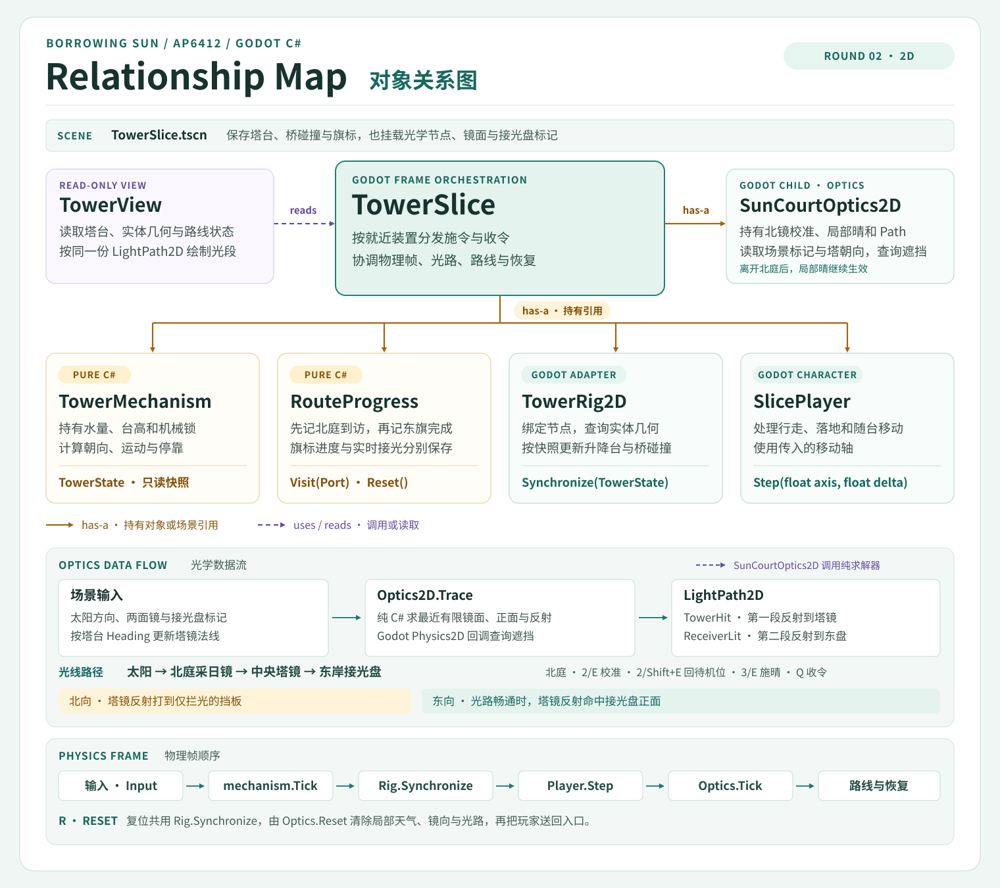

# 第 01 轮续 · SOLID 框架整理

本轮以三岸路线已跑通的 `087df5d` 为比较基线。沿用 AP6412 Week 10 的「位置、原因、改动影响、解决方式」记录法，先找将来会因不同需求而变化的职责，再用原路线回归核对。 [重构前提交](https://github.com/buriallsy/coding_team/commit/087df5dfc5b1b5689dd4ec8c3a12fb342a3109ba) · [第 01 轮玩法与用例](ROUND_01.md)

## Relationship Map

## 拆分依据

| 课件原则与原位置 | 原来耦合在哪里 | 哪类改动会碰到它 | 本轮处理 |
| --- | --- | --- | --- |
| SRP · `TowerSlice._Ready`、`UpdateLiftGeometry` | 场景控制器直接绑定岸、桥、台面和旗标，也计算塔的位置和碰撞。 | 换用 3D 实体或调整桥的场景结构时，会碰到施令和关卡进度所在的类。 | `TowerRig2D` 持有节点和几何查询，用 `Synchronize(TowerState)` 同步升降与左右桥。 |
| SRP · `TowerSlice.TrackPlayer`、`ResetSlice` | 落脚检测、跌落恢复和「先北后东」写在一起，两个进度值由场景修改。 | 加入接光或交付条件时，需要在处理玩家位置的代码里修改完成规则。 | `RouteProgress` 持有北庭到访和东岸完成。场景只在站稳并到达对应旗标后传入 `Visit(Port)`，全局重开调用 `Reset()`。 |
| 依赖边界 · `SlicePlayer.Step` | 玩家移动直接读取键位动作，角色物理和输入来源连在一起。 | 替换输入来源时会碰到走路、重力和落地逻辑。 | `TowerSlice` 读取现有 Input Map，并将横向轴传给 `SlicePlayer.Step`。 |

`TowerMechanism` 与 `RouteProgress` 是可单独复用的纯 C# 规则。`TowerRig2D` 用领域快照驱动 Godot 节点，`TowerView` 读取规则结果与碰撞实际几何。场景协调者用具体类型组合这些职责。

正常物理帧依次处理施令、推进机关、同步实体、移动玩家、记录进度或恢复。按 `R` 仍经同一处同步恢复低桥。下一轮可以从 `TowerSlice` 接入采光交互，光路读取塔的停靠与朝向，桥的碰撞仍由场景适配器负责。 [规则与帧顺序](../../Scripts/TowerSlice.cs) · [实体同步](../../Scripts/TowerRig2D.cs) · [路线进度](../../Scripts/Core/RouteProgress.cs)

## 预留一个扩展点

`RouteProgress.MeetsEastFinishCondition()` 是 `protected virtual`，默认允许抵达东岸后完成。后续若要把接光盘受光作为附加条件，可在派生类型中覆写这一处，并在 `TowerSlice` 的组装处选用它。覆写只回答额外条件是否满足，`Visit` 继续保证先到北庭、只完成一次，`Reset` 统一清掉两处进度。场景仍负责确认角色站稳且到达旗标。课件中的 OCP 与替换契约在这里对应同一个可验证的变化。 [扩展点](../../Scripts/Core/RouteProgress.cs) · [替换用例](../../Scripts/Verification/TowerRouteCheck.cs)

## 实际回归 · 2026-11-06

在 macOS arm64 用 Godot 4.7.1 .NET 和 .NET SDK 8.0.424 分别构建重构前后的干净副本。使用第 01 轮的原操作顺序。内置测试中对几何数据的读取改为经 `Rig`，原有路线断言和输入保持一致；独立按键脚本逐字节相同。 [复跑命令与按键脚本](ROUND_01.md#复跑)

| 验证 | 结果 |
| --- | --- |
| 干净构建 | 重构前后均为 0 警告、0 错误。[本轮构建日志](../Evidence/round-01-solid/clean-build.log) |
| 内置路线与扩展点 | 112 项通过。原有 107 项结果与基线一致。新增 5 项检查北庭前置、条件关闭时保留进度、开放后只完成一次，以及重开恢复规则。[内置日志](../Evidence/round-01-solid/built-in-route.log) |
| 独立按键 | 71 项通过。原路线走位、角色坐标、桥碰撞和 `R` 后再次实走低桥的记录与重构前一致。[独立日志](../Evidence/round-01-solid/independent-route.log) |
| 窗口运行 | 73 项通过。北庭与东岸的两张原帧与基线逐字节相同，报告可继续引用原图。[窗口日志](../Evidence/round-01-solid/rendered-route.log) · [北庭原帧](../Evidence/round-01/north-court.png) · [东岸原帧](../Evidence/round-01/east-shore.png) |
