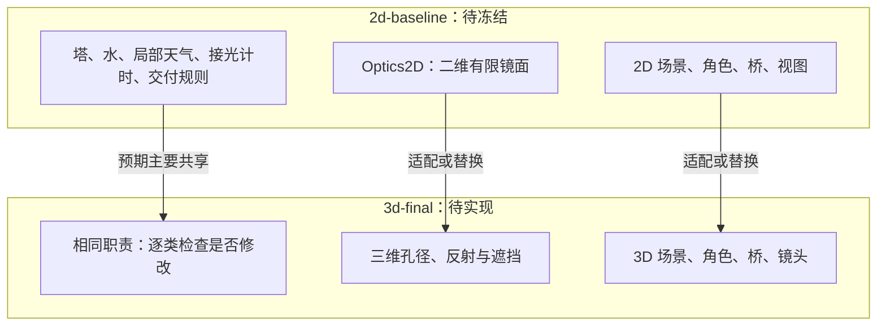

# 变化图与 CCR / Change Map and Core Change Ratio

## A. 导入灰盒 → 本次框架：实际开发变化

| 项目 | 分类 | 实际变化 | 验证 |
|---|---|---|---|
| TowerMechanism | 修改 | 晴/无天气不会误进风分支；明确第三停点；同一类拥有储水和配重；转水保高；禁止转水后补雨和排水 | 领域断言、原有 Godot 路线 |
| SunMirror | 新增 | 三档镜面与局部天气状态 | 领域断言 |
| LightReceiver | 新增 | 连续受光、打断清零、解锁保留 | 领域断言 |
| DeliveryState | 新增 | 五项发车条件、失光后继续行程、下车交付、只记一次 | 领域断言 |
| GameSession | 新增 | 协调规则与全局复位，控制转水时序 | 领域集成夹具 |
| Optics2D | 新增 | 有限镜面、双反射顺序、正面入射、遮挡与近交点 | 几何正反例 |
| TowerSlice / SlicePlayer / TowerView | 不变 | 仍运行原灰盒；未来接入完整关卡 | 原有物理回归 |
| GameTuning / 数据结构 / 枚举 | 新增或修改 | 初始参数、传输数据、命令结果 | 编译及使用它们的断言 |

这些是完整 2D 冻结之前的工作，不计成课程的 2D→3D 移植 CCR。

## B. 完整 2D → 3D：迁移预测，不是实际结果



不得将上图改成“已复用”或填入百分比，直到两个版本和证据都存在。

## CCR 的正式算法

`CCR = (行为被修改或移除的原2D核心类数 / 冻结时原2D核心类总数) × 100%`

1. 分母在 `2d-baseline` 固定。当前候选 6 个：TowerMechanism、SunMirror、LightReceiver、DeliveryState、GameSession、Optics2D。**6 是本分支候选数量，不是已冻结分母。**
2. 包含解谜关键算法 Optics2D。虽然维度变化预期会改它，仍如实计入。
3. 纯显示、输入适配、测试、常量、枚举和只读数据不计。冻结时检查 TowerSlice：如果仍有未抽出的实质玩法规则，必须纳入核心或在冻结前合理拆分。
4. 搬目录、重命名、排版、注释不算行为修改，但在变化表说明。不能因源码字节改变就自动宣称行为改变，也不能因接口未变就宣称行为不变。
5. 原类拆为多个类或多个原类合为一个，按原类分别追踪，每个原类最多计一次。
6. 3D 新增类另列，不加入原分母。删除、以全新实现替换且行为职责改变的原类计入分子。
7. 每个类的最终分类必须附理由、对应 3D 路径、测试或比较证据。保留 shared/modified/removed 和新增清单，不设 CCR 达标阈值。

`Tools/ccr.py` 默认读取当前分析文件并返回 PENDING。它不会猜出语义变化。完整 2D 验收后，由成员复核候选清单，创建真实标签，再执行：

```sh
python Tools/ccr.py --freeze 2d-baseline --output frozen-core.json
```

输出保存标签对应提交、每个核心源文件 Git blob 和类别。之后使用冻结清单，填入 `final_ref`、逐类 `reviews`、`new_core_classes`，保存为最终分析文件并运行 `python Tools/ccr.py --analysis <文件>`。工具核对真实 Git 对象、对应路径和分类完整性，再计算比例。它不能替代代码审查。

报告表至少包含：原类 ID、原职责、2D 路径、3D 对应类/路径、变化类别、原因、比较链接、验证记录。现有 `ccr-analysis.json` 是待填分析入口。
