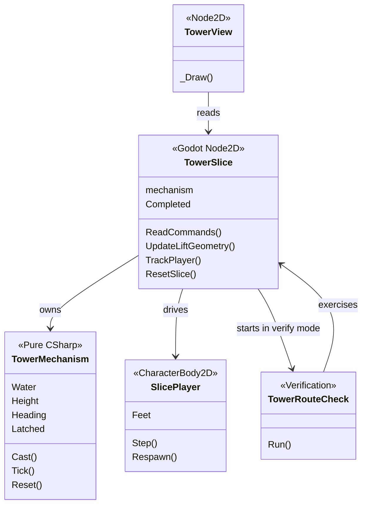
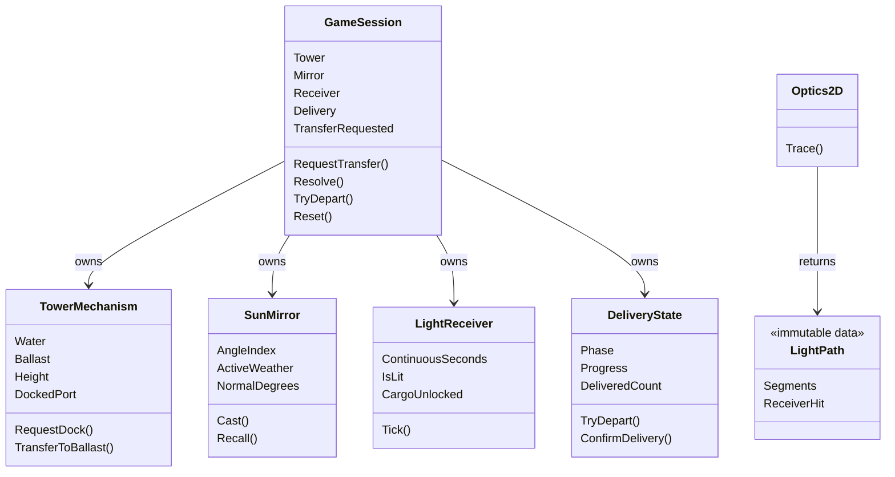
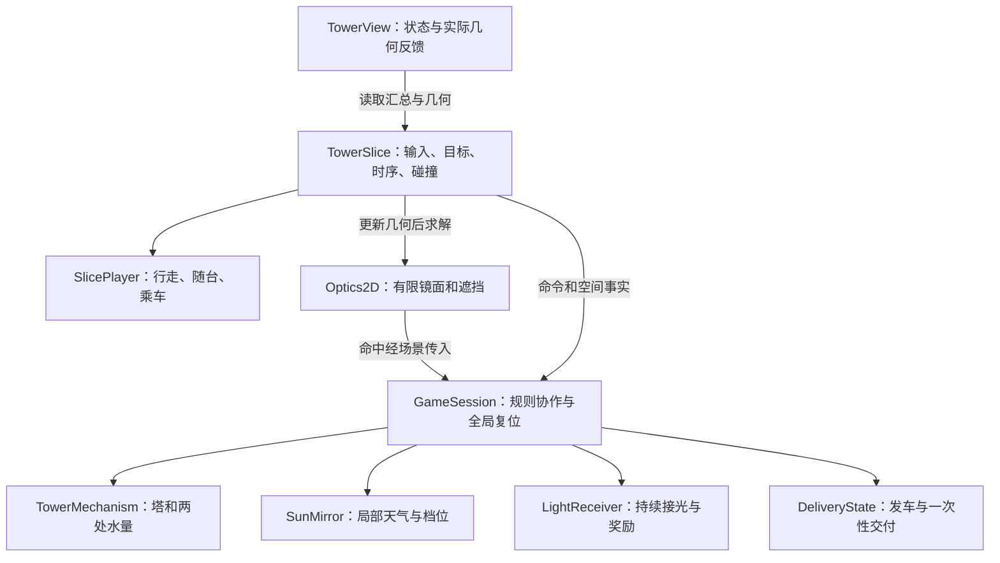

# Class Map 与职责边界

所有图都写明版本范围。当前分支是可编译框架；完整 2D 与 3D 的最终图必须在各自标签处重新核对。

## A. 导入灰盒 f6900c4：实际关系

`TowerState` 是只读 record struct，`Weather`、`Port`、`MechanismResult` 是枚举，作为辅助数据不另计行为类。

## B. 本分支新增领域框架：实际关系

`GameSession` 尚未被 `TowerSlice` 持有。实际 F5 场景仍自己持有 `TowerMechanism`；不能把下面的目标图描述成已经接线。`Optics2D` 与 Session 不直接互相引用，几何结果由适配层传入。`GameTuning` 是常量及数值检查辅助类，不是游戏状态管理器。

## C. 完整 2D 场景接入目标：尚待实现的连接

## 分类登记

| 类型 | 负责/拥有 | 不负责 | CCR 分类 |
|---|---|---|---|
| TowerMechanism | 水、配重、机械锁、升降、朝向、停靠合法性 | Godot 碰撞和像素 | 核心规则 |
| SunMirror | 离散档位、局部天气 | 镜面空间放置、光线是否击中 | 核心规则 |
| LightReceiver | 持续命中时序和一次性解锁 | 几何求交、绘制 | 核心规则 |
| DeliveryState | 发车检查、车程进度、确认交付 | 移动物理车体、检测玩家坐标 | 核心规则 |
| GameSession | 组件协作、转水条件、领域全局复位 | 帧率、Input、Node、射线几何 | 核心规则协调 |
| Optics2D | 有限镜面、反射顺序、遮挡、有效接光 | 持续计时、奖励、Godot 调用 | 核心算法，纳入 CCR |
| TowerSlice | 输入、实体引用、更新时序、安全点与空间事件 | 完整版不再自己决定最终交付 | 混合→适配，冻结时复查 |
| SlicePlayer | CharacterBody2D 行走、落地、复位；后续乘车 | 水量、奖励、任务进度 | 引擎适配 |
| TowerView | 读取状态与真实几何绘制 | 修改规则或伪造光路 | 表现 |
| TowerRouteCheck、DomainChecks | 可重复验证 | 正式游戏行为 | 测试工具 |

设计理由：SRP 将水量、受光和交付分开；封装让这些状态只经操作改变。OCP 在维度适配上表现为保留规则、替换空间实现，不声称所有扩展零修改。当前没有多个共享契约的光学实现，不提前加接口或抽象基类。共享规则不引用 Godot；只有真正出现第二实现时再评估契约。类图无需通过增加类数或继承层数获取“复杂度”。
