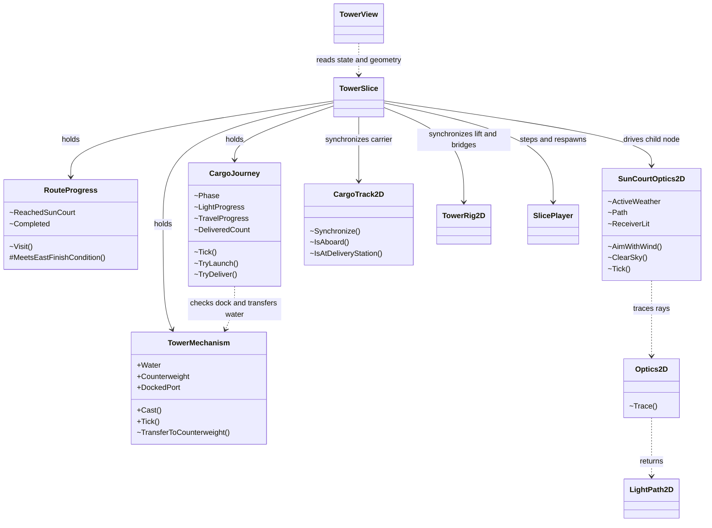

# Class Map 与职责边界

## Round 03 · 当前可玩实现

[对象关系图](RELATIONSHIP_MAP.svg) 对应 Round 03 的 Godot C# 生产场景。它与下方类图一起记录状态归属、调用和物理帧顺序。 [当前运行入口](CURRENT_STATUS.md)

`TowerSlice` 把 `SunCourtOptics2D.ReceiverLit` 作为当帧输入交给 `CargoJourney`，将规则输出 `TravelProgress` 交给 `CargoTrack2D`，并把物理站位反馈给发车、交付入口。`RouteProgress` 的东岸旗标记录步行里程碑，`CargoJourney` 持有最终交付。 [调用与复位顺序](INTEGRATION.md)

| 类或数据 | 实际职责 | 冻结前分类 |
|---|---|---|
| [`TowerMechanism`](../../Scripts/Core/TowerMechanism.cs) | 持有水量、配重、台高、机械锁、天气、方向和停靠；保证等量转水。 | 核心候选 |
| [`RouteProgress`](../../Scripts/Core/RouteProgress.cs) | 记录北庭到访和东岸旗标，约束到访顺序。 | 核心候选 |
| [`CargoJourney`](../../Scripts/Core/CargoJourney.cs) | 连续接光装货、按条件转水、发车、行程和一次性交付。 | 核心候选 |
| [`Optics2D`](../../Scripts/Core/Optics2D.cs) | 用有限镜面、正面入射、近交点、遮挡和实际反射计算光路。 | 核心候选 |
| [`SunCourtOptics2D`](../../Scripts/SunCourtOptics2D.cs) | 持有局部天气与调镜状态，读取场景几何，将遮挡查询和光段接到纯求解器。 | 混合职责，列入核心候选 |
| [`TowerSlice`](../../Scripts/TowerSlice.cs) | 输入分发、物理帧顺序、空间条件、安全点与统一重开。 | 场景协调，冻结时复查 |
| [`TowerRig2D`](../../Scripts/TowerRig2D.cs) / [`CargoTrack2D`](../../Scripts/CargoTrack2D.cs) | 将规则结果映射到活动平台、桥、车台和实体站点。 | Godot 空间适配 |
| [`SlicePlayer`](../../Scripts/SlicePlayer.cs) / [`TowerView`](../../Scripts/TowerView.cs) | 角色移动和碰撞；读取状态、实体几何与实际光段绘制。 | 引擎角色与表现 |
| `TowerState`、`LightPath2D` 等 / `TowerRouteCheck`、`DomainChecks` | 只读值和枚举 / 测试与取证。 | 辅助数据与验证 |

核心候选随 Round 04 的实际源码核对。两版共享规则与各自的空间适配在 Round 05 实现后逐类比较。 [变化与 CCR](CHANGE_AND_CCR.md)

## 历史版本 · 导入灰盒与并行框架

- **Round 00 `f6900c4`。** 初始可玩路线由 `TowerSlice` 持有 `TowerMechanism`，协调玩家与塔桥。 [导入版 Class Map](class-map-imported.svg)
- **2026-11-07 `djwcb2333` 并行框架。** `GameSession` 组合候选 `TowerMechanism`、`SunMirror`、`LightReceiver` 与 `DeliveryState`，并用纯 `Optics2D` 求解光路。它展示早期拆分方案，验证覆盖该分支的领域夹具和原有灰盒。 [并行框架图](class-map-framework.svg) · [当时的完整类图](https://github.com/buriallsy/coding_team/blob/181ec16361f5c22fecd7594519111068cac55baf/BorrowingSun2D/Docs/2D-to-3D/CLASS_MAPS.md) · [验证记录](../Evidence/2026-11-07-framework/RESULTS.md)
