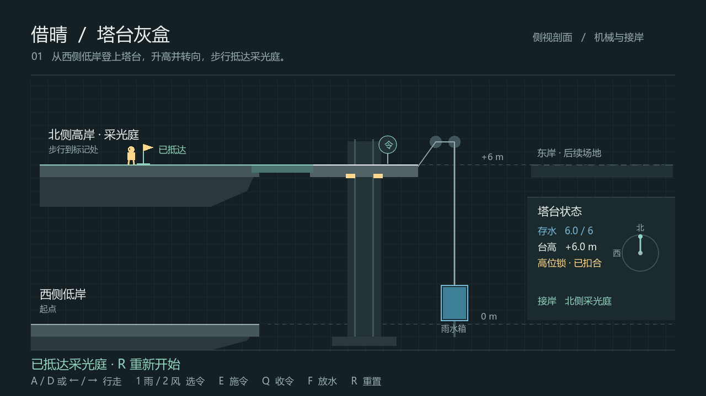

# 2026-11-07 架构分支验证

此页记录同学并行分支当时的 Windows 测试。现行玩法和整合验收见 [第 03 轮整合入口](../../2D-to-3D/FRAMEWORK.md)。

基线：导入提交 f6900c483680de7f1d21a4768720753b6f1512d7。分支：feature/djwcb2333/scope-architecture。本文件随框架提交保存；没有创建完整2D或3D标签。

## 实际执行结果

| 检查 | 平台与环境 | 结果 | 证据 |
|---|---|---|---|
| 领域框架构建 | Windows x64；SDK 10.0.400；目标 net8.0，参考包8.0.26 | 0警告、0错误 | domain-build.log |
| 领域、光学及集成夹具 | 同上 | 69条断言通过 | domain-checks.log |
| Godot游戏构建 | Godot.NET.Sdk 4.7.1，net8.0 | 0警告、0错误 | game-build.log |
| 生产场景内置路线 | Godot 4.7.1.stable.mono.official.a13da4feb，Windows，固定60fps | 26条断言通过，退出0 | mvp-route.log |
| 独立按键物理路线 | 同一生产场景，InputEventKey | 28条断言通过，失败0 | independent-route.log |
| 图形运行及终点截图 | 同一独立脚本，实际Windows绘制 | 29条断言通过，含捕获，退出0 | graphics.log、windows-goal.png |
| CCR工具证据完整性 | Python 3.14.7，临时Git夹具 | 7个测试通过 | ccr-tests.log |
| 当前CCR报告 | 当前候选清单 | PENDING，不输出虚构百分比 | ccr-status.log |

领域夹具测试了实际几何反射、有限镜面、背面、遮挡、错误顺序、重复交付、失光暂停、原水守恒及重新完成。它显式提供空间/玩家事实，不能等同新增关卡的玩家实走。

## 环境问题与处理

默认构建因当前沙箱无法读取用户 NuGet 配置失败。使用仓库内被忽略的 .local 隔离配置及 Godot 自带 nupkgs 后，较新 SDK 又请求与安装版本不同的参考包。最终显式使用已安装的 .NET 8.0.26 reference pack，项目仍以 net8.0 为目标；没有修改目标框架或引擎版本。可用 Tools/verify.ps1 的 Offline 模式复现。

Godot 输出 `Failed to read the root certificate store`。本测试只访问本地资源，路线与图形进程都退出0；原始错误保留在对应日志，不把该错误描述为已修复。

## 尚未完成，不能据此宣称通过

- macOS 本分支运行：未执行。提供 Tools/verify-macos.sh 和 domain-matrix.yml，旧macOS灰盒日志不代表本分支验证。
- 完整三岸、光路、货运玩家场景：未接入，所以没有完整关卡通关或3分钟实测。
- 3D、正式标签、最终类变化和CCR百分比：未产生。
- 真人首次试玩和同伴复核：未执行。
- 完整AI原始对话导出：索引已建，完整导出待补，摘要不能替代。
- 架构页面浏览器能打开并读到内容；截图接口超时，未完成页面截图目检。SVG源及文档链接另做结构检查。

