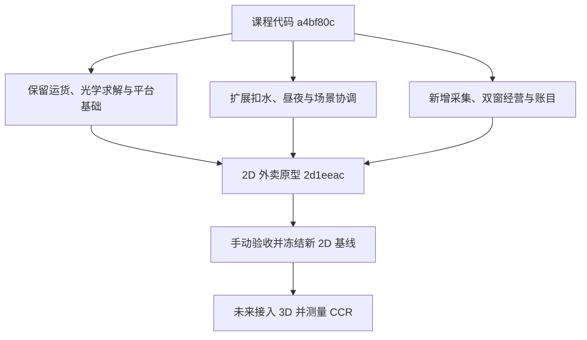

# 外卖原型变化图与 CCR 边界

本页对比课程代码基点 `a4bf80cd6725dbc923201d3fa338ee2e1b07cddb` 与外卖原型提交 `2d1eeac434f4b9fa84edbc3efc193c355c7a95c7`。前者已有课程 2D、3D 运货玩法；后者在独立分支 `feature/djwcb2333/market-loop` 加入新的 **2D** 采集和经营循环。后续补充文档不改变这组代码对比范围。

该范围共变更 26 个文件，分为游戏代码、场景/工程、测试与说明；不把文件数当作核心类数。外卖玩法尚未接入 3D，因此本页不报告新玩法的 2D→3D 实测 CCR。

[当前策划、数值与 UML](Design.md) · [2D 收尾和 3D 接入计划](Roadmap.md)

## 已实现的变化

| 分类 | 类或文件 | 原有职责 → 当前变化 | 所属边界与依据 |
|---|---|---|---|
| 新增 | `MarketRun` | 原版单次运货完成后结束 → 管教学后的天数、白天/黄昏/夜探/菜单/营业状态、跨天账目和厨房升级。 | 纯 C# 规则；[源码](../../Scripts/Core/MarketRun.cs) |
| 新增 | `ForageSpot`、`ForageEnvironment`、食材/点位枚举 | 原版只有货运水果 → 每个预设点维护成熟时间和产物，成熟树果随昼夜、雨和受光换种。环境记录和枚举作为数据单列。 | 纯 C# 规则与输入数据；[源码](../../Scripts/Core/ForageSpot.cs) |
| 新增 | `TakeawayShop`、`Inventory`、`CustomerOrder` | 新增两窗预留、投料、独立计时、手动出餐、收款返回和打烊退料；背包保存食材数量。 | 纯 C# 规则与订单状态；[源码](../../Scripts/Core/TakeawayShop.cs) |
| 新增 | `RecipeBook`、`Recipe`、`Ingredient` | 新增 6 个配方、原料数量、售价与烹饪时长。 | 配置与数据类型；不自动算作具有独立行为的核心类；[源码](../../Scripts/Core/TakeawayShop.cs) |
| 新增 | `MarketPlay2D`、`MarketText` | 连接 8 个场景采集点、真实受光、玩家脚底、返店、雨状态、往返摆渡和 HUD。文本辅助类负责品种名与库存文案。 | 2D 适配；`MarketPlay2D` 目前还持有采集范围、摆渡返程水量要求等玩法判断，不能直接宣称全部可原样复用；[源码](../../Scripts/MarketPlay2D.cs) |
| 新增 | `MarketPanel` | 新增黄昏选择、菜单、两个订单窗口、收款和升级按钮。 | UI；[源码](../../Scripts/MarketPanel.cs) |
| 修改 | `TowerMechanism` | 原有水箱/配重规则继续使用，新增 `TrySpendWater(amount)`，拒绝非有限值、非正数及超出可用水量的扣水。 | 核心规则扩展；摆渡实际消耗同一水箱，原有配重不被当成可用水；[源码](../../Scripts/Core/TowerMechanism.cs) |
| 修改 | `TowerSlice` | 继续协调原教学；新增经营入口、探索与营业的帧分流、夜间太阳限制、返回中央及次日重置。 | 场景协调及环境接线；[源码](../../Scripts/TowerSlice.cs) |
| 修改 | `SunCourtOptics2D` | 保留原几何光路，增加 `sunlightAvailable` 输入；夜晚使日照不可用。 | 原有混合光学职责；[源码](../../Scripts/SunCourtOptics2D.cs) |
| 修改 | `CargoTrack2D` | 保留车程投影和交付站判断，增加整块车板范围的 `IsOnDeck`，让玩家下车后能从边缘重登返航。 | 2D 物理/位置适配；[源码](../../Scripts/CargoTrack2D.cs) |
| 修改 | `TowerSessionOverlay`、`TowerView` | 签收页进入第 1 天；增加资源标记、昼夜/钱箱/库存及摆渡提示。 | UI 与绘制；[开场和签收](../../Scripts/TowerSessionOverlay.cs)、[视图](../../Scripts/TowerView.cs) |
| 修改 | `TowerSlice.tscn`、`project.godot`、`BorrowingSun2D.csproj` | 场景增加中央店铺和采集点，接入采集输入；工程配置与 Godot 4.7.2 .NET 验证环境一致。 | 场景、输入与工程配置，不计作核心类；[场景](../../Scenes/TowerSlice.tscn)、[项目设置](../../project.godot)、[C# 工程](../../BorrowingSun2D.csproj) |
| 新增/接入 | `MarketChecks`、`MarketRouteCheck`、领域测试入口 | 补资源变种、阶段比例、订单预留、双灶、退料、收款、升级、跨天与无截止日检查；场景路线覆盖真实采集和下车再登船返航。 | 验证；[领域检查](../../../Tests/DomainChecks/MarketChecks.cs)、[场景检查](../../Scripts/Verification/MarketRouteCheck.cs)、[测试入口](../../../Tests/DomainChecks/Program.cs) |
| 保持 | `CargoJourney`、`RouteProgress`、`Optics2D` | 这些文件在本次对比范围内没有变化。原运货规则作为教学，3.4 秒货车时长供摆渡复用，原光学求解仍负责实际命中。 | 保留的规则；[货运](../../Scripts/Core/CargoJourney.cs)、[进度](../../Scripts/Core/RouteProgress.cs)、[光学](../../Scripts/Core/Optics2D.cs) |
| 保持 | `SlicePlayer`、`TowerRig2D` | 原行走、落地与塔台/桥的物理投影继续使用；新玩法由协调层给它们提供时机和目标。 | 2D 适配；[角色](../../Scripts/SlicePlayer.cs)、[塔台](../../Scripts/TowerRig2D.cs) |
| 未接入 | `BorrowingSun3D` | 本轮没有修改 3D 场景或增加 3D 经营入口。3D 工程链接的共享塔台源文件能看到新扣水方法，不等于已有新经营玩法。 | 后续工作，见 [Roadmap](Roadmap.md) |



## 验证证据的范围

当前设计说明记录了此前 Windows Godot 4.7.2 .NET 的 134 项领域检查及原运货、新经营路线通过结果。[领域检查代码](../../../Tests/DomainChecks/MarketChecks.cs)和[场景检查代码](../../Scripts/Verification/MarketRouteCheck.cs)随项目保留，可以按[复测命令](Design.md#打开与复测)重新执行。

自动场景路线通过模拟按键/按钮验证行为。它不替代组员用键盘和鼠标试玩两条夜间路线，也不能证明未运行过的平台已经通过。当前经营进度只在本次游戏运行中保存；退出游戏再打开会重新开始。

## 未来 2D→3D 的 CCR 口径

沿用课程的类级定义：

`CCR =（行为被修改或移除的原 2D 核心类数 ÷ 新外卖 2D 冻结核心类总数）× 100%`

目前**未冻结外卖 2D 基线、未完成外卖 3D 版、未得到该迁移的实测 CCR**。建议的标签 `market-2d-baseline` 是后续动作，不表示已经创建。原课程版的 `2d-baseline` 与 `3d-final`（如存在）也不能代替这组新玩法的基线。

| 冻结时要核对的对象 | 建议处理 |
|---|---|
| 原塔台、到访、货运、光学规则 | 从冻结源码重新核对 `TowerMechanism`、`RouteProgress`、`CargoJourney`、`Optics2D`、`SunCourtOptics2D`，不得直接照抄旧清单后宣称分母不变。 |
| 新经营与资源行为 | 核对 `MarketRun`、`ForageSpot`、`TakeawayShop`、`Inventory` 的独立职责与行为；把确定纳入的类、路径及 blob 记录进冻结清单。 |
| 混合场景职责 | 复核 `MarketPlay2D` 和 `TowerSlice` 的采集、摆渡、环境及阶段判断。若仍拥有可改变玩法结果的规则，应追踪这些职责；若先拆到共享规则类，必须在冻结前完成并记录理由。 |
| 订单/配方/环境数据、枚举、UI、场景与测试 | 记录依赖和变化，但纯数据或呈现不自动进入分母。若某类后续增加实质规则，按冻结时的真实职责重新判断。 |
| 3D 新增类 | 单独列新增职责；原类一对多拆分或多对一合并时，按原 2D 类逐项追踪，每个原类只算一次。 |

迁移完成后，每个冻结核心类登记 `shared`、`modified` 或 `removed`，附上对应 3D 路径、行为变化理由和相同输入下的复测结果。仅改名、搬文件、注释或格式不构成行为修改。类和文件不是同一个计数单位，新增文件数也不是 CCR 分子。

旧课程版的 **40%** 来自五个冻结核心类中的两个修改，范围是旧运货玩法的 2D→3D 迁移，详见[原变化图](../../../BorrowingSun3D/Docs/CHANGE_MAP.md)。它只能作为历史证据，不能作为外卖新玩法的结果。本轮 26 文件变化也不能据此计算一个新的百分比。

## 复核本页的代码范围

在仓库根目录执行：

```sh
git diff --stat a4bf80c 2d1eeac
git diff --name-status a4bf80c 2d1eeac
git diff a4bf80c 2d1eeac -- BorrowingSun2D/Scripts/Core/
```

组员先阅读本页和[策划](Design.md)，再运行 2D 原型。后续是否采用新玩法、何时冻结新基线及如何接入 3D，由团队基于试玩结果决定；本页不会把这份独立原型写成已合入课程最终版。
