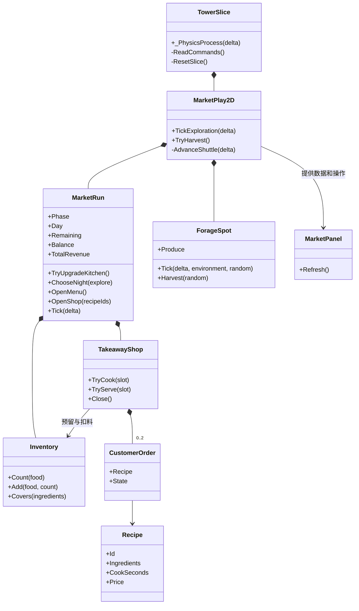
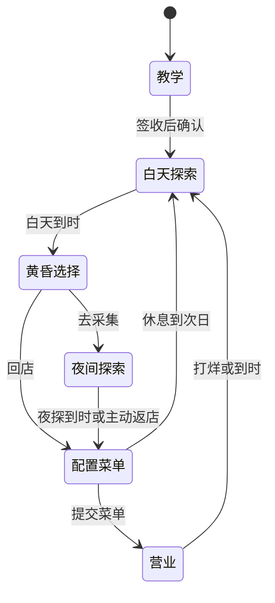

# 借晴 · 谷地外卖店

## 2026-11-11 版本说明

- 运货教学接入白天采集、夜探选择和外卖营业。果实随雨、夜晚和实际受光变化，玩家回店后用库存选菜单。
- 摆渡允许下车后从车板边缘重新登船。往返各耗 1 单位水，去程出发时预留返航用水。
- 双窗口可以同时投料、独立计时。收款进入钱箱，累计营业额单独记录。余额可跨天用于购买 36 金币的双口快灶，烹饪耗时缩短 30%。
- Windows 上使用 Godot 4.7.2 .NET 验证。134 项领域检查、原运货路线回归和新经营路线均通过。窗口版复测覆盖下车再登船返航、双灶并行、跨天结算、购买升级及下一晚使用新烹饪时间。

## 策划案

每一天从中央升降台旁的外卖店开始。白天用雨、风和反射光打开路线，采集食材。天黑时决定直接开店，或再去一趟夜间采集。回店后从现有库存选择上架菜品，接单、投料、等烹饪完成，再把餐送到对应窗口收款。收入当天进钱箱，玩家可以跨天攒钱改善小店，累计天数不限。

### 教学与地图

原有的雨升塔、风接岸、反射装箱、货车和花庭签收作为一次教学。签收后确认进入第一天，玩家从中央店铺位置开始。此后货车变成东岸与花庭间的双向摆渡车。站在车板范围内按 G，车开向另一端。到花庭下车采集后，可从车板边缘重新上车返航。单程从塔台扣 1 单位水。从东岸出发需至少 2 单位水，以便留出返航水量。摆渡在夜间也能运行。中央开店和日末结算会送玩家回店，隔天从低位中央出发。库存和资金在同一局内跨天保留。

白天和夜间均使用原来的西岸、采光庭、东岸、花庭及中央升降台。资源只出现在这些区域的预设点。桥未接通时，资源可以存在于对岸。要采到它，玩家仍需走到实际站点。中央点固定产菇，作为不依赖镜面的基本进货方式。普通野生点从该区域的池中随机选食材，首轮将肉类做成可直接采集的野味。

### 时间和资源

| 规则 | 首轮数值 |
|---|---|
| 白天采集 | 180 秒 |
| 直接开店 | 120 秒营业 |
| 先夜探再开店 | 90 秒夜探 + 60 秒营业 |
| 选择时段、配置菜单 | 等待玩家操作，计时暂停 |
| 采集点 | 8 个，每点最多一份 |
| 空点刷新 | 每次 8–14 秒随机，首日开场为 2–6 秒 |
| 采集 | 靠近点位、落地后按 C，水平 30 px、高度差 10 px |
| 一次采集 | 1 份，背包容量不限 |
| 顾客 | 两个独立窗口，每个窗口一位，付钱后才补下一位 |
| 摆渡 | 单程耗水 1 单位，东岸出发要求有至少 2 单位水 |
| 烹饪机 | 两口灶，每个窗口一口，独立备菜和计时 |
| 小店升级 | 36 金币换双口快灶，两口灶的烹饪耗时减少 30% |

白天的采光庭树读取真实入射命中，东岸树读取接收盘的真实受光。夜间关闭太阳光路，仍可用风和雨。探索阶段在中央使用雨，降雨会持续到中央收回或次日开始。风转台和北庭的局部天气各自保留原有控制。这样可以先降雨再开桥，到对岸采雨果。

| 环境 | 树上的食材 |
|---|---|
| 白天降雨 | 雨露果 |
| 白天无雨且树受光 | 晴果 |
| 白天无雨、树未受光 | 暂无可采品种，槽位等到有合适条件 |
| 夜晚无雨 | 月果 |
| 夜晚降雨 | 雨夜果 |

树槽位成熟后，果实随当前环境直接变成对应品种，无需先采掉旧果。已经入包的食材保持品种。采集后槽位重新计时。普通点在刷新时决定产物，雨天和夜间增加菇类的机会。

### 外卖店

玩家从已有配方选择当晚菜单，库存满足配方才可勾选。确认开店后，两个窗口才各自尝试生成一个可做的订单。每单预留所需数量，另一队按剩余可用库存点餐。给两单分别投料后，两口灶可以同时烹饪，烹饪完成后按窗口手动送餐。顾客马上付款离开，钱箱和当晚营业额同步更新，收款记录显示窗口和金额。只有付款对应的窗口会尝试补位。没食材时窗口保持空闲，没有排队顾客的用餐时间或耐心计时。

营业时间结束或玩家主动打烊时，取消未交付订单，退还两口灶上未交付的食材并进入次日。没有可做菜品时可直接休息到次日。次日显示昨晚收入，钱箱和累计营业额都结转。选菜单时可从钱箱花 36 金币升级双口快灶。升级立即缩短本晚及之后的烹饪时间，例如菌菇便当从 3 秒缩至 2.1 秒。累计营业额记录全部收入，升级只扣可用余额。首轮以单次运行内的进度为范围。

| 菜品 | 食材 | 烹饪 | 收款 |
|---|---|---|---|
| 菌菇便当 | 蘑菇 ×2 | 3 秒 | 12 |
| 菌菇肉串 | 野味 ×1、蘑菇 ×1 | 5 秒 | 20 |
| 昼夜果盘 | 晴果 ×1、月果 ×1 | 4 秒 | 26 |
| 雨果菌菇盒 | 雨露果 ×1、蘑菇 ×1 | 5 秒 | 22 |
| 月果菌菇盒 | 月果 ×1、蘑菇 ×1 | 5 秒 | 24 |
| 雨夜双拼 | 雨夜果 ×1、野味 ×1 | 6 秒 | 28 |

资源刷新范围、阶段时长、售价、菜品、退料和跨天规则是首轮试玩的设计值。两种夜间路线的时间比例、果实变种、选菜单后才来客、两个窗口以及无限天数来自玩法设定。摆渡扣水和双口快灶的价格、提速比例是本轮试玩值。

## UML 与职责





## 架构与接口

| 边界 | 输入与输出 |
|---|---|
| 塔台与光照 | 沿用 `TowerMechanism`、`TowerRig2D`、`SunCourtOptics2D`。Godot 层把昼夜、降雨和实际光路命中汇总为 `ForageEnvironment`。摆渡通过 `TrySpendWater(amount)` 从塔台实际水箱扣水。 |
| `MarketPlay2D` | 从场景的 `Marker2D` 获取点位。传入玩家脚底与落地状态来决定能否采集。阶段切换时通知场景回店或重置塔台。 |
| `ForageSpot` | `Tick(delta, environment, random)` 推进空位计时或更新果实。 `Harvest(random)` 取出食材并重新安排刷新。 |
| `MarketRun` | 持有阶段、时间、背包和经营账目。`ChooseNight` 在黄昏可用，`OpenShop` 和 `TryUpgradeKitchen` 在菜单阶段可用，`TryCook` 和 `TryServe` 在营业时可用。 |
| `TakeawayShop` | 以食谱和库存生成订单。`TryCook(slot)` 扣料并启动对应炉口，`Tick(delta)` 推进两个窗口的独立计时。`TryServe(slot)` 校验出餐状态并返回收款。`Close()` 清理预留并退料。 |
| `MarketPanel` | 显示阶段、食材、菜单、窗口和进度。按钮发出命令，阶段与订单状态由规则层处理。 |

每个探索帧先推进机关并同步场景，再计算太阳光路，然后推进资源刷新并处理采集。营业只推进经营时钟和烹饪。当天到时自动切换阶段。规则层以普通 C# 对象维护库存和订单，可用固定随机种子复测。

## 验收路线

1. 用原路线送达一箱水果。确认教学完成后，从中央进入第一天。
2. 采中央蘑菇，试走采光庭和东岸。对同一个成熟树槽位切换晴、雨或夜晚，确认显示品种更新，背包中已采食材保持品种。
3. 验证直接开店是 120 秒。另一次选择夜探，确认无阳光，探索 90 秒，营业 60 秒。
4. 先选菜单再开店。用刚好只够一单的库存验证另一窗口不会重复预留。用够两单的库存验证两个炉口可以同时烹饪。
5. 投料、等待、送餐、收款。确认只有该窗口补位，重复送餐不会重复收款。
6. 打烊进入次日，确认食材、钱款结转。用收来的 36 金币购买双口快灶，检查余额、累计营业额与新烹饪时间。
7. 摆渡到花庭后下车，再从车板边缘上车按 G 返回。检查两程各扣 1 单位水，以及不足往返水量时的提示。

## 打开与复测

在 Godot 4.7.2 .NET 中导入本工作目录的 `BorrowingSun2D/project.godot`，按 F5 从运货教学开始。签收页按 Enter 或点击「进入第 1 天」。走到食材标记附近按 C，站在车板上按 G 往返花庭。黄昏、菜单、投料、送餐和结算使用界面按钮。中央的雨由 `1`、`E` 开启，`Q` 收回。

`dotnet run --project Tests/DomainChecks` 检查可复现的领域规则。编译 2D 项目后，在仓库根目录将下面的 `godot` 换成本机 Godot .NET 命令或完整路径。

```sh
godot --headless --path BorrowingSun2D --fixed-fps 60 -- --verify --skip-intro
godot --headless --path BorrowingSun2D --fixed-fps 60 -- --verify-market
```

`--verify-market` 从游戏入口操作教学路线、真实采集、光路、付费摆渡和经营界面，验证下车再上车、双灶、跨天收款和升级。若要单独重玩旧运货路线，可在用户参数中传 `--tutorial-only`。
