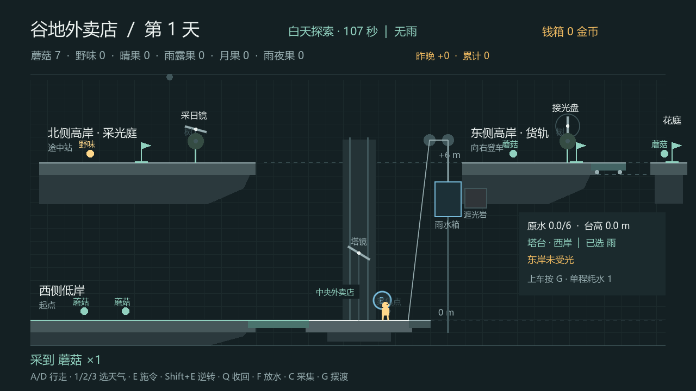
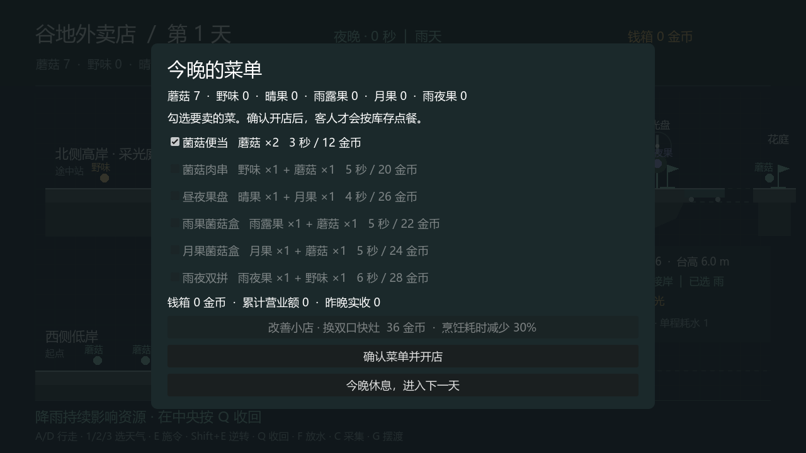
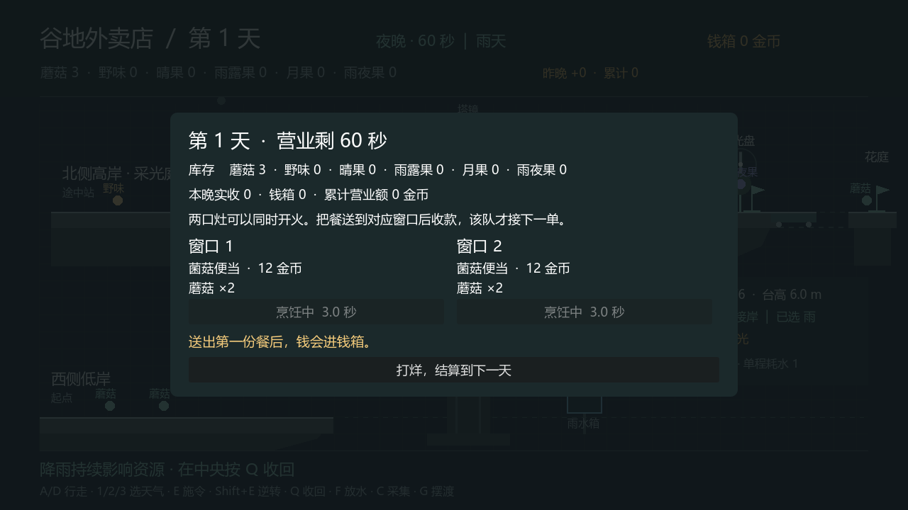
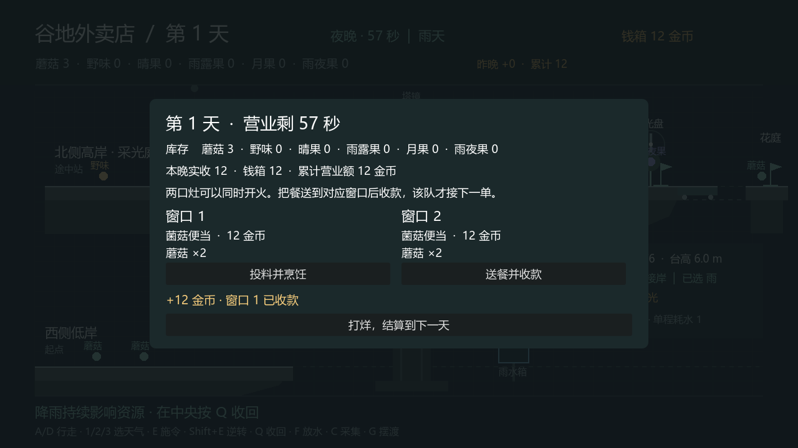
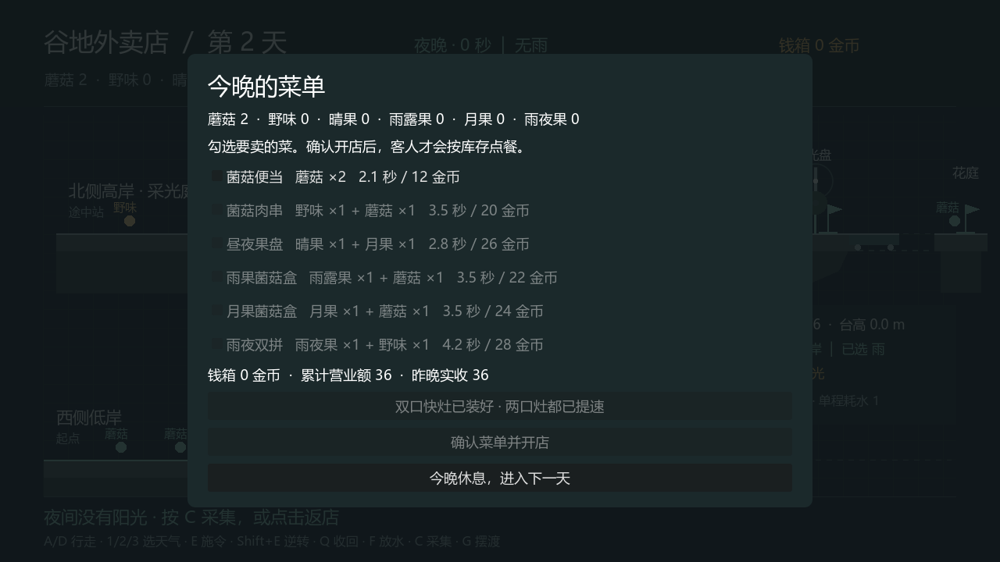

# 外卖 2D 验证记录

2026-11-11 交接整理。玩法源码是 `2d1eeac` 的实现，本次只补文档和归档证据。

| 文件 | 来源与结果 |
| --- | --- |
| [domain-checks-v2.log](domain-checks-v2.log) | 先前本机领域测试原始记录，134 个断言通过 |
| [market-route-v2.log](market-route-v2.log) | 先前 Godot 4.7.2 .NET 无头经营路线，`MARKET_ROUTE PASSED` |
| [market-window-v2.log](market-window-v2.log) | 先前 Godot 4.7.2 .NET 实际窗口自动路线，`MARKET_ROUTE PASSED` |
| [market-window-v2-error.log](market-window-v2-error.log) | 同轮标准错误原样保留，有读取系统根证书库失败的环境提示 |
| [tutorial-route-v2.log](tutorial-route-v2.log) | 先前原运货教学回归，`TOWER_ROUTE PASSED` |
| [handoff-domain-recheck.log](handoff-domain-recheck.log) | 本次再次执行已有领域测试程序集，134 个断言通过，退出码 0；没有在本轮重新构建或重跑 Godot 场景 |

上述既有日志来自本工作副本的 `.local` 验证产物。归档未改写 PASS/ERROR 内容。根证书环境提示仍在日志中，不能据此将整轮描述为“完全无错误输出”。实际窗口自动路线也不等于组员已真人完成试玩。新外卖版没有本轮 macOS 验证记录。

## 同轮实际窗口截图

