# 借晴 / 天井跨谷

AP6412 小组作业报告初稿 · 路线 B · Godot C# · 2026-11-09

> 比较版本：2D 冻结基线 `6175db9` 与 3D 第 05D 轮候选 `fb4cbb4`。macOS 已验证。Windows 托管开窗预验已通过，Windows 实机人工验收待同学完成，`3d-final` 待定。组号、成员署名和个人反思留待小组填写。

## 01 · 游戏与原始设计

《借晴》是一关围绕天气和地形的解谜游戏。玩家从西岸低桥上塔，把雨借给升降台，用风改变接桥方向，再把北庭的日光经两面镜子送到东岸。持续接光得到一箱水果，升塔用过的雨水转入货车配重。玩家乘车跨谷并在花庭签收，交付计数变为 `1/1`。早期 Unity L5 提供世界观与装置设定，课程版本从独立的 Godot 2D 开始，冻结后才迁移到 Godot 3D。 [项目构思](../../BorrowingSun2D/Docs/2D-to-3D/DESIGN.md)

| 原始假设 | 在两个版本中的检验方式 |
| --- | --- |
| 高度和朝向是两种独立的反馈 | 雨升至 6 m 并机械锁定。风切换西岸、北庭和东岸的接桥位置。两版实走北庭后都要回到塔再换东桥。 |
| 玩家可读出哪一段光路已接通 | 北向只命中塔镜。转东且无遮挡时，第二段才点亮东岸接光盘。两版使用镜面求交和遮挡。 |
| 同一份雨水能把前后两段玩法连起来 | 接光持续 1.5 秒装箱。原有 6 单位雨水转 4 入配重，塔箱留 2，塔仍锁在高位。 |
| 一次短交付足以验证完整循环 | 登车、满配重且实时受光时可按 `G` 发车。到花庭标记再次按 `G` 签收。失光会暂停转水并保留已转量，发车后行程仍继续。 |

**操作。** `Enter` 或开始按钮进入。2D 用 `A/D` 或方向键行走；3D 用 `WASD` 或方向键，北桥用 `W/S` 往返。`1/2/3` 选雨、风、晴，`E` 对附近设备施令，`G` 发车或签收，`R` 从西岸低桥重开。交付完成是关卡结束；误操作有提示，角色跌落可回安全位置。单局约三分钟是设计目标，首次玩家用时待测。 [2D 操作](../../BorrowingSun2D/README.md) · [3D 操作](../README.md)

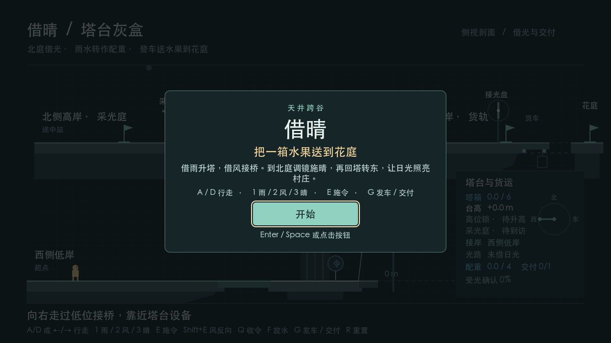 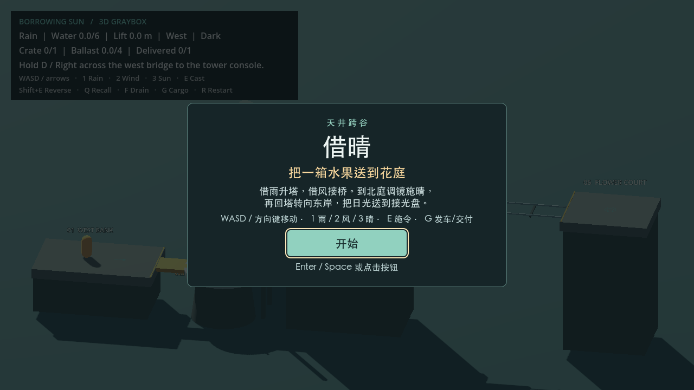

<!-- page -->

# 从最小可玩到 3D 候选

02 · 制作过程与取舍

| 轮次 | 本轮问题与决定 | 结果与记录 |
| --- | --- | --- |
| 00 · 2D 最小可玩 | 用同屏侧剖面先验证西岸过低桥、雨升塔、风接北庭。 | 独立按键发现 `R` 后塔台归零但桥碰撞未回低位，修复后用相同输入走过低桥。 [失败日志](../../BorrowingSun2D/Docs/Evidence/01-independent-reset-failure.log) · [过程记录](../../BorrowingSun2D/Docs/ITERATIONS.md) |
| 01 · 三岸与职责拆分 | 补东岸实体桥与第三停点，北庭成为途中里程碑。将塔桥节点同步和到访进度从协调器拆出，提前验证 `RouteProgress` 的终点扩展点。 | 实走西→塔→北→塔→东，复测重开。 [三岸路线](../../BorrowingSun2D/Docs/2D-to-3D/ROUND_01.md) · [SOLID 整理](../../BorrowingSun2D/Docs/2D-to-3D/ARCHITECTURE_REFACTOR.md) |
| 02 · 双反射 | 分开「塔镜命中」与「东岸实时接光」，先让北庭校准和施晴，再回塔转东。 | 北向、东向和遮挡有可复现的正反例。 [2D 光路](../../BorrowingSun2D/Docs/2D-to-3D/ROUND_02.md) |
| 03 · 装箱、配重与交付 | 引入 `CargoJourney`，把同一份雨水接到货车；到站与签收分开。集成队友的领域测试、CI 和 CCR 工具，保留已测规则与数值。 | 测了断光停转水、发车门槛和重开再次签收。 [货运](../../BorrowingSun2D/Docs/2D-to-3D/ROUND_03.md) · [集成](../../BorrowingSun2D/Docs/Evidence/2026-11-08-round03-integration/RESULTS.md) |
| 04 · 冻结 2D | 补目标、操作、发车提示、签收页和重开，固定可运行对照基线。 | `2d-baseline` 指向 `6175db9`。 [冻结验收](../../BorrowingSun2D/Docs/2D-to-3D/ROUND_04.md) |
| 05A · 三维塔桥 | 先链接塔机与到访源码，做实际升降、偏航和北桥落脚。 | 西岸低桥至北庭，`R` 后能重走。 [05A](ROUND_05A.md) |
| 05B · 三维光学 | 加东桥，用有限圆面和世界姿态计算反射，以物理射线查询遮挡。 | 北向只命中塔镜，转东接光；加挡块变暗，移除后恢复。 [05B](ROUND_05B.md) |
| 05C–D · 跨谷与收尾 | 接回共享货运，再对齐首玩与结束页。窗口复核修正失光提示残留和开场末字换行。 | 装货、发车反例、签收和重开复测；固定候选 `fb4cbb4`。 [05C](ROUND_05C.md) · [05D](ROUND_05D.md) |

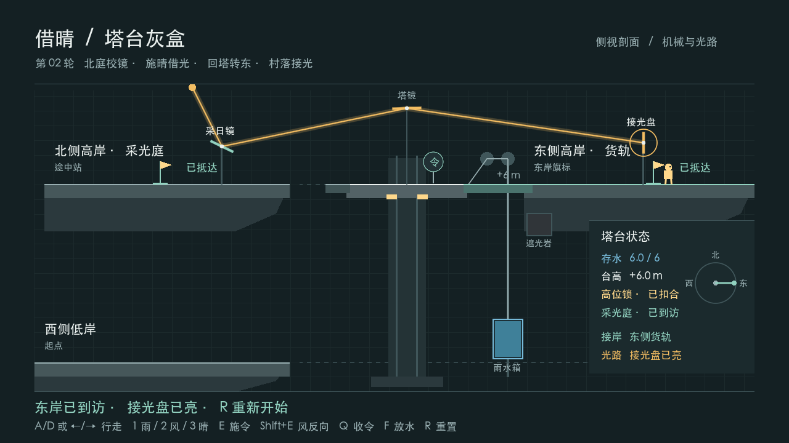 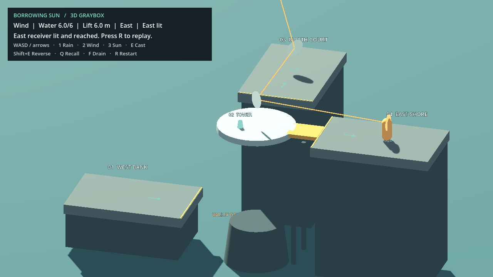

图 1 · 同一光路目标经过两个实现阶段。左图是第 02 轮侧视投影，右图是第 05B 轮的三维场景。截图来自当轮游戏窗口。

<!-- page -->

# 2D 类关系

03 · 冻结基线 `6175db9`

`TowerSlice` 接收 Godot 输入，按物理帧协调核心规则、场景节点和会话界面。规则保有水量、到访、受光和货运等会改变结果的状态；角色与场景适配负责输入后的实际落脚、碰撞、显示和重置接线。

<!-- class-map: 2D -->

| 类与职责 | 关键状态、方法或事件 |
| --- | --- |
| `TowerMechanism` · 塔和雨水 | `TowerState` 供场景同步，管理高度、锁定、停靠和转水。 |
| `RouteProgress` · 先北后东 | `Visit(Port)`、`Reset()`；到岸里程碑与最终交付独立。 |
| `CargoJourney` · 一箱水果的状态 | 使用实时受光装货、转水、许可发车，输出行程和交付计数。 |
| `SunCourtOptics2D` · 局部天气与校准 | 持有采日镜状态和光路，委托 `Optics2D` 计算。 |
| `TowerRig2D`、`SlicePlayer`、`CargoTrack2D` · Godot 适配 | 同步塔桥、角色落脚和实体车台。 |
| `TowerView`、`TowerSessionOverlay` · 表现 | 读取现场数据；开场及签收卡通过 `Accepted` 回传操作。 |

图 2 · PDF 第 3 页的 2D 关系节选。实线为协调器持有或调用，金色箭头标记几何求解与转水依赖。 [2D 完整关系图](../../BorrowingSun2D/Docs/2D-to-3D/RELATIONSHIP_MAP.svg) · [2D 类图说明](../../BorrowingSun2D/Docs/2D-to-3D/CLASS_MAPS.md)

<!-- page -->

# 3D 类关系

04 · 第 05D 轮候选 `fb4cbb4`

`TowerGraybox` 代替 2D 的协调器，链接同一份塔机、到访和货运源码。实体塔台偏航决定塔镜姿态。光学适配查询遮挡，将接光结果交回协调器。货车继续由共享行程状态驱动，三维场景负责车体位置和碰撞。

<!-- class-map: 3D -->

| 类与职责 | 关键状态、方法或事件 |
| --- | --- |
| `TowerMechanism`、`RouteProgress`、`CargoJourney` · 共享规则 | 分别保有水、停靠、到访和货运状态。3D 项目直接编译链接三份源码。 |
| `SunCourtOptics3D` · 局部天气与校准 | 读塔镜世界姿态，以物理射线检查遮挡，回传 `TowerHit` 和 `ReceiverLit`。 |
| `Optics3D` · 纯几何求解 | 以有限圆面和世界空间向量求交、反射，返回 `LightPath3D`。 |
| `TowerRig3D`、`GrayboxPlayer`、`CargoTrack3D` · Godot 适配 | 同步塔台偏航、桥碰撞、角色移动和实际车台。 |
| `TowerSessionOverlay3D` · 会话表现 | 按 `TowerScreen` 显示开场或签收，`Accepted` 回到原重开入口。 |
| `GrayboxRouteCheck` · 验证入口 | 向场景发按键，核对落脚、光路、货车、签收与重开。 |

图 3 · PDF 第 4 页的 3D 关系节选。几何与场景接线替换为三维实现，光路结果仍驱动同一个货运规则。 [3D 完整关系图](RELATIONSHIP_MAP.md) · [编译链接](../BorrowingSun3D.csproj)

<!-- page -->

# 变化图与 CCR

05 · 从冻结 2D 对照 05D 候选

| 2D 冻结核心类 | 3D 对应 | 变化与原因 |
| --- | --- | --- |
| `TowerMechanism` | 同源编译 | 共享。保留蓄水、升降、机械锁、朝向、停靠与原水配重。 |
| `RouteProgress` | 同源编译 | 共享。先北庭、再东岸，实际落点由各场景提供。 |
| `CargoJourney` | 同源编译 | 共享。保留接光装箱、转水、发车、行程、签收。 |
| `Optics2D` | `Optics3D` | 修改。有限线段变为有限圆面，世界空间求交并保留真实双反射与遮挡。 |
| `SunCourtOptics2D` | `SunCourtOptics3D` | 修改。保留天气与校准职责，改为实体塔镜姿态与 `Physics3D` 遮挡。 |

> **候选 CCR = (修改 2 + 移除 0) ÷ 冻结核心类 5 × 100% = 40.00%。** 共享 3 类；3D 独有新增核心职责 0。两项光学替换各承接一个原有职责，分别计一次修改。

**范围。** 分母按冻结版本的五个核心类固定。光学控制器尽管接线到引擎，也拥有直接改变玩法的天气、镜面和接光状态，因此计入。输入映射、角色物理、桥和车台的场景适配、镜头、界面、场景资源和测试归到移植开销，另列如下。

| 变化类别 | 2D → 3D |
| --- | --- |
| 协调与控制 | `TowerSlice` → `TowerGraybox`。侧视横移 → 平面移动，真实北桥以 `W/S` 往返。 |
| 场景与表现 | `TowerRig2D` / `CargoTrack2D` → 三维塔桥和车台适配；剖面图 → 固定观察角度的立体灰盒；开场与结束页保留相同语义。 |
| 增删口径 | 新增 3D 场景、输入物理适配和验证入口；未删除任何冻结核心职责。原 2D 工程仍可独立运行。 |

**复算。** 在仓库根目录运行 `python3 Tools/ccr.py --analysis BorrowingSun3D/Docs/ccr-analysis.json`。工具核对标签、提交、源码 Git 对象和候选映射，逐类行为归类由人工审查。40% 描述这五个类的职责实现改动比例，无法单独说明总工时或玩法等价。若正式候选的玩法源码变更，按最终代码重审。 [逐类变化图](CHANGE_MAP.md) · [冻结清单](ccr-analysis.json) · [复算日志](Evidence/round-05d/ccr.log)

<!-- page -->

# 实现与验收

06 · 可复跑的交付路线

两版使用 Godot 4.7.1 .NET 和 .NET 8 SDK。从仓库根目录分别打开 `BorrowingSun2D/project.godot` 与 `BorrowingSun3D/project.godot`，按 F5 运行。3D 依赖同级 2D 目录的共享源码。自动路线由脚本向实际场景发送按键，光路断开通过临时实体挡块复现，重玩路线使用默认场景。 [运行说明](../../README.md) · [共用验收用例](ROUND_05D.md#对照验收表)

| 环境与方式 | 冻结 2D `6175db9` | 3D 候选 `fb4cbb4` |
| --- | --- | --- |
| macOS 26.5.2 arm64 | 无头 154 项，开窗 46 项；开窗记录一趟正常交付。 | 无头 160 项，开窗 160 项；覆盖发车反例、两次签收和重开。 |
| Windows Server 2025 x64 托管无头 | 154 项通过。 | 160 项通过。 |
| Windows Server 2025 x64 托管开窗 | 90 项通过。正常签收两趟，`R` 后走过实体低桥。 | 160 项通过。签收两趟，首趟另复测未满配重、失光拒发与发车后失光。 |
| Windows 实机人工 | 待同学复跑，记录默认显卡、焦点、鼠标与两次签收。 | 待同学以同一候选复跑，补实机截图和日志。 |

| 可重复情景 | 观察到的行为 |
| --- | --- |
| 配重不足 / 发车前断光 | `G` 拒绝发车，等待配重或恢复来光；已转水量保留。拒发由 2D 无头及 3D 自动路线覆盖。2D 托管开窗记录等待提示。 |
| 满配重且实时接光 | 玩家站上实体车台按 `G`，车跨谷。到站后走到花庭标记按 `G`，才记 `1/1`。 |
| `R` 后再次交付 | 开始于西岸，塔、镜、配重和交付计数复位，玩家实走低桥，再沿全程交付。 |

**一次量测。** 3D 托管开窗的货车实际承载站稳的角色行进 7.24 m，首趟发车后失光仍到站；1607 次物理采样中，总水量和实体台高的记录漂移均为 0。 [原始路线日志](Evidence/windows-05d/hosted/3d/route.log)

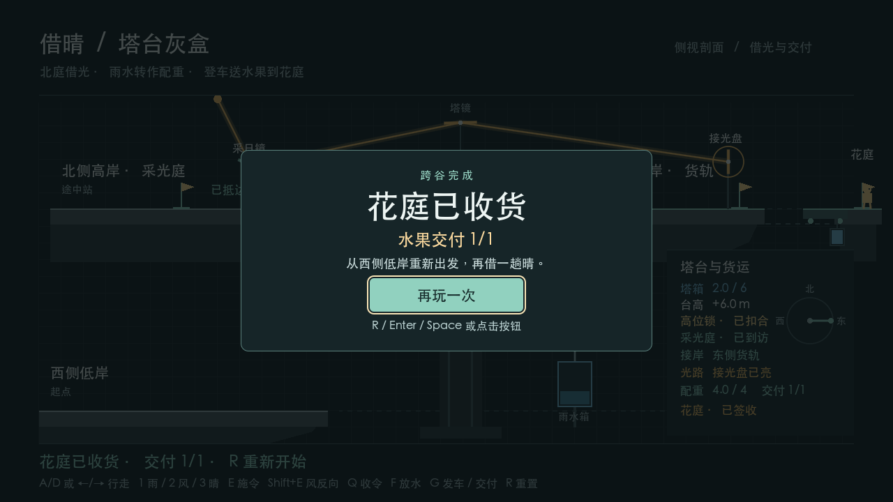 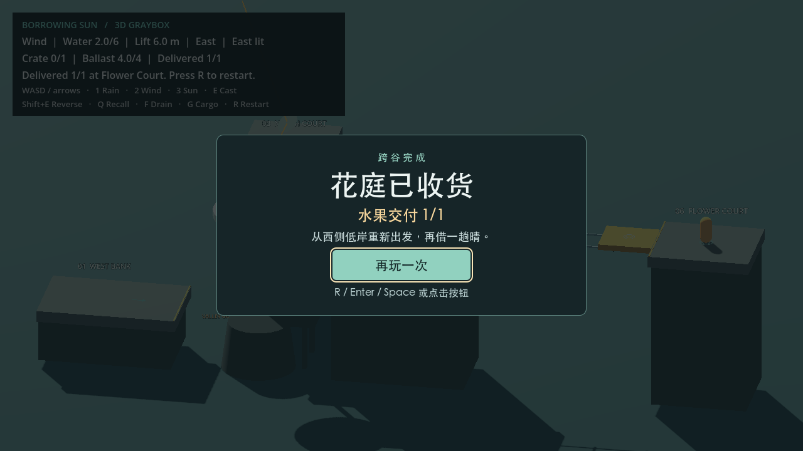

图 4 · macOS 开窗的签收页，均可读到 `1/1`。断言数取决于探针覆盖，不能用来比较版本质量。 [macOS 日志](ROUND_05D.md#实测与签收--2026-11-08) · [Windows 记录及复跑命令](WINDOWS_ACCEPTANCE.md)

<!-- page -->

# Windows 托管开窗原帧

07 · 左：2D 基线　右：3D 05D 候选

2026-11-09（新加坡时间）在 GitHub Actions 的 Windows Server 2025 图形会话取证。Windows 显示驱动经 ANGLE / Direct3D 11 渲染，实际视口 1028×578。首跑路线均通过，截图比例守卫因取整误报；QA 修正后重跑全绿。以下是首跑原图。 [首跑产物](https://github.com/buriallsy/coding_team/actions/runs/42502404839/artifacts/13626431731) · [通过的复跑](https://github.com/buriallsy/coding_team/actions/runs/42503364565/job/128800674252)

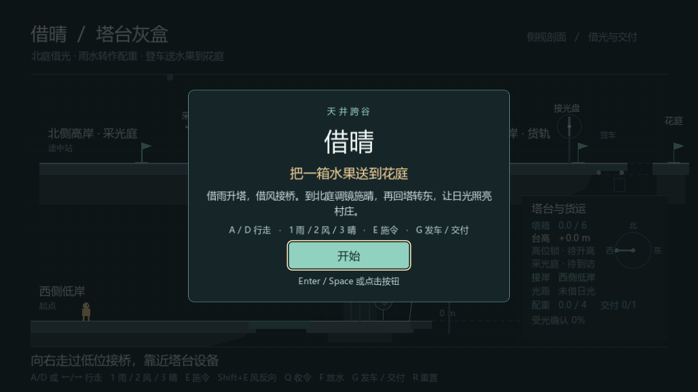 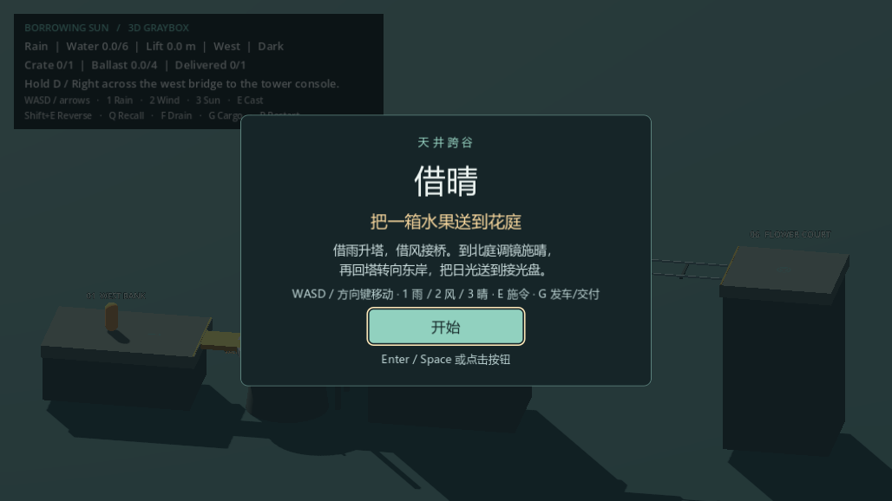

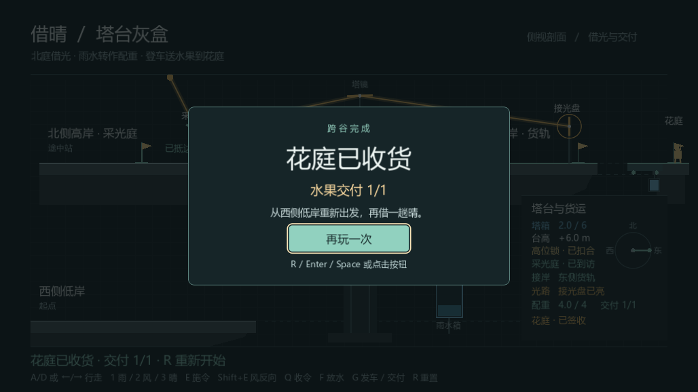 

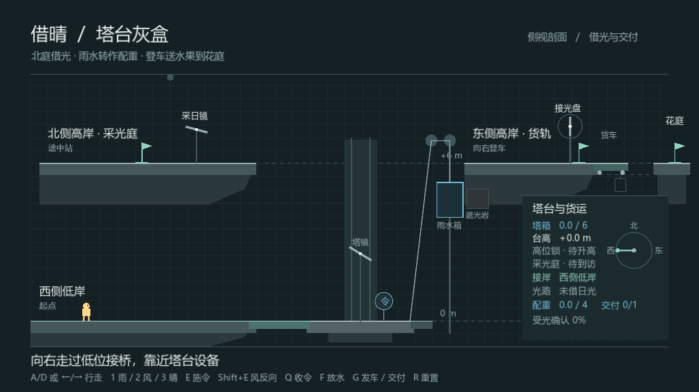 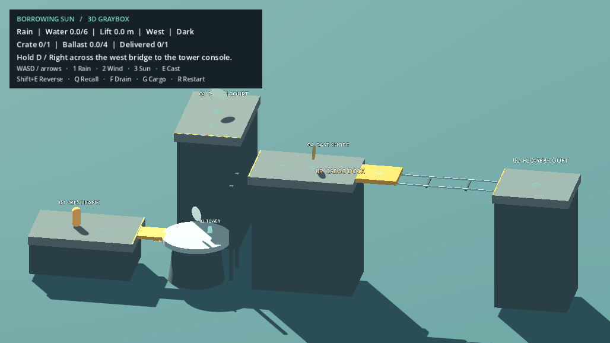

 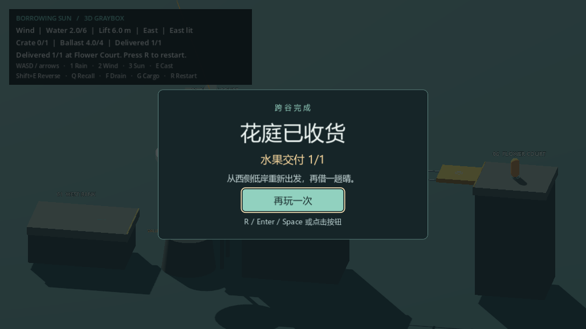

图 5 · 四个节点按实际顺序排列。跨过低桥和两次签收均有路线日志，Windows 实机人工结果待填。 [2D 日志](Evidence/windows-05d/hosted/2d/route.log) · [3D 日志](Evidence/windows-05d/hosted/3d/route.log) · [完整截图索引](WINDOWS_ACCEPTANCE.md#托管开窗预验)

<!-- page -->

# 制作证据与交付待办

08 · 小组共同初稿

| 证据 | 可核对的记录 |
| --- | --- |
| 版本演化 | [2d-baseline 标签](https://github.com/buriallsy/coding_team/tree/2d-baseline) · [05D 候选](https://github.com/buriallsy/coding_team/commit/fb4cbb451c028234dd093576fa8c0e6e72bb457e) · [2D 到 3D 的 GitHub 对照](https://github.com/buriallsy/coding_team/compare/2d-baseline...fb4cbb451c028234dd093576fa8c0e6e72bb457e) |
| 主线开发 | [buriallsy/3d-graybox](https://github.com/buriallsy/coding_team/tree/buriallsy/3d-graybox) · [三维移植起点 05A](https://github.com/buriallsy/coding_team/commit/c1209a8) · [验收证据提交](https://github.com/buriallsy/coding_team/commit/442d751422dec109af41f9327465acefb436ccec) |
| 队友协作 | Git 作者 `djwcb2333` 的 [领域架构提交](https://github.com/buriallsy/coding_team/commit/d2bfee7) 与 [数值边界提交](https://github.com/buriallsy/coding_team/commit/181ec16) 可核对。团队在 [合并提交 6b4357a](https://github.com/buriallsy/coding_team/commit/6b4357a) 保留 03 轮玩法，接入独立领域测试、CI、CCR 工具和复跑记录。各成员另确认本人姓名、分支、贡献和评估。 |
| AI 协作证据索引 | 已有成员索引记录范围、数值和框架的协作与核对。另一实例是 Windows 预验：实机暂不可用，用户选择托管开窗。用首跑日志、QA 修正提交和复跑核查 AI 生成的检查。完整交流及是否采用由成员本人记录。 [成员现有索引](../../BorrowingSun2D/Docs/AI/djwcb2333/INDEX.md) · [实际 QA 修正](https://github.com/buriallsy/coding_team/commit/e57b3c88f4d752d98053d63eeb33ae8f5447bfe2) |

**个人署名反思，待每位成员独立填写。** 每人写明姓名与个人分支、负责的具体决定或实现、遇到的问题、如何检查结果、课程原则怎样改变做法，以及本人如何核对与修订 AI 结果。附提交或 PR 和私有交流索引。小组需补实际组号、正式成员名单、个人反思与签署声明。

**下一次验收。** 用 Windows 实机按 [验收清单](WINDOWS_ACCEPTANCE.md#人工窗口核对)完成两版的开场、两次签收与低桥重走。记录操作人、环境、源码 SHA 与截图。首次玩家独立试玩另记时间和卡点。双平台签收后再核对最终版本是否与候选相同，并据实际结果决定 `3d-final` 与 CCR。

**交付。** 用同一代码版本彩排 [15 分钟演示](DEMO_15_MIN.md)。正式包应含两个可运行工程、README、共同 PDF、小组原创声明及每人生成式 AI 声明；由组员在独立解压目录启动验收后再提交。组号、截止、命名和声明模板以最新课程平台为准。此稿依据仓库保存的课程要求摘要整理，正式提交前由小组复核原简报。 [制作计划](../../BorrowingSun2D/Docs/2D-to-3D/PRODUCTION_PLAN.md) · [打包清单](ROUND_06_PREP.md#交付检查表)

| 定稿前的负责人 | 要补的实际信息 |
| --- | --- |
| Windows 复跑组员 | 两版实机日志、开场和签收原帧、低桥重走及复核人。 |
| 每位组员 | 个人署名、实际贡献证据、个人反思、完整 AI 交流索引或未使用声明。 |
| 归档与提交人 | 确认组号、截止、签名与文件名，核对解压后运行和最终提交回执。 |
