# Borrowing Sun

AP6412 Group Assignment Report Draft · Route B · Godot C# · 2026-11-09

> Frozen 2D baseline `6175db9` and 3D 05D candidate `fb4cbb4`. macOS tests and the hosted Windows preflight passed. Manual Windows PC acceptance, `3d-final`, group number, member names, and individual reflections are pending.

## 01 · Game and Original Design

Borrowing Sun is a weather puzzle. Cross the low west bridge, raise the tower with rain, and turn the bridge with wind. Two mirrors relay sunlight from Sun Court (North Court in 3D) to the east receiver, earning a fruit crate. Reuse the rainwater as cargo ballast, ride across the valley, and confirm delivery at Flower Court. Unity L5 inspired the setting and devices. We built and froze the standalone Godot 2D game before porting it to 3D. [Game concept](../../BorrowingSun2D/Docs/2D-to-3D/DESIGN.md)

| Original assumption | How we test it in both versions |
| --- | --- |
| Height and heading give distinct cues | Rain raises and locks the tower at 6 m. Wind changes its dock. Return from Sun Court before turning east. |
| Players can read the beam path | North lights the tower mirror. East lights the receiver if unobstructed. Both versions calculate mirror hits and occlusion. |
| Rainwater connects the two parts | After 1.5 seconds of light, load one crate. Of 6 water units, 4 become ballast and 2 stay in the tank. The tower stays locked. |
| One delivery exercises the loop | Board the car, wait for full ballast and a lit receiver, then press `G`. Confirm delivery at the Flower Court marker with `G` to finish at `1/1`. Loss of light pauses transfer. A moving car continues. |

**Controls.** `Enter` or Start begins. Move with `A/D` in 2D, `WASD` in 3D, or arrows. Use `W/S` at the 3D north bridge. Select rain, wind, or sun with `1/2/3`, cast with `E`, depart or confirm delivery with `G`, and restart at the low bridge with `R`. Prompts explain invalid actions, and falls return players to safety. The three-minute target awaits first-time playtesting. [2D controls](../../BorrowingSun2D/README.md) · [3D controls](../README.md)

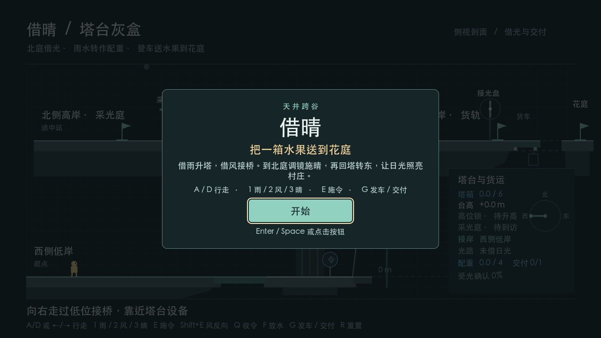 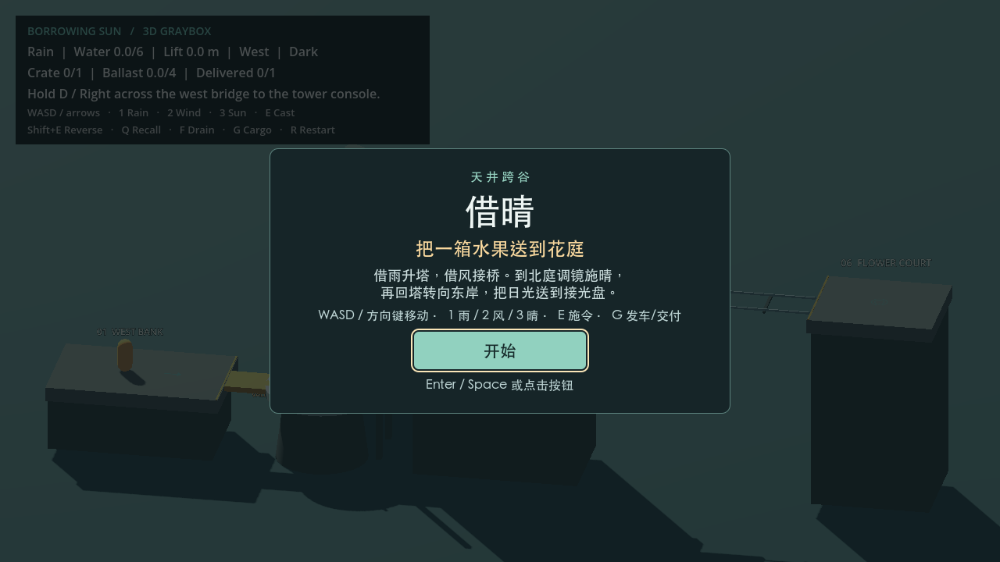

<!-- page -->

# From 2D Prototype to 3D Candidate

02 · Iterations and Design Decisions

| Round | Question and decision | Outcome and evidence |
| --- | --- | --- |
| 00 · Playable 2D | Side view tests the west bridge, rain lift, and wind docking. | Keyboard test exposed a bridge collider left high after `R`. Same inputs passed after the fix. [Failure log](../../BorrowingSun2D/Docs/Evidence/01-independent-reset-failure.log) · [Iteration record](../../BorrowingSun2D/Docs/ITERATIONS.md) |
| 01 · Three shores | Add the east bridge and third dock. Separate bridge sync and visits from the coordinator. Test the `RouteProgress` finish extension. | Walk west → tower → north → tower → east and retest after reset. [Route](../../BorrowingSun2D/Docs/2D-to-3D/ROUND_01.md) · [SOLID](../../BorrowingSun2D/Docs/2D-to-3D/ARCHITECTURE_REFACTOR.md) |
| 02 · Double reflection | Calibrate, cast sun, then turn east. Distinguish tower hit from east receiver light. | Verify north, east, and occlusion. [2D optics](../../BorrowingSun2D/Docs/2D-to-3D/ROUND_02.md) |
| 03 · Cargo | Add `CargoJourney` with reused water and separate arrival and confirmation. Integrate tests, CI, and CCR without changing gameplay. | Test loss of light, departure gates, and replay. [Cargo](../../BorrowingSun2D/Docs/2D-to-3D/ROUND_03.md) · [Integration](../../BorrowingSun2D/Docs/Evidence/2026-11-08-round03-integration/RESULTS.md) |
| 04 · 2D freeze | Add goal, controls, hints, delivery screen, and replay. | Freeze `2d-baseline` at `6175db9`. [Acceptance](../../BorrowingSun2D/Docs/2D-to-3D/ROUND_04.md) |
| 05A · 3D tower | Link tower and route rules. Implement lift, yaw, and north bridge. | Reach Sun Court and repeat after `R`. [05A](ROUND_05A.md) |
| 05B · 3D optics | Add east bridge, world-space discs, and occlusion raycasts. | Confirm north and east outcomes, then block and restore the beam. [05B](ROUND_05B.md) |
| 05C–D · 3D cargo | Reuse cargo and align screens. Fix a stale light prompt and a wrapped character. | Retest loading, refusal, delivery, and replay. Pin `fb4cbb4`. [05C](ROUND_05C.md) · [05D](ROUND_05D.md) |

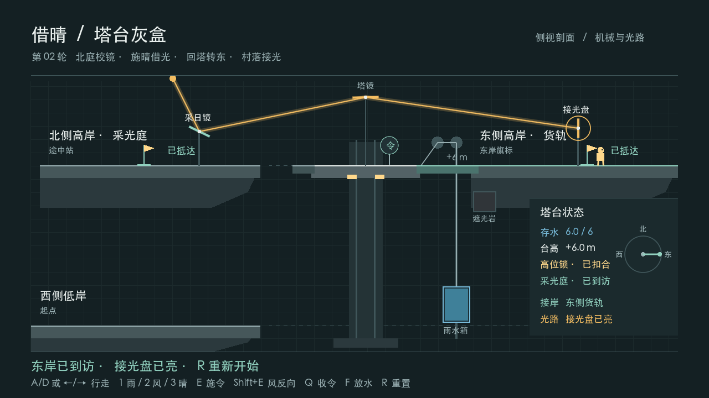 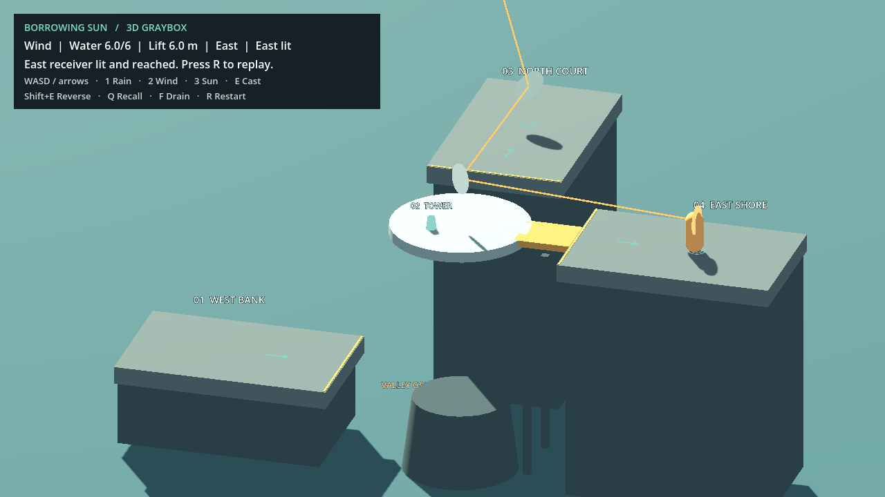

Figure 1. East receiver in the original 2D (Round 02) and 3D (Round 05B) game captures.

<!-- page -->

# 2D Class Relationships

03 · Frozen Baseline `6175db9`

`TowerSlice` receives Godot input and coordinates the core rules, scene nodes, and session UI each physics frame. The rules own gameplay state for water, visits, light, and cargo. The player and scene adapters handle footing, collisions, rendering, and reset wiring.

<!-- class-map: 2D -->

| Class and responsibility | Key state, method, or event |
| --- | --- |
| `TowerMechanism` · Tower and rainwater | Exposes `TowerState` to synchronize the scene. Owns height, locking, docking, and water transfer. |
| `RouteProgress` · North before east | `Visit(Port)` and `Reset()`. Shore milestones and final delivery are separate. |
| `CargoJourney` · State of one fruit crate | Uses live receiver light to load cargo, transfer water, and authorize departure. Exposes travel progress and delivery count. |
| `SunCourtOptics2D` · Local weather and calibration | Owns the collector mirror’s state and the light path. Delegates calculation to `Optics2D`. |
| `TowerRig2D`, `SlicePlayer`, `CargoTrack2D` · Godot adapters | Synchronize the tower, bridge, player footing, and physical cargo car. |
| `TowerView`, `TowerSessionOverlay` · Presentation | Read scene state. The opening and delivery cards relay input through `Accepted`. |

Figure 2. Selected 2D relationships on page 3 of the PDF. Solid lines show coordinator ownership or calls. Gold arrows show dependencies for geometry and water transfer. [Full 2D relationship map](../../BorrowingSun2D/Docs/2D-to-3D/RELATIONSHIP_MAP.svg) · [2D class map notes](../../BorrowingSun2D/Docs/2D-to-3D/CLASS_MAPS.md)

<!-- page -->

# 3D Class Relationships

04 · Round 05D Candidate `fb4cbb4`

`TowerGraybox` replaces the 2D coordinator and links the same tower, route, and cargo sources. The physical tower’s yaw sets the mirror pose. The optics adapter queries occlusion and sends the receiver result to the coordinator. The shared journey state still drives the car, with its position and collisions handled by the 3D scene.

<!-- class-map: 3D -->

| Class and responsibility | Key state, method, or event |
| --- | --- |
| `TowerMechanism`, `RouteProgress`, `CargoJourney` · Shared rules | Own tower water and docking, visits, and cargo state respectively. The 3D project links all three source files directly. |
| `SunCourtOptics3D` · Local weather and calibration | Reads the tower mirror’s world pose, raycasts for occlusion, and exposes `TowerHit` and `ReceiverLit`. |
| `Optics3D` · Pure geometry solver | Uses finite discs and world-space vectors to compute intersections and reflections, returning `LightPath3D`. |
| `TowerRig3D`, `GrayboxPlayer`, `CargoTrack3D` · Godot adapters | Synchronize tower yaw, bridge collision, player movement, and the physical car. |
| `TowerSessionOverlay3D` · Session UI | Shows the opening or delivery screen according to `TowerScreen`. `Accepted` returns control to the existing restart path. |
| `GrayboxRouteCheck` · Verification entry point | Sends key events and checks footing, light, cargo, delivery, and reset. |

Figure 3. Selected 3D relationships on page 4 of the PDF. The geometry and scene wiring use 3D implementations. The resulting light path drives the same cargo rules. [Full 3D relationship map](RELATIONSHIP_MAP.md) · [Compile links](../BorrowingSun3D.csproj)

<!-- page -->

# Change Map and CCR

05 · Core Change Ratio for the Round 05D Candidate

| Frozen 2D core class | 3D counterpart | Change and rationale |
| --- | --- | --- |
| `TowerMechanism` | Shared source | Retains water storage, lift, mechanical lock, heading, docking, and transfer to ballast. |
| `RouteProgress` | Shared source | Preserves the north-then-east order. Each scene supplies the physical visit locations. |
| `CargoJourney` | Shared source | Retains light-gated loading, water transfer, departure, travel, and delivery confirmation. |
| `Optics2D` | `Optics3D` | Replaces finite segments with finite discs and world-space intersections. Retains two calculated reflections and occlusion. |
| `SunCourtOptics2D` | `SunCourtOptics3D` | Retains weather and calibration. Uses the physical tower mirror’s pose and `Physics3D` for occlusion. |

> **Candidate CCR = (2 modified + 0 removed) ÷ 5 frozen core classes × 100% = 40.00%.** Three classes share source, and 3D adds zero independent core responsibilities. Each optics replacement counts as one modification to an existing responsibility.

**Scope.** The frozen baseline fixes the denominator at five core classes. The optics controller counts because it owns weather, mirror, and receiver states that affect gameplay. Input mapping, character physics, scene adapters, camera, UI, scene assets, and tests are tracked separately as porting work.

| Type of change | 2D → 3D |
| --- | --- |
| Coordination and controls | `TowerSlice` → `TowerGraybox`. Side-view movement becomes planar movement. `W/S` crosses the physical north bridge. |
| Scene and presentation | `TowerRig2D` and `CargoTrack2D` gain 3D equivalents. The side-view section becomes a fixed-view 3D graybox. The opening and delivery screens convey the same information. |
| Additions and removals | Added a 3D scene, input and physics adapters, and a verification entry point. All frozen core responsibilities are retained. The 2D project still runs independently. |

**Reproduce the calculation.** From the repository root, run `python3 Tools/ccr.py --analysis BorrowingSun3D/Docs/ccr-analysis.json`. The tool verifies the tag, commits, Git source objects, and candidate mappings. We classify behavior changes by reviewing each class. The 40% measures implementation changes in these five classes. Total effort and gameplay equivalence require separate evidence. If the final candidate’s gameplay code changes, review the calculation against that code. [Class-by-class change map](CHANGE_MAP.md) · [Frozen manifest](ccr-analysis.json) · [CCR log](Evidence/round-05d/ccr.log)

<!-- page -->

# Implementation and Acceptance

06 · Reproducible Delivery Route

Both versions use Godot 4.7.1 .NET and the .NET 8 SDK. Open either project's `project.godot` and press F5. Keep the projects side by side so 3D can link 2D source. The tests send key events to the live scene and use a temporary beam blocker. Replay uses the default scene. [Run instructions](../../README.md) · [Shared acceptance cases](ROUND_05D.md#对照验收表)

| Environment and method | Frozen 2D `6175db9` | 3D candidate `fb4cbb4` |
| --- | --- | --- |
| macOS 26.5.2 arm64 | 154 headless, 46 windowed. One normal delivery in the windowed run. | 160 headless, 160 windowed. Includes refused departures, two deliveries, and replay. |
| Hosted Windows Server 2025 x64, headless | 154 passed. | 160 passed. |
| Hosted Windows Server 2025 x64, windowed | 90 passed. Two deliveries and a low bridge crossing after `R`. | 160 passed. Two deliveries. Tests refusal for low ballast and loss of light, plus travel after loss of light. |
| Manual Windows PC acceptance | Pending. Check the default driver, focus, mouse input, and two deliveries. | Pending on the same candidate. Capture screenshots and logs. |

| Reproducible scenario | Observed behavior |
| --- | --- |
| Low ballast or loss of light before departure | Pressing `G` leaves the car at the dock, with transferred water still in the ballast. The 2D headless and 3D routes test both cases. The hosted 2D windowed run records the waiting prompt. |
| Full ballast and live light | Press `G` aboard the car to cross the valley. Press `G` at the Flower Court marker to record `1/1`. |
| Deliver again after `R` | The tower, mirrors, ballast, and count reset. Cross the low bridge from West Bank and repeat the full route. |

In the hosted 3D windowed test, the car carried the grounded player 7.24 m and arrived after losing light on the first trip. Total water and physical tower height showed zero drift across 1,607 physics samples. [Raw route log](Evidence/windows-05d/hosted/3d/route.log)

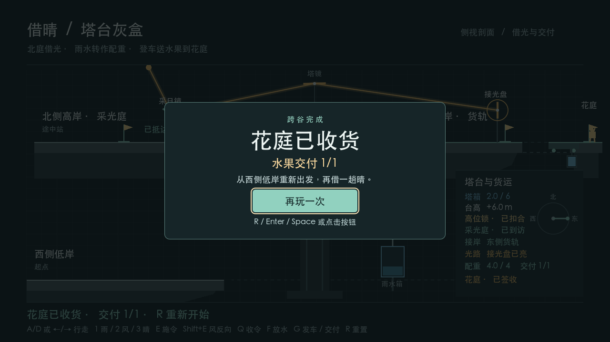 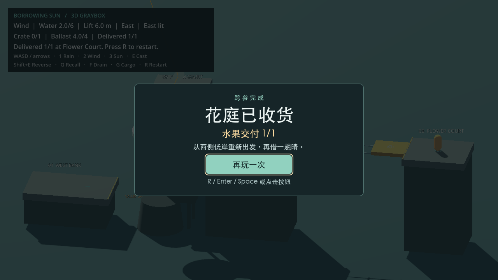

Figure 4. Both macOS delivery screens show `1/1`. Assertion counts reflect each probe’s coverage. [macOS logs](ROUND_05D.md#实测与签收--2026-11-08) · [Windows results and rerun commands](WINDOWS_ACCEPTANCE.md)

<!-- page -->

# Screenshots from Hosted Windows Tests

07 · Left 2D Baseline · Right 3D Round 05D Candidate

The captures were taken on 2026-11-09 Singapore time in a GitHub Actions Windows Server 2025 graphical session. The Windows display driver rendered through ANGLE and Direct3D 11 at a 1028×578 viewport. Both routes passed on the first run. Pixel rounding caused a false failure in the screenshot aspect-ratio check. After the QA fix, the full rerun passed. These original captures are from the first run. [First-run artifact](https://github.com/buriallsy/coding_team/actions/runs/42502404839/artifacts/13626431731) · [Passing rerun](https://github.com/buriallsy/coding_team/actions/runs/42503364565/job/128800674252)

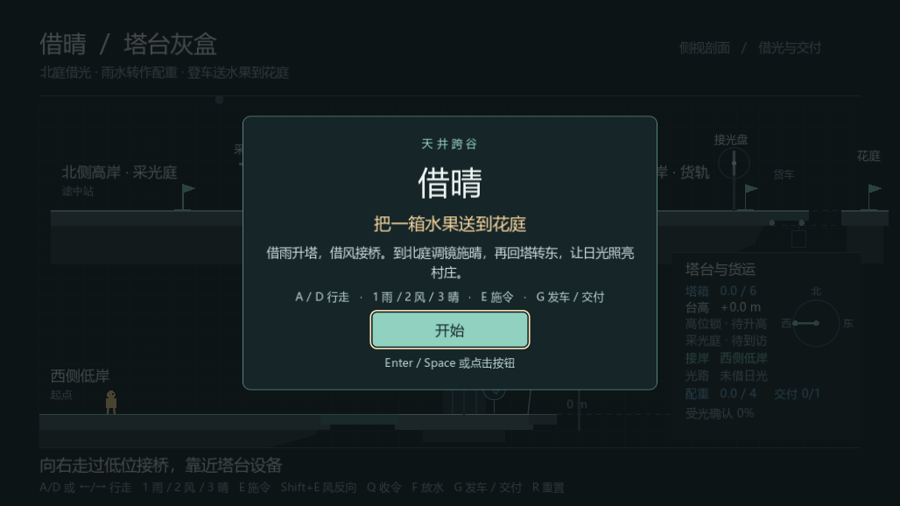 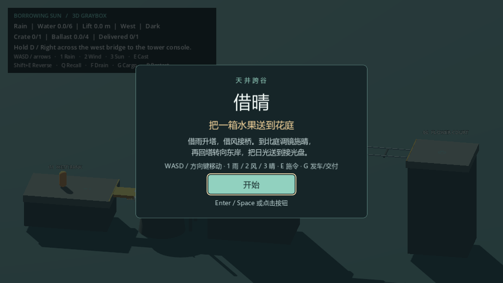

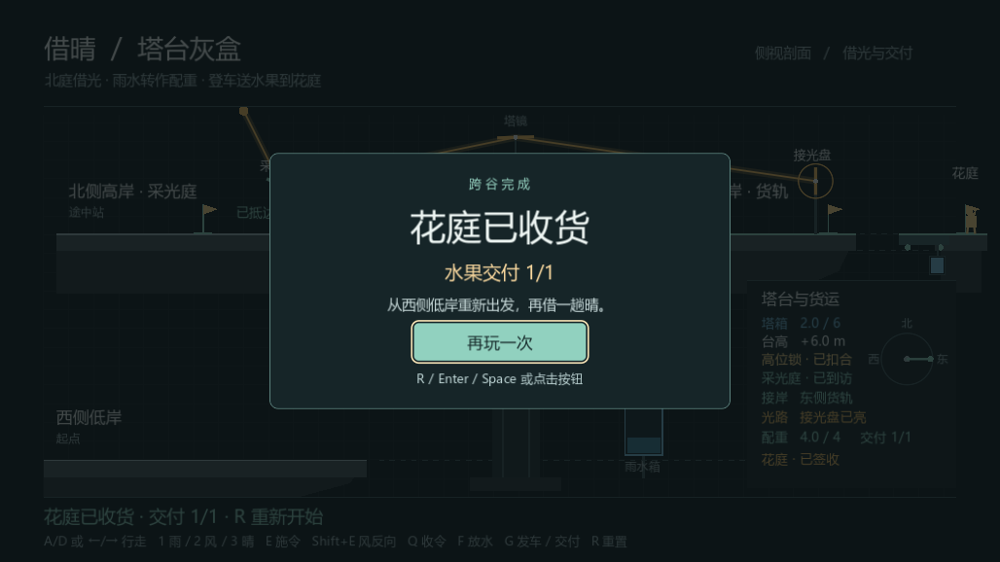 

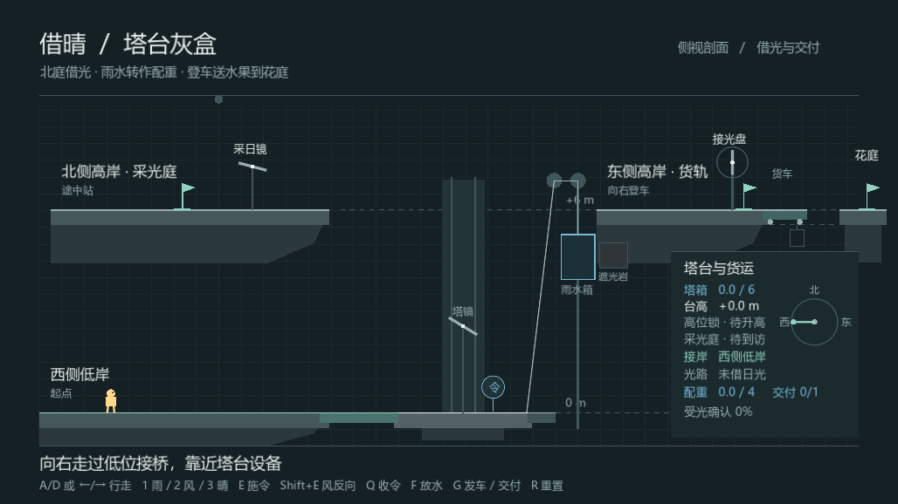 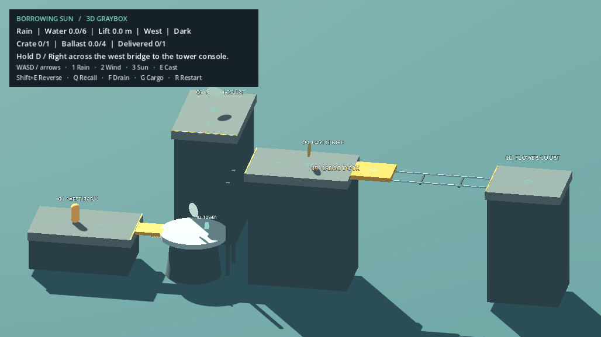

 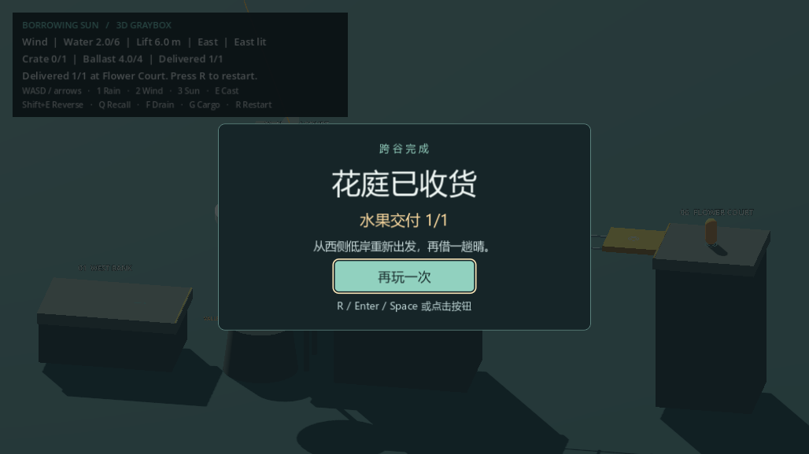

Figure 5. Four checkpoints in play order. The route logs record the low bridge crossing and both deliveries. Manual Windows PC results are pending. [2D log](Evidence/windows-05d/hosted/2d/route.log) · [3D log](Evidence/windows-05d/hosted/3d/route.log) · [Full capture index](WINDOWS_ACCEPTANCE.md#托管开窗预验)

<!-- page -->

# Development Evidence and Submission Tasks

08 · Shared Group Draft

| Evidence | Records to check |
| --- | --- |
| Version history | [2d-baseline tag](https://github.com/buriallsy/coding_team/tree/2d-baseline) · [05D candidate](https://github.com/buriallsy/coding_team/commit/fb4cbb451c028234dd093576fa8c0e6e72bb457e) · [GitHub comparison from 2D to 3D](https://github.com/buriallsy/coding_team/compare/2d-baseline...fb4cbb451c028234dd093576fa8c0e6e72bb457e) |
| Main development | [buriallsy/3d-graybox](https://github.com/buriallsy/coding_team/tree/buriallsy/3d-graybox) · [Start of the 3D port in 05A](https://github.com/buriallsy/coding_team/commit/c1209a8) · [Acceptance evidence commit](https://github.com/buriallsy/coding_team/commit/442d751422dec109af41f9327465acefb436ccec) |
| Team collaboration | Git author `djwcb2333` contributed the [domain architecture](https://github.com/buriallsy/coding_team/commit/d2bfee7) and [numeric boundaries](https://github.com/buriallsy/coding_team/commit/181ec16). [Merge commit 6b4357a](https://github.com/buriallsy/coding_team/commit/6b4357a) retained Round 03 gameplay and integrated standalone domain tests, CI, CCR tooling, and rerun notes. Members will confirm their own names, branches, contributions, and assessments. |
| AI collaboration index | An existing member index documents work and checks on scope, values, and the framework. The Windows preflight is another example. With a physical Windows PC unavailable, the user chose hosted windowed testing. The first-run logs, QA fix, and passing rerun document how the AI-generated check was verified. Members record their full exchanges and which suggestions they used. [Existing member index](../../BorrowingSun2D/Docs/AI/djwcb2333/INDEX.md) · [QA fix](https://github.com/buriallsy/coding_team/commit/e57b3c88f4d752d98053d63eeb33ae8f5447bfe2) |

**Individual signed reflections, pending.** Each member should give their name and branch, describe a specific decision or implementation they owned, and explain the problem, how they verified the result, and how course principles shaped their work. Include how they checked and revised AI output, with a commit or pull request and a private transcript index. The group must add its number, official member list, individual reflections, and signed declarations.

**Next acceptance run.** Follow the [manual Windows checklist](WINDOWS_ACCEPTANCE.md#人工窗口核对) on a Windows PC for both opening screens, two deliveries, and the low bridge crossing after reset. Record the operator, environment, source SHA, and screenshots. Record first-time players’ completion times and sticking points separately. After acceptance on both platforms, confirm the final code against the candidate before deciding on `3d-final` and the CCR.

**Submission.** Rehearse the [15-minute demo](DEMO_15_MIN.md) on the same code versions. The final archive should contain both runnable projects, a README, the joint PDF, the group originality declaration, and each member’s generative AI declaration. A member should test launch from a freshly extracted copy before submission. Check the course portal for the group number, deadline, naming rules, and declaration templates. This draft follows the repository’s summary of the course requirements. Check the original brief before submitting. [Production plan](../../BorrowingSun2D/Docs/2D-to-3D/PRODUCTION_PLAN.md) · [Packaging checklist](ROUND_06_PREP.md#交付检查表)

| Owner before finalization | Evidence to supply |
| --- | --- |
| Windows test operator | PC logs for both versions, opening and delivery captures, low bridge replay, and reviewer. |
| Each member | Name, evidence of their contribution, individual reflection, and full AI transcript index or a declaration of non-use. |
| Packaging and submission owner | Confirm the group number, deadline, signatures, and filenames. Verify launch after extraction and save the submission receipt. |
