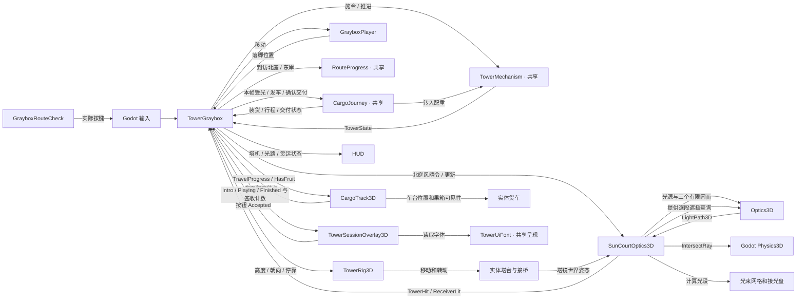

# 3D 关系图 · 第 05D 轮

`TowerGraybox` 负责输入、物理步进、会话切换和 HUD。塔机、到访和货运规则沿用冻结的 2D C# 源码。三维场景适配负责真实光路、塔桥和车台的碰撞与呈现。会话卡片只展示当前页面和实际签收计数，按键和按钮都通过关卡协调器进入原复位流程。

| 关系 | 代码与场景 |
| --- | --- |
| `TowerGraybox` 持有规则实例和场景适配 | [关卡协调](../Scripts/TowerGraybox.cs) · [共享编译项](../BorrowingSun3D.csproj) |
| `TowerRig3D` 投影塔台姿态并切换桥碰撞 | [实体桥适配](../Scripts/TowerRig3D.cs) · [场景](../Scenes/TowerGraybox.tscn) |
| `SunCourtOptics3D` 持有北庭天气和校准状态，读取世界姿态，接入物理遮挡和显示 | [3D 采光适配](../Scripts/SunCourtOptics3D.cs) |
| `Optics3D` 使用几何和遮挡查询，返回入射及反射段 | [3D 光学求解](../Scripts/Optics3D.cs) |
| `CargoJourney` 根据实时受光装货，与 `TowerMechanism` 共享原水转移，并持有发车、行程和交付状态 | [共享货运规则](../../BorrowingSun2D/Scripts/Core/CargoJourney.cs) · [共享塔机规则](../../BorrowingSun2D/Scripts/Core/TowerMechanism.cs) |
| `CargoTrack3D` 把行程投影到实体车台，从车面和花庭标记提供交互位置，按状态显示果箱 | [实体货运适配](../Scripts/CargoTrack3D.cs) · [场景](../Scenes/TowerGraybox.tscn) |
| `TowerSessionOverlay3D` 根据 `TowerScreen` 显示开场或签收，按钮回调由 `TowerGraybox` 处理 | [界面脚本](../Scripts/TowerSessionOverlay3D.cs) · [界面场景](../Scenes/TowerSessionOverlay3D.tscn) · [共享字体](../../BorrowingSun2D/Scripts/TowerUiFont.cs) |
| `GrayboxRouteCheck` 向默认场景发按键并检查开场、落脚、停靠、光路、货车、交付及重开 | [验证入口](../Scripts/Verification/GrayboxRouteCheck.cs) |

[05A 规则接线](ROUND_05A.md#规则与场景接线) · [05B 光路](ROUND_05B.md) · [05C 货运](ROUND_05C.md) · [05D 首玩与验收](ROUND_05D.md) · [逐类变化与 CCR](CHANGE_MAP.md)
