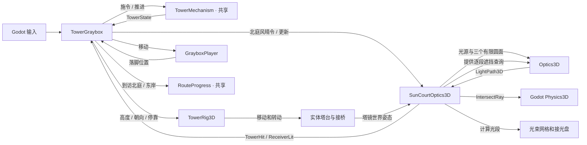

# 3D 关系图 · 第 05B 轮

`TowerGraybox` 负责输入、物理步进和 HUD。塔机和到访规则沿用冻结的 2D C# 源码。三维空间接线和光学求交各有自己的职责。

| 关系 | 代码与场景 |
| --- | --- |
| `TowerGraybox` 持有规则实例和场景适配 | [关卡协调](../Scripts/TowerGraybox.cs) · [共享编译项](../BorrowingSun3D.csproj) |
| `TowerRig3D` 投影塔台姿态并切换桥碰撞 | [实体桥适配](../Scripts/TowerRig3D.cs) · [场景](../Scenes/TowerGraybox.tscn) |
| `SunCourtOptics3D` 持有北庭天气和校准状态，读取世界姿态，接入物理遮挡和显示 | [3D 采光适配](../Scripts/SunCourtOptics3D.cs) |
| `Optics3D` 使用几何和遮挡查询，返回入射及反射段 | [3D 光学求解](../Scripts/Optics3D.cs) |
| `GrayboxRouteCheck` 向默认场景发按键并检查落脚、停靠和光路 | [验证入口](../Scripts/Verification/GrayboxRouteCheck.cs) |

[05A 历史关系图](ROUND_05A.md#规则与场景接线) · [05B 设计与验证](ROUND_05B.md)
