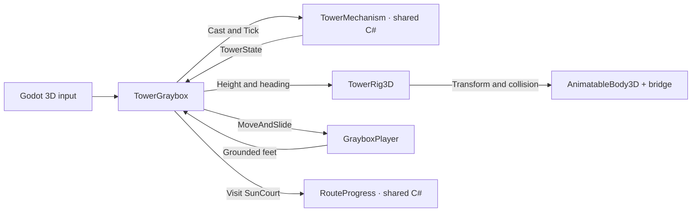

# 第 05A 轮 · 三维升降塔

**分支** `buriallsy/3d-graybox` · **起点** `2d-baseline` · `6175db9`

这一轮验证同一套升降和停靠规则能否在三维几何中走通。玩家从西侧低岸上塔，站在台面上借雨升高 6 m，借风转 90° 接北桥，再步行到采光庭。北庭记录为里程碑。本轮验收止于北庭，东岸、三维光路和货运属于后续阶段。 [完整玩法与移植顺序](../../BorrowingSun2D/Docs/2D-to-3D/PRODUCTION_PLAN.md)

## 空间与玩家判断

| 地点 | 3D 表达 | 玩家可验证的条件 |
| --- | --- | --- |
| 西侧低岸 | 塔轴西侧 `−X`，对应低位和入口朝向。 | 从默认入口走过低桥，站到塔台设备旁。 |
| 中央塔 | 塔台沿 `+Y` 升降，桥舌在水平面随塔换向。 | 雨决定高度，风决定朝向。站在塔面上随台升高，高位机械锁扣合后再转向。 |
| 北侧采光庭 | 塔轴北侧 `−Z`，对应高位和 90° 朝向。 | 等桥停稳并获得实体承托，再步行过桥到标记。 |
| 东向 | 共享规则仍保留 180° 停点。 | 朝东没有落脚岸。用逆风回北，再通过已接通的北桥。 |

角色胶囊半径为 0.33 m，步速为 4.2 m/s，接桥宽 1.72 m。西岸和北庭的桥口分别离塔轴 4.20 m，同一块桥板转向后与对应岸面接合。全程步行，无跳跃。固定正交镜头同时呈现两岸与塔台，玩家可以用岸面高度和桥口位置判断下一步。 [操作说明](../README.md)

## 规则与场景接线

| 2D 中的职责 | 05A 对应 |
| --- | --- |
| `TowerMechanism` / `TowerState` | 编译链接同一份 C#，沿用水量、台高、转角、锁扣、停靠和拒绝条件。 [共享机关源文件](../../BorrowingSun2D/Scripts/Core/TowerMechanism.cs) |
| `RouteProgress` | 编译链接同一份 C#。本轮通过真实站位提交北庭到访。 [共享里程碑源文件](../../BorrowingSun2D/Scripts/Core/RouteProgress.cs) |
| `TowerSlice` | `TowerGraybox` 按 3D 站位分发命令，调用共享规则并协调物理状态、里程碑与重开。 |
| `TowerRig2D` | `TowerRig3D` 将领域高度和停靠映射到实际升降体、桥舌旋转和碰撞。 |
| `SlicePlayer` | `GrayboxPlayer` 用 `CharacterBody3D` 移动并通过碰撞随台。 |
| 三岸实体路线验证 | `GrayboxRouteCheck` 用实际输入驱动默认入口到北庭，检查接岸、落脚和复位。 |

场景适配持有坐标、镜头、输入与碰撞。领域层给出状态和操作结果。角色用 Godot 的移动平台承托随塔移动。 [CharacterBody3D 文档](https://docs.godotengine.org/en/stable/classes/class_characterbody3d.html#class-characterbody3d-property-platform-floor-layers)

三维场景用 `TowerState.Height` 沿 `+Y` 移动升降体，用朝向的负弧度绕 `+Y` 旋转，使规则中的 `0°`、`90°` 分别对应西 `−X`、北 `−Z`。桥碰撞只在入口或北庭停靠时启用。记录本轮类变化时，共享源码与 3D 适配类分开列。最终 CCR 在完整 3D 和实际类对照齐备后再计算。 [编译链接配置](../BorrowingSun3D.csproj) · [CCR 口径](../../BorrowingSun2D/Docs/2D-to-3D/CHANGE_AND_CCR.md)



## 复跑

从仓库根目录执行。先用 Godot 正常打开场景，按 [操作表](../README.md#运行) 实走一遍，再用同一源码运行无头路线。环境变量 `BORROWINGSUN_GODOT_BIN` 指向 Godot 4.7.1 .NET 可执行文件。

```sh
cd -P BorrowingSun3D
log_dir=$(mktemp -d)
dotnet build BorrowingSun3D.csproj
"$BORROWINGSUN_GODOT_BIN" --headless --path "$(pwd -P)" --fixed-fps 60 \
  --quit-after 5000 --log-file "$log_dir/graybox-route.log" -- --verify
grep '^GRAYBOX_ROUTE PASSED' "$log_dir/graybox-route.log"
```

| 用例 | 应观察到的结果 |
| --- | --- |
| 西岸到塔台 | 从默认出生点步行过低桥，并在塔台设备旁落脚。低位和接桥门槛上的风令被拒绝。 |
| 升降与高位锁 | 台面和站稳的玩家一同升高 6 m，高位机械锁保持。 |
| 转向与真实缺口 | 高位仍朝西和转动未完成时，物理射线查不到通往北岸的桥面。 |
| 北岸到访 | 转到 90° 并停稳后，桥能承托玩家。玩家沿真实地面走到采光庭标记。 |
| 复位 | 从北庭按 `R` 回到西侧低岸，清除里程碑并重新实走到北庭。 |

如需同一脚本输出窗口原帧，去掉 `--headless`，并传入图像目录。

```sh
mkdir -p "$log_dir/frames"
"$BORROWINGSUN_GODOT_BIN" --path "$(pwd -P)" --resolution 1280x720 --audio-driver Dummy \
  --fixed-fps 60 --quit-after 5000 --log-file "$log_dir/graybox-window.log" \
  -- --verify --capture-dir="$log_dir/frames"
grep '^GRAYBOX_ROUTE PASSED' "$log_dir/graybox-window.log"
```

## 实测记录 · 2026-11-08

macOS 26.5.2 arm64，Godot 4.7.1 .NET，.NET SDK 8.0.424。验证从无 Godot 缓存的源码副本构建并导入，通过项目默认主场景跑无头和窗口两种模式。测试向实际 Input Map 送按键事件，用地面状态、物理塔变换和桥板射线验证结果。

| 检查 | 结果与证据 |
| --- | --- |
| 构建与导入 | 3D 工程构建 0 警告、0 错误，Godot 导入完成。原领域夹具通过 80 项。 [构建](Evidence/round-05a/graybox-build.log) · [导入](Evidence/round-05a/graybox-import.log) · [领域夹具](Evidence/round-05a/domain-checks.log) |
| 西岸 → 塔 → 北庭 | 无头与窗口各通过 41 项。低桥可承托，门槛拒绝施令，低位拒绝风令。蓄满 6 单位后，塔与角色升高 6 m。 [无头](Evidence/round-05a/graybox-headless.log) · [窗口](Evidence/round-05a/graybox-window.log) |
| 实体北桥 | 升降、锁高仍朝西和旋转中，桥板射线未命中；90° 停靠后命中实体桥板，玩家步行到北庭标记。 |
| 重开与失足 | 在北庭按 `R`，水量、塔高、朝向和里程碑归零。重新走低桥并再次到北庭。第二趟从北岸失足，回到当前高位塔台，北庭记录保留。 |
| 画面复核 | 首轮窗口只显示 HUD 与背景。场景的相机矩阵行列写反，导致镜头朝上。改用明确的位置和欧拉角后，用同一路线复拍，确认低桥、北桥、玩家和到访提示可见。 [首轮画面](Evidence/round-05a/camera-first-attempt.png) · [西岸原帧](Evidence/round-05a/west-entrance.png) · [北庭原帧](Evidence/round-05a/north-marker.png) |

当前证据覆盖 macOS 的自动输入和窗口画面。Windows 实机、首次玩家观察、3D 东岸与光路留待后续验收。
