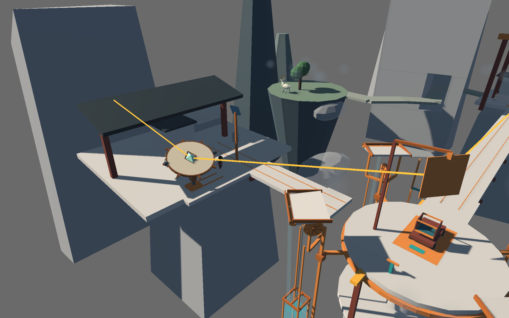

# Borrowing Sun · Skywell

**Unity playable whitebox · 借晴 / 天井跨谷**

Borrowing Sun is a 3D puzzle about operating public weather machinery in a mountain settlement. In Skywell, the player retrieves an oar and a Sunny token, climbs the central tower, and uses rain and wind to reach the collector. Repairing and aligning the mirrors brings sunlight to a shaded village. A cargo car then carries the player and a fruit crate across the valley to the delivery point. The deer and four cloud platforms form an optional route.

The Unity prototype supplied the level and mechanic concepts for the separately developed AP6412 Godot port. [Godot course project and report](https://github.com/buriallsy/coding_team/tree/buriallsy/3d-graybox)

## Unity market modules / Unity 独立经营模块

The new market is implemented independently in Unity. Godot remains a gameplay prototype. Open `Assets/BorrowingSun/Scenes/05_Skywell_MarketModules.unity` in Unity **6000.5.4f1** for the new phase cycle, environment-based fruit, two cooking orders, menu selection, income and kitchen upgrade. The original L5 and Flower Market scenes remain as baselines.

本轮新增独立 Unity 经营模块：白天探索、可选夜采、回店菜单、双订单同时备菜、收款与跨天升级。原始关卡与花庭白盒保留；代码没有引用 Godot。

[Open new scene / 新场景](unity_prototype/BorrowingSun/Assets/BorrowingSun/Scenes/05_Skywell_MarketModules.unity) · [Play instructions / 试玩步骤](docs/06_MarketModules/README.md) · [Class Map, boundaries and values / 架构与数值](docs/06_MarketModules/ARCHITECTURE.md) · [Validation status / 验证状态](docs/06_MarketModules/VALIDATION.md)

This source change does not include a newly verified standalone build. Read the module validation record separately from the historical whitebox and macOS release results below.

## Architecture · 工程结构

The architecture snapshot includes 29 editable Mermaid class and flow diagrams, a source index for 112 C# files, and a proposal for a small Flower Court shop after the existing cargo delivery. The proposal documents how gameplay, terrain, input, weather, and the one-way cargo route constrain the experiment.

本次整理包含 29 张类图与玩法流程图、112 个 C# 文件的索引，以及花庭签收后接入经营的方案。经营文档列出了现有天气、地形、交互与单向运输对原型的限制。

[Architecture index / 架构目录](docs/05_Architecture/README.md) · [Offline diagram atlas / 离线图册](docs/05_Architecture/DIAGRAMS.html) · [Market proposal / 经营接入](docs/05_Architecture/05_MARKET_INTEGRATION.md) · [Integration conflicts / 冲突清单](docs/05_Architecture/06_MARKET_CONFLICTS.md)

Download the atlas HTML and open it in a browser to view or export individual SVGs. 下载图册 HTML 后用浏览器打开，可逐张导出 SVG。

## Flower Court market whitebox · 花庭经营白盒

After the original cargo handover, the Flower Court market opens a short loop of gathering, cooking, collecting payments, and carrying cash and ingredients into the next day. Mushrooms grow at the west patch. Dewfruit can be picked in the east patch while the local rain is active.

在花庭完成原货运签收后，可开小铺、采菌菇和雨露果、烹饪两道菜、收款并结转次日。雨露果需要用花庭集雨盆施雨。

1. 已有仓库切到 `unity-skywell` 并拉取。首次下载可用 `git clone --branch unity-skywell https://github.com/buriallsy/coding_team.git`。用 Unity Hub 打开 `unity_prototype/BorrowingSun`，编辑器版本为 **6000.5.4f1**。
2. 在 Project 窗口打开 `Assets/BorrowingSun/Scenes/05_Skywell_FlowerMarket.unity`，按 **Play**。走完下方原 L5 路线，在花庭签收后，走到西北侧「花庭小铺」，短按 `E` 开店。 [打开白盒场景文件](unity_prototype/BorrowingSun/Assets/BorrowingSun/Scenes/05_Skywell_FlowerMarket.unity)
3. 用 `Q` 或 `Esc` 回庭院，靠近食材短按 `E` 采集。采雨露果前按住 `Tab` 选雨令，再长按 `E` 左键点击花庭集雨盆。
4. 回店按 `1` 或 `2` 下锅。完成后按 `E` 交餐收款，按 `N` 进入次日。按 `R` 从原入口重开。

Open the Flower Market scene in **Unity 6000.5.4f1** and press **Play**. Complete the delivery, then tap `E` at the shop on the northwest side of Flower Court. Tap `E` to gather, hold `Tab` to select the Rain token and hold `E` while left-clicking the basin to water the dewfruit patch. At the shop, `1` or `2` starts a recipe, `E` serves it, and `N` advances the day.

调菜价、食材消耗与烹饪时间，在 `FlowerMarketRun.TryGetRecipe` 修改。调采集距离和刷新时间，在场景层级搜索 `Flower_market_prototype`，打开 **Skywell Flower Market** 组件，调整 `Interaction Radius` 和 `Regrow Seconds`。本轮实测菌菇回店 **1.24 秒**，雨露果回店 **2.68 秒**。 [菜谱代码](unity_prototype/BorrowingSun/Assets/BorrowingSun/Runtime/Skywell/Market/FlowerMarketRun.cs) · [实测、试值与截图](docs/04_Iterations/Skywell_Flower_Market_Whitebox.md)

## Play on macOS

[Download the Skywell 0.1.0 playtest ZIP](https://github.com/buriallsy/coding_team/releases/download/unity-skywell-macos-v0.1.0/Borrowing_Sun_Skywell_macOS_0.1.0.zip) (123 MiB) · [Release notes](https://github.com/buriallsy/coding_team/releases/tag/unity-skywell-macos-v0.1.0)

1. Download the playtest ZIP and extract it in Finder.
2. Double-click `Skywell_Playtest.app`. The bundle includes Apple silicon and Intel binaries and declares macOS 12 or later. Unity Editor installation is unnecessary for the downloaded app.
3. This development build uses an ad-hoc signature and has no Apple notarization. If macOS blocks it because it cannot verify the developer, confirm the ZIP came from the release above. After trying to open the app, use **System Settings → Privacy & Security → Open Anyway** and confirm. [Apple’s first-launch instructions](https://support.apple.com/en-us/102445)

The extracted app passed strict signature verification and 48 headless startup checks on Apple silicon. Intel startup and a full standalone GUI playthrough remain unverified.

## Open the Unity source project

1. Clone the Unity branch. In Unity Hub, add `unity_prototype/BorrowingSun` and open it with **Unity 6000.5.4f1**. Allow Unity to import the assets and resolve the locked packages.
2. In the Project window, open [05_Skywell.unity](unity_prototype/BorrowingSun/Assets/BorrowingSun/Scenes/05_Skywell.unity), then press **Play**.
3. To build Skywell on macOS, install the macOS build module and choose **Borrowing Sun > Skywell > Portfolio > Build macOS playable**. The regular Build Settings currently start with Water Court (L1). The dedicated Skywell command explicitly builds L5 and writes the development app to `unity_prototype/portfolio/L5_Skywell/08_Playable/`.

The project uses URP 17.5.0, Input System 1.19.0, and Unity Test Framework 1.7.0. Package versions are pinned in [Packages](unity_prototype/BorrowingSun/Packages).

| Input | Action in Skywell |
| --- | --- |
| `WASD` | Walk or swim relative to the camera. |
| Tap `E` | Interact, board, pick up an item, paddle, or advance a conversation. Use `E` at the cargo car and at the delivery marker. |
| Hold `Tab` | Choose a weather token. |
| Hold `E` and click | Aim at a visible device. Left click casts rain or sun. For wind, left click turns clockwise and right click turns counterclockwise. The dock wind chime uses left for east and right for west. |
| `W/S` on the ladder | Climb or descend. Release to stop. |
| `Z` | Switch between fixed and over-the-shoulder cameras. |
| `Space` | Jump on the optional cloud route when available. |
| `R` | Reset the level. |

The main route goes from the dock and boat to the tower ladder, then to the north collector and the east village. Inspect the collector, observe the shaded village, and speak with the residents to obtain the lightstone. Repair the collector, use wind to align it, cast sun, and turn the tower east to complete the reflected path. Board the cargo car and confirm delivery after getting off at the destination.

## Project layout

| Location | Contents |
| --- | --- |
| [Assets/BorrowingSun/Scenes](unity_prototype/BorrowingSun/Assets/BorrowingSun/Scenes) | Water Court (L1), Rain Cargo Street (L3), Skywell (L5), and the earlier Borrowed Rain scene. |
| [Runtime](unity_prototype/BorrowingSun/Assets/BorrowingSun/Runtime) | Shared player, camera, and weather code alongside the level systems. |
| [Editor](unity_prototype/BorrowingSun/Assets/BorrowingSun/Editor) and [Tests](unity_prototype/BorrowingSun/Assets/BorrowingSun/Tests) | Editor tools, scene and prefab reference checks, and EditMode tests. |
| [Validation](docs/VALIDATION.md) | Import and test results for this source snapshot, plus dated L5 play and build evidence. |

This branch contains the Unity source project, its serialized assets and `.meta` files, the locked packages and project settings, and selected verification material. Unity recreates its local cache on first import.

## Credits

The project author led world design, level layout, mechanic design, and playtest decisions. Codex assisted with prototype implementation, scene assembly, and verification. The Unity project includes [Kenney character assets](unity_prototype/BorrowingSun/Assets/BorrowingSun/Art/Characters/KenneyProtagonist/License.txt) and [villager assets](unity_prototype/BorrowingSun/Assets/BorrowingSun/Art/Characters/SkywellVillagers/LICENSE-Kenney.txt) under CC0, the [Mesh2Motion ladder animation](unity_prototype/BorrowingSun/Assets/BorrowingSun/Art/Characters/Mesh2MotionLadder/Source.txt) by Scott Petrovic under CC0, and [Noto Sans CJK SC](unity_prototype/BorrowingSun/Assets/BorrowingSun/Resources/Fonts/LICENSE.txt) under the SIL Open Font License 1.1.
