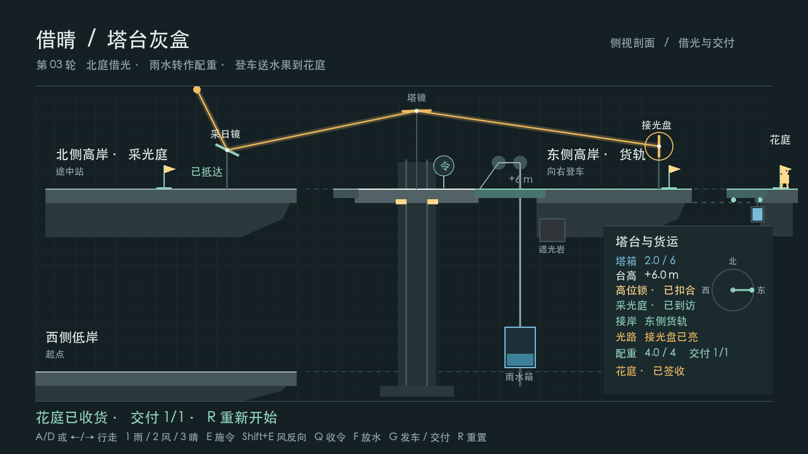

# Borrowing Sun (借晴)

**AP6412 · Route B · Milestone 03 · One Crate Across the Valley**

Borrowing Sun is a weather puzzle set around a mountain tower. Rain lifts the tower and wind connects its bridges. Aim the Sun Court mirror, borrow sunlight, and turn the tower east to light the receiver. Sustained light earns one fruit crate. The same rainwater fills the cargo counterweight so you can ride across the valley and deliver the crate.

## Run and play

1. Clone or download this repository. Install **Godot 4.7.1 .NET** and the **.NET 8 SDK**.
2. In the Godot Project Manager, import `BorrowingSun2D/project.godot`. Open the project and press **F5** to run the main scene. [Project file](BorrowingSun2D/project.godot)
3. Press `D` or `→` to cross the low bridge and approach the device on the tower. Press `1` to select rain, then `E` to apply it. Wait for the lift to reach the upper level and lock.
4. Press `2` then `E` to turn north and walk left to the Sun Court mirror. Press `2` then `E` beside the mirror to aim it, then `3` and `E` to open local sunlight. The tower mirror is now hit while the east receiver remains dark.
5. Walk back to the tower device and press `2` then `E` to turn east. Cross the east bridge and walk onto the cargo car. Wait for the crate and the `4/4` counterweight, then press `G` to depart while the receiver is lit.
6. When the car stops, walk right to the delivery flag and press `G` to record `1/1`. Press `R` to restart from the west low bridge. [Full controls and scene entry](BorrowingSun2D/README.md)

## Verification

The clean macOS arm64 build passed without warnings or errors. The cargo route passed 129 checks, including both departure blocks, a dark crossing after departure, and a full delivery replay after `R`. Across 3,460 physics ticks, the tank and counterweight total stayed at six units and the physical lift held its height. The earlier three-shore and optics checks also passed. [Milestone 03 design, logs and reproduction steps](BorrowingSun2D/Docs/2D-to-3D/ROUND_03.md)

## Design and development

`TowerMechanism` owns the lift, docking and shared rainwater. `SunCourtOptics2D` uses the pure C# `Optics2D` solver to determine live receiver light. `CargoJourney` uses that light to earn the crate and fill the counterweight. Once the car departs, `CargoTrack2D` moves its physical deck according to journey progress until arrival.

| Project documents | What to look for |
| --- | --- |
| [Game concept / 项目构思](BorrowingSun2D/Docs/2D-to-3D/DESIGN.md) | The full gameplay loop and what carries from 2D to 3D |
| [Production plan / 制作计划](BorrowingSun2D/Docs/2D-to-3D/PRODUCTION_PLAN.md) | Milestones, acceptance checks and evidence for the report |
| [Project conventions / 项目规范](BorrowingSun2D/Docs/2D-to-3D/PROJECT_CONVENTIONS.md) | Code responsibilities, scene editing, testing and Git workflow |
| [Current status / 当前版本](BorrowingSun2D/Docs/2D-to-3D/CURRENT_STATUS.md) | What is playable now, the reset regression, and the next milestone |
| [Milestone 01 / 三岸接驳](BorrowingSun2D/Docs/2D-to-3D/ROUND_01.md) | Docking design decisions, the three-shore route, and reset checks |
| [Milestone 02 / 借光](BorrowingSun2D/Docs/2D-to-3D/ROUND_02.md) | Two reflections, the north and east outcomes, and replayable tests |
| [Milestone 03 / 一箱水果](BorrowingSun2D/Docs/2D-to-3D/ROUND_03.md) | Shared rainwater, departure rules, physical ride, and delivery |
| [SOLID refactor / 框架整理](BorrowingSun2D/Docs/2D-to-3D/ARCHITECTURE_REFACTOR.md) | Why the rules and Godot adapter were separated, with regression evidence |
| [Relationship Map / 对象关系图](BorrowingSun2D/Docs/2D-to-3D/RELATIONSHIP_MAP.svg) | Implemented class relationships and the physics frame order |
| [Iteration record / 制作记录](BorrowingSun2D/Docs/ITERATIONS.md) | The early reset failure, its retest, and the three-shore extension |
