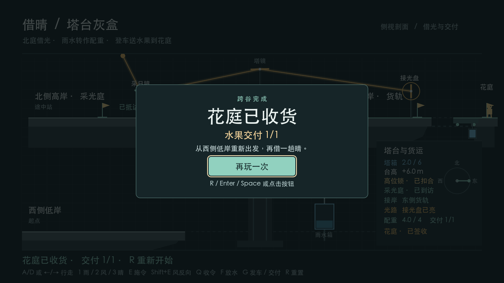

# Borrowing Sun (借晴)

**AP6412 · Route B · 2D baseline and 3D graybox 05D candidate**

Borrowing Sun is a weather puzzle set around a mountain tower. Rain lifts the tower and wind connects its bridges. Aim the Sun Court mirror, borrow sunlight, and turn the tower east to light the receiver. Sustained light earns one fruit crate. The same rainwater fills the cargo counterweight so you can ride across the valley and deliver the crate.

## 3D graybox

Round 05D brings the frozen 2D introduction and delivery screen to the complete 3D route. Start with `Enter`, `Space`, or the Start button. Borrow rain to raise the tower, use wind to connect the north and east bridges, and reflect sunlight to the east receiver. Board the loaded car and press `G` to cross the valley. At Flower Court, press `G` at the marker to confirm `1/1`, then press `R` to replay from the low bridge. [3D project](BorrowingSun3D/project.godot) · [Controls](BorrowingSun3D/README.md) · [Windows handoff](BorrowingSun3D/Docs/WINDOWS_ACCEPTANCE.md)

The 3D project compiles shared rules from its sibling `BorrowingSun2D` directory. Keep both directories in the same checkout. [Start here](START_HERE.md) · [Round 06 submission preparation](BorrowingSun3D/Docs/ROUND_06_PREP.md)

## Run and play 2D

1. Clone or download this repository. Install **Godot 4.7.1 .NET** and the **.NET 8 SDK**.
2. In the Godot Project Manager, import `BorrowingSun2D/project.godot`. Press **F5**, then press **Enter** or click Start on the opening card. [Project file](BorrowingSun2D/project.godot)
3. Press `D` or `→` to cross the low bridge and approach the device on the tower. Press `1` to select rain, then `E` to apply it. Wait for the lift to reach the upper level and lock.
4. Press `2` then `E` to turn north and walk left to the Sun Court mirror. Press `2` then `E` beside the mirror to aim it, then `3` and `E` to open local sunlight. The tower mirror is now hit while the east receiver remains dark.
5. Walk back to the tower device and press `2` then `E` to turn east. Cross the east bridge and walk onto the cargo car. Wait for the crate and the `4/4` counterweight, then press `G` to depart while the receiver is lit.
6. When the car stops, walk right to the delivery flag and press `G` to record `1/1`. The delivery card confirms `1/1`. Press `R` to replay from the west low bridge. [Full controls and scene entry](BorrowingSun2D/README.md)

## Verification

| Reference | macOS arm64 automated route | Windows Server 2025 x64 automated route |
| --- | --- | --- |
| Frozen 2D `2d-baseline` (`6175db9`) | 154 headless checks and 46 windowed checks. [Round 04 acceptance](BorrowingSun2D/Docs/2D-to-3D/ROUND_04.md) | 154 headless checks and 90 windowed checks. |
| 3D 05D code candidate (`fb4cbb4`) | 160 headless checks and 160 windowed checks. [05D comparison and evidence](BorrowingSun3D/Docs/ROUND_05D.md) | 160 headless checks and 160 windowed checks. |

Both versions reached delivery `1/1` twice in the hosted Windows windowed preflight, with an `R` reset and a walk across the low bridge between deliveries. Manual playthroughs on a Windows PC remain pending before `3d-final`. [Windows acceptance, logs and screenshots](BorrowingSun3D/Docs/WINDOWS_ACCEPTANCE.md)



From the repository root, run the standalone rule checks and the CCR tool tests.

```sh
dotnet run --project Tests/DomainChecks --configuration Release
python3 -m unittest discover -s Tests -p test_ccr.py
python3 Tools/ccr.py --analysis BorrowingSun3D/Docs/ccr-analysis.json
```

The candidate CCR is **2/5 (40%)**. Three original classes compile directly from shared source. Two optical classes change to support finite 3D surfaces and world-space transforms. [Change map and CCR](BorrowingSun3D/Docs/CHANGE_MAP.md) · [Domain integration logs](BorrowingSun2D/Docs/Evidence/2026-11-08-round03-integration/RESULTS.md)

## Design and development

`TowerMechanism` owns the lift, docking and shared rainwater. `SunCourtOptics2D` uses the pure C# `Optics2D` solver to determine live receiver light. `CargoJourney` uses that light to earn the crate and fill the counterweight. Once the car departs, `CargoTrack2D` moves its physical deck according to journey progress until arrival.

| Project documents | What to look for |
| --- | --- |
| [Game concept / 项目构思](BorrowingSun2D/Docs/2D-to-3D/DESIGN.md) | The full gameplay loop and what carries from 2D to 3D |
| [Scope and architecture / 范围与架构](BorrowingSun2D/Docs/2D-to-3D/FRAMEWORK.md) | Current rules, class maps and the CCR workflow |
| [Production plan / 制作计划](BorrowingSun2D/Docs/2D-to-3D/PRODUCTION_PLAN.md) | Milestones, acceptance checks and evidence for the report |
| [Project conventions / 项目规范](BorrowingSun2D/Docs/2D-to-3D/PROJECT_CONVENTIONS.md) | Code responsibilities, scene editing, testing and Git workflow |
| [Round 04 status / 2D 历史记录](BorrowingSun2D/Docs/2D-to-3D/CURRENT_STATUS.md) | The Round 04 2D route and its status before the freeze |
| [Milestone 01 / 三岸接驳](BorrowingSun2D/Docs/2D-to-3D/ROUND_01.md) | Docking design decisions, the three-shore route, and reset checks |
| [Milestone 02 / 借光](BorrowingSun2D/Docs/2D-to-3D/ROUND_02.md) | Two reflections, the north and east outcomes, and replayable tests |
| [Milestone 03 / 一箱水果](BorrowingSun2D/Docs/2D-to-3D/ROUND_03.md) | Shared rainwater, departure rules, physical ride, and delivery |
| [Milestone 04 / 首玩与验收](BorrowingSun2D/Docs/2D-to-3D/ROUND_04.md) | Opening, delivery and replay checks for the frozen 2D baseline |
| [Milestone 05D / 3D 对照](BorrowingSun3D/Docs/ROUND_05D.md) | Shared acceptance cases and the tested 3D code candidate |
| [SOLID refactor / 框架整理](BorrowingSun2D/Docs/2D-to-3D/ARCHITECTURE_REFACTOR.md) | Why the rules and Godot adapter were separated, with regression evidence |
| [2D class map](BorrowingSun2D/Docs/2D-to-3D/RELATIONSHIP_MAP.svg) · [3D class map](BorrowingSun3D/Docs/RELATIONSHIP_MAP.md) | Implemented class relationships and their roles in each physics frame |
| [Iteration record / 制作记录](BorrowingSun2D/Docs/ITERATIONS.md) | The early reset failure, its retest, and the three-shore extension |
