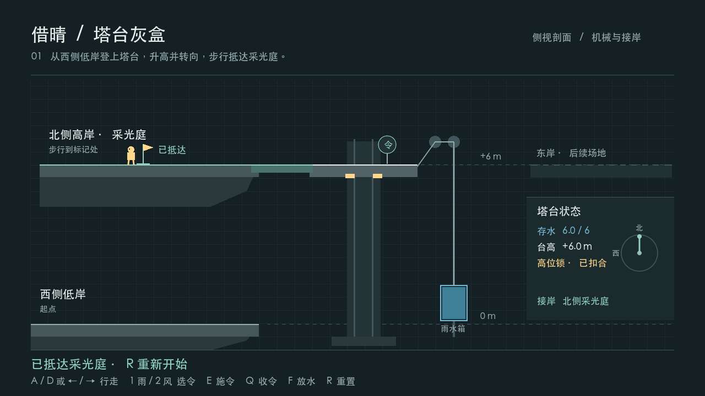

# Borrowing Sun (借晴)

**AP6412 · Route B · Milestone 00 · Playable 2D MVP**

**明确了具体边界和数值（2026-11-07）：** [本轮完整数值决策表](BorrowingSun2D/Docs/2D-to-3D/NUMERIC_DECISIONS.md) 汇总范围、玩法参数、180 秒流程预算、输入与复位、CCR 口径及验证结果；明确区分已实现规则、待接场景和未来 3D 初值。

**Architecture branch update (2026-11-07):** the playable scene remains the tower MVP. The complete 2D scope, decisions, class maps, change/CCR policy and executable domain/optics framework are in [Scope & Architecture / 范围与架构](BorrowingSun2D/Docs/2D-to-3D/FRAMEWORK.md). New rules have not yet been wired into the full Godot level; no `2d-baseline` or `3d-final` tag is claimed.

Borrowing Sun is a puzzle game about using weather to change how a mountain tower connects its shores. This milestone covers the tower and bridge. Walk onto the low platform, use rain to lift it, then use wind to connect the upper bridge. Reaching the flag in the Sun Court completes the current build.

## Run and play

1. Clone or download this repository. Install **Godot 4.7.1 .NET** and the **.NET 8 SDK**.
2. In the Godot Project Manager, import `BorrowingSun2D/project.godot`. Open the project and press **F5** to run the main scene. [Project file](BorrowingSun2D/project.godot)
3. Press `D` or `→` to cross the low bridge and approach the device on the tower. Press `1` to select rain, then `E` to apply it. Wait for the lift to reach the upper level and lock.
4. Press `2` to select wind, then `E` to apply it. Once the upper bridge connects, press `A` or `←` to walk left to the flag. The Chinese HUD shows `已抵达采光庭` when you reach the Sun Court. Press `R` to restart. [Full controls and scene entry](BorrowingSun2D/README.md)

## Verification

The macOS arm64 build passed 26 assertions from a fresh project copy. A separate keyboard-driven run passed 28 assertions, including a real crossing after restarting. The graphical run added one assertion for capturing the frame below. [Reproduction steps and logs](BorrowingSun2D/Docs/TESTING.md)

## Design and development

The tower's water, lift, lock and docking rules live in the pure C# `TowerMechanism`. Godot handles character movement, collision and the scene presentation. The full 2D game will add the two-mirror light puzzle and a cargo delivery powered by the water collected for the lift. Once the complete 2D game is frozen as `2d-baseline`, Route B moves to the matching 3D version. The earlier Unity L5 prototype is the design reference.

| Project documents | What to look for |
| --- | --- |
| [Game concept / 项目构思](BorrowingSun2D/Docs/2D-to-3D/DESIGN.md) | The full gameplay loop and what carries from 2D to 3D |
| [Production plan / 制作计划](BorrowingSun2D/Docs/2D-to-3D/PRODUCTION_PLAN.md) | Milestones, acceptance checks and evidence for the report |
| [Project conventions / 项目规范](BorrowingSun2D/Docs/2D-to-3D/PROJECT_CONVENTIONS.md) | Code responsibilities, scene editing, testing and Git workflow |
| [Current status / 当前版本](BorrowingSun2D/Docs/2D-to-3D/CURRENT_STATUS.md) | What is playable now, the reset fix, and the next milestone |
| [Iteration record / 制作记录](BorrowingSun2D/Docs/ITERATIONS.md) | Design decisions, a failed reset test, and the successful retest |
