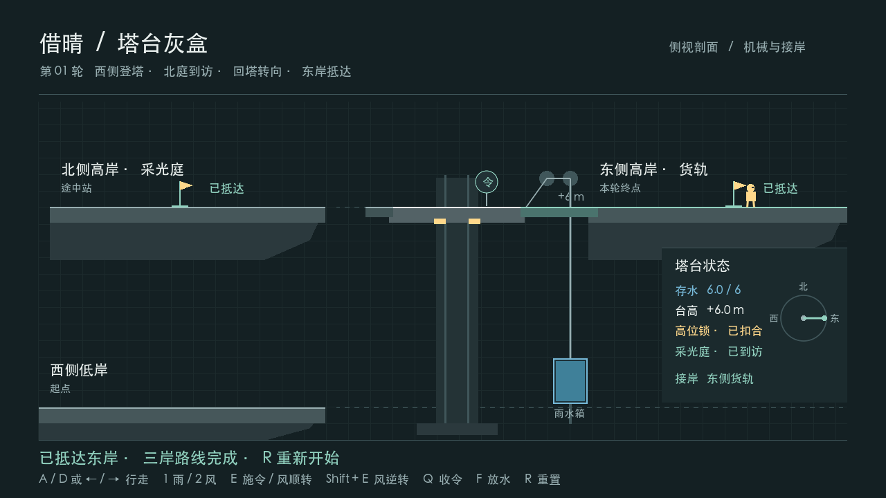

# Borrowing Sun (借晴)

**AP6412 · Route B · Milestone 01 · Three-shore 2D Prototype**

Borrowing Sun is a puzzle game about using weather to change how a mountain tower connects its shores. Walk onto the tower from the low west bank and use rain to lift it. Use wind to connect the north bridge, walk to the Sun Court flag, then return to the same tower and turn it toward the east shore. The east flag completes this milestone once the Sun Court has been reached.

## Run and play

1. Clone or download this repository. Install **Godot 4.7.1 .NET** and the **.NET 8 SDK**.
2. In the Godot Project Manager, import `BorrowingSun2D/project.godot`. Open the project and press **F5** to run the main scene. [Project file](BorrowingSun2D/project.godot)
3. Press `D` or `→` to cross the low bridge and approach the device on the tower. Press `1` to select rain, then `E` to apply it. Wait for the lift to reach the upper level and lock.
4. Press `2` to select wind, then `E` to turn one stop to the north. Once the bridge connects, walk left with `A` or `←` to the Sun Court flag.
5. Walk right back to the tower device, press `E` again with wind selected, and wait for the east bridge to connect. Walk right to the east flag. Use `Shift+E` to turn one stop in reverse, or `R` to restart. [Full controls and scene entry](BorrowingSun2D/README.md)

## Verification

On macOS arm64, the fresh project built with zero warnings and zero errors. The built-in route passed 107 checks. The independent keyboard run passed 71 checks, including two complete trips, walking across the low bridge again after `R`, and returning the tower from the east dock to the north dock. The windowed run passed the same checks plus two screenshot captures. [Reproduction steps and logs](BorrowingSun2D/Docs/2D-to-3D/ROUND_01.md)

## Design and development

The tower's water, lift, lock and docking rules live in the pure C# `TowerMechanism`. Godot handles character movement, collision and the scene presentation. The full 2D game will add the two-mirror light puzzle and a cargo delivery powered by the water collected for the lift. Once the complete 2D game is frozen as `2d-baseline`, Route B moves to the matching 3D version. The earlier Unity L5 prototype is the design reference.

| Project documents | What to look for |
| --- | --- |
| [Game concept / 项目构思](BorrowingSun2D/Docs/2D-to-3D/DESIGN.md) | The full gameplay loop and what carries from 2D to 3D |
| [Production plan / 制作计划](BorrowingSun2D/Docs/2D-to-3D/PRODUCTION_PLAN.md) | Milestones, acceptance checks and evidence for the report |
| [Project conventions / 项目规范](BorrowingSun2D/Docs/2D-to-3D/PROJECT_CONVENTIONS.md) | Code responsibilities, scene editing, testing and Git workflow |
| [Current status / 当前版本](BorrowingSun2D/Docs/2D-to-3D/CURRENT_STATUS.md) | What is playable now, the reset regression, and the next milestone |
| [Milestone 01 / 三岸接驳](BorrowingSun2D/Docs/2D-to-3D/ROUND_01.md) | Docking design decisions, the three-shore route, and reset checks |
| [Iteration record / 制作记录](BorrowingSun2D/Docs/ITERATIONS.md) | The early reset failure, its retest, and the three-shore extension |
