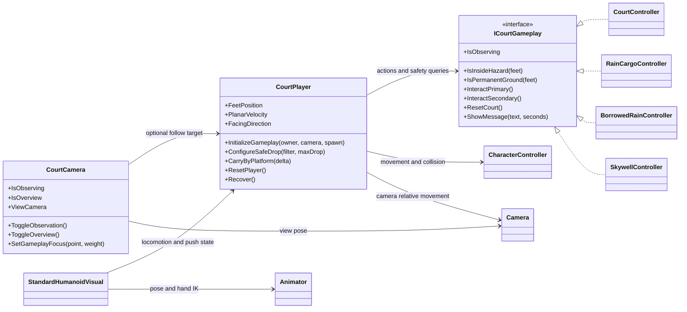
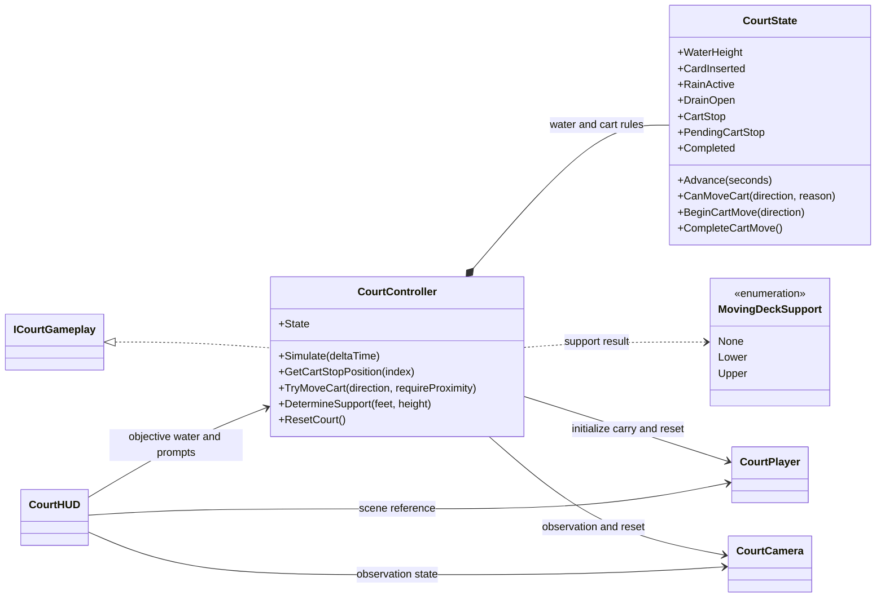
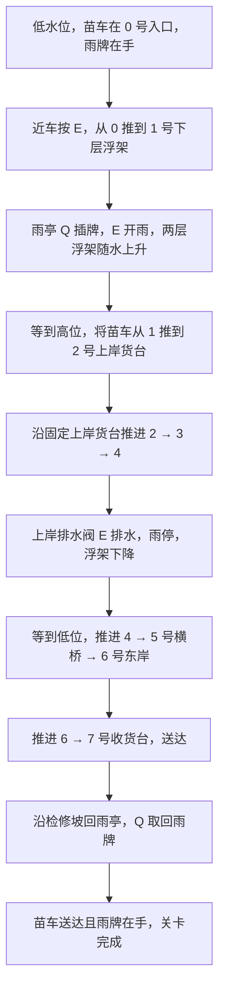
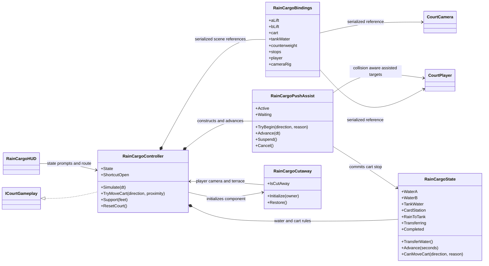
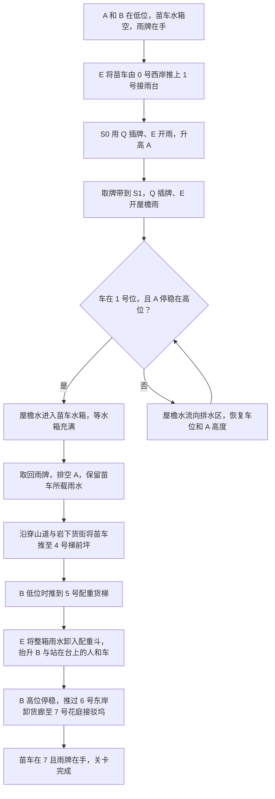
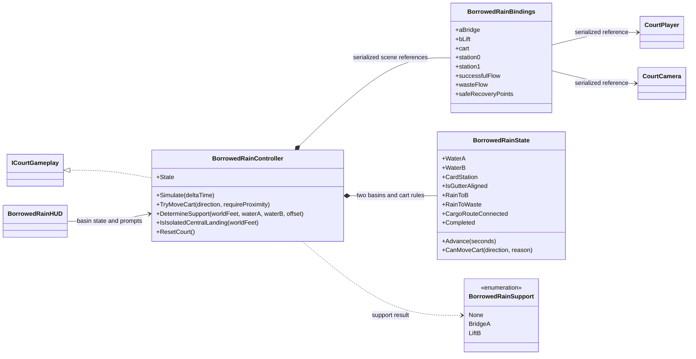
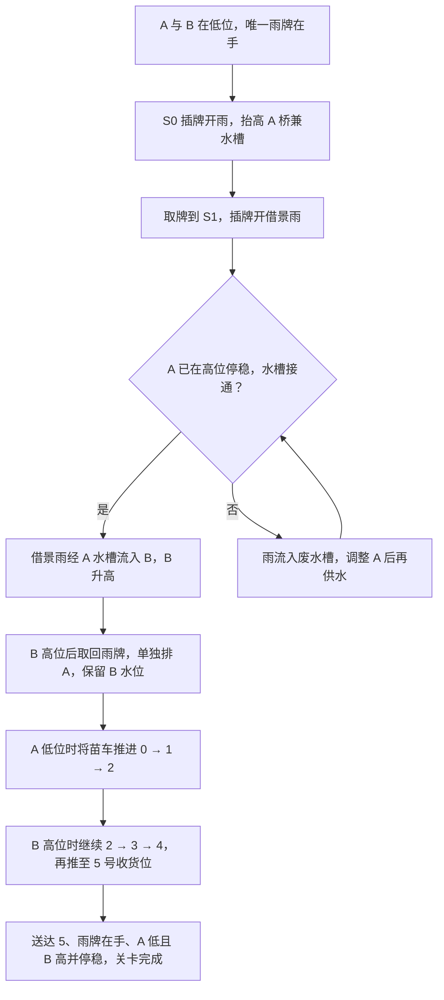

# 共享运行时、L1、L3 与借雨双院

三份已保存场景共用移动、相机和交互接口，各自拥有水量、苗车及胜利判定。L1 是 `01_WaterCourt.unity`，当前 L3 是 `03_RainCargoStreet.unity`，早期借雨双院在 `03_BorrowedRain.unity` 独立保留。全局 Build Settings 只启用 L1。这三组运行时代码的完成逻辑以目标提示收束关卡，场景之间没有自动加载调用。[Build Settings](../../unity_prototype/BorrowingSun/ProjectSettings/EditorBuildSettings.asset) · [场景目录](../../unity_prototype/BorrowingSun/Assets/BorrowingSun/Scenes)

## Shared · 输入、物理和表现

1. `CourtPlayer.Update()` 读取 Input System。WASD 和方向键按镜头平面移动，`CharacterController.Move()` 执行移动与碰撞。E、Q、R 分别调用当前玩法控制器的 `InteractPrimary()`、`InteractSecondary()`、`ResetCourt()`。L1 场景序列化 `court`，启动时 `Initialize()` 统一写入玩法 owner。当前 L3 和 Legacy 在场景直接绑定 `gameplayOwner`。[接口](../../unity_prototype/BorrowingSun/Assets/BorrowingSun/Runtime/Shared/ICourtGameplay.cs#L6) · [玩法绑定与输入](../../unity_prototype/BorrowingSun/Assets/BorrowingSun/Runtime/Shared/CourtPlayer.cs#L156)
2. `CourtPlayer` 通过 `IsInsideHazard()` 和 `IsPermanentGround()` 更新最近的安全脚位。落入危险区域时只恢复人物，按 R 才重置关卡。控制器负责判断旧帧承托并把移动台面位移传给 `CarryByPlatform()`。L3 开启边缘保护和短下台检测，运货协助也走同一个 `CharacterController`。[安全位置更新](../../unity_prototype/BorrowingSun/Assets/BorrowingSun/Runtime/Shared/CourtPlayer.cs#L241) · [恢复与复位](../../unity_prototype/BorrowingSun/Assets/BorrowingSun/Runtime/Shared/CourtPlayer.cs#L554)
3. `CourtCamera` 读玩家位置并设置 Unity `Camera`。L1 和 Legacy 使用固定视角，L3 启用跟随，可按 V 总览。三份场景均走早期观察控制，C 切换观察，Esc 退出。L3 的 `StandardHumanoidVisual` 读取实际移动和推车状态，驱动 `Animator` 与手部 IK。[相机输入与跟随](../../unity_prototype/BorrowingSun/Assets/BorrowingSun/Runtime/Shared/CourtCamera.cs#L247) · [人物表现](../../unity_prototype/BorrowingSun/Assets/BorrowingSun/Runtime/Shared/StandardHumanoidVisual.cs#L120)

## L1 · 水院 `01_WaterCourt`

已保存场景的 `08_Court_runtime` 挂 `CourtController` 和 `CourtHUD`。控制器引用南北下层浮架 `02_Float_lower_NS_3x6`、东西上层浮架 `03_Float_upper_EW_8x3`、`06_Sapling_cart`、`Water_level`、雨亭交互点 `04_Rain_pavilion_interaction`、`05_Drain_valve` 和 `Contained_rain` 粒子。`07_Apprentice` 和 `Camera_Main` 分别提供人物与相机组件。[控制器绑定](../../unity_prototype/BorrowingSun/Assets/BorrowingSun/Scenes/01_WaterCourt.unity#L11145) · [人物绑定](../../unity_prototype/BorrowingSun/Assets/BorrowingSun/Scenes/01_WaterCourt.unity#L38648) · [相机绑定](../../unity_prototype/BorrowingSun/Assets/BorrowingSun/Scenes/01_WaterCourt.unity#L23029)

- `CourtState` 管水位 `0–3 m`、雨牌、雨与排水互锁及一站一站的车程。开始推车先记录 `PendingCartStop`，动画停稳后才提交 `CartStop`。水在变化或苗车在途时，关卡拒绝会打断接缝的操作。Q 在车旁倒推一站。[状态与过缝条件](../../unity_prototype/BorrowingSun/Assets/BorrowingSun/Runtime/WaterCourt/CourtState.cs#L8)
- `CourtController.Simulate()` 依据状态同步两层浮架、水面、承托人物、苗车和雨 VFX。`GetCartStopPosition()` 定义八个站点，其中 1 随下层浮架，5 随上层浮架。HUD 从控制器读取目标和提示，完成条件为送达 7 且已收回雨牌。[帧更新](../../unity_prototype/BorrowingSun/Assets/BorrowingSun/Runtime/WaterCourt/CourtController.cs#L73) · [站点与交互](../../unity_prototype/BorrowingSun/Assets/BorrowingSun/Runtime/WaterCourt/CourtController.cs#L128) · [HUD](../../unity_prototype/BorrowingSun/Assets/BorrowingSun/Runtime/WaterCourt/CourtHUD.cs#L51)

## 当前 L3 · 穿山运雨街 `03_RainCargoStreet`

`09_RainCargo_runtime` 挂 `RainCargoController` 与 `RainCargoHUD`。序列化 `RainCargoBindings` 引用 `02_A_receiver_lift`、`03_B_counterweight_lift`、`06_Water_and_sapling_cart`、升台雨亭 `S0_raise_lift`、屋檐集雨亭 `S1_collect_at_eaves`、两处排水控制、`Freight_stop_0` 至 `Freight_stop_7` 及路线提示。上方检修捷径接到 `Upper_shortcut_latch` 与 `Shortcut_gate_opens_from_above`。`08_Apprentice` 的 `gameplayOwner` 指向该控制器，`Camera_Main` 启用跟随，人物的动画组件绑定同一个 `CourtPlayer`。[场景控制器绑定](../../unity_prototype/BorrowingSun/Assets/BorrowingSun/Scenes/03_RainCargoStreet.unity#L41174) · [人物](../../unity_prototype/BorrowingSun/Assets/BorrowingSun/Scenes/03_RainCargoStreet.unity#L41973) · [相机](../../unity_prototype/BorrowingSun/Assets/BorrowingSun/Scenes/03_RainCargoStreet.unity#L27702) · [动画组件](../../unity_prototype/BorrowingSun/Assets/BorrowingSun/Scenes/03_RainCargoStreet.unity#L1634)

- `RainCargoState` 分别保存 A 水位、苗车存水和 B 配重水量。A 与 B 的高位均为 `3 m`，常规水速 `0.65`，卸水速率 `0.8`。`TransferWater()` 只接受车停 5、水箱已满、B 低且系统停稳的状态，关 B 排水后由一个 `transferVolume` 计算两端水量。E 在低位 5 号站执行卸水，其余可推进场合推进一站。Q 在车边倒推，在雨亭插拔唯一雨牌。[水路、车程与门槛](../../unity_prototype/BorrowingSun/Assets/BorrowingSun/Runtime/RainCargo/RainCargoState.cs#L30) · [按键分派](../../unity_prototype/BorrowingSun/Assets/BorrowingSun/Runtime/RainCargo/RainCargoController.cs#L217)
- 控制器启动后构建 `RainCargoPushAssist`。助手依次自动绕位、转车、贴手和推行，检测承托与车体阻挡，暂停后可继续，抵达才提交下一站。`RainCargoCutaway` 在跟随视角用相机射线决定是否隐藏固定东岸平台的选定 Renderer，平台 Collider 仍承托。上层检修捷径由 E 打开，Space 在已有安全下台落点时用于受控下降。[启动与帧更新](../../unity_prototype/BorrowingSun/Assets/BorrowingSun/Runtime/RainCargo/RainCargoController.cs#L52) · [推车状态机](../../unity_prototype/BorrowingSun/Assets/BorrowingSun/Runtime/RainCargo/RainCargoPushAssist.cs#L30) · [剖切显示](../../unity_prototype/BorrowingSun/Assets/BorrowingSun/Runtime/RainCargo/RainCargoCutaway.cs#L51)

## 早期独立原型 · 借雨双院 `03_BorrowedRain`

`09_BorrowedRain_runtime` 挂 `BorrowedRainController` 和 `BorrowedRainHUD`。`BorrowedRainBindings` 引用兼作水槽的桥 `02_A_bridge_also_aqueduct`、`03_B_cargo_lift`、苗车、两座雨亭与两只排水阀，以及入 B 和溢废两套水流表现、`Safe_west` 和 `Safe_east`。`08_Apprentice` 的 `gameplayOwner` 绑定这一控制器，`Camera_Main` 关闭跟随。[控制器绑定](../../unity_prototype/BorrowingSun/Assets/BorrowingSun/Scenes/03_BorrowedRain.unity#L37089) · [人物](../../unity_prototype/BorrowingSun/Assets/BorrowingSun/Scenes/03_BorrowedRain.unity#L11032) · [相机](../../unity_prototype/BorrowingSun/Assets/BorrowingSun/Scenes/03_BorrowedRain.unity#L33424)

`BorrowedRainState` 的水路由 A 水槽机械对齐直接把 S1 雨导入 B，苗车负责运苗。控制器根据两池水位同步 A 桥、B 台、玩家承托和水流表现。车停稳时，角色站在停于中间水位的 A 或 B，或两头断开的中接台，可按 E 回到固定检修台，保留苗车、雨牌与水位。靠近车时 E/Q 仍是推进或倒推一站，R 复位整关。[源头、排水与完成规则](../../unity_prototype/BorrowingSun/Assets/BorrowingSun/Runtime/Legacy_BorrowedRain/BorrowedRainState.cs#L25) · [承托、站点及交互](../../unity_prototype/BorrowingSun/Assets/BorrowingSun/Runtime/Legacy_BorrowedRain/BorrowedRainController.cs#L73) · [安全返回条件](../../unity_prototype/BorrowingSun/Assets/BorrowingSun/Runtime/Legacy_BorrowedRain/BorrowedRainController.cs#L281)

## 验证入口

三套状态类各有 Editor 测试。独立场景验证脚本在相应 `Editor` 目录，其中 L1 Play 检查会在站点之间摆位，测试范围以各报告为准。本文依据当前 C# 和场景 YAML，图中箭头表示实际引用、数据归属或调用关系。[L1 状态测试](../../unity_prototype/BorrowingSun/Assets/BorrowingSun/Tests/Editor/CourtStateTests.cs) · [L3 状态测试](../../unity_prototype/BorrowingSun/Assets/BorrowingSun/Tests/Editor/RainCargoStateTests.cs) · [Legacy 状态测试](../../unity_prototype/BorrowingSun/Assets/BorrowingSun/Tests/Editor/BorrowedRainStateTests.cs) · [L1 Play 检查](../../unity_prototype/BorrowingSun/Assets/BorrowingSun/Editor/WaterCourt/CourtPlayModeChecks.cs#L33) · [L3 Play 检查](../../unity_prototype/BorrowingSun/Assets/BorrowingSun/Editor/RainCargo/RainCargoPlayChecks.cs) · [Legacy Play 检查](../../unity_prototype/BorrowingSun/Assets/BorrowingSun/Editor/Legacy_BorrowedRain/BorrowedRainPlayModeChecks.cs)
