# L5 天井跨谷 · Unity 运行架构

L5 从水面取回晴牌开始。雨水先举升塔台，风使实体桥对接不同岸口，修好的采日镜和塔镜把太阳送进山阴村。同一批雨水随后转入运输配重，玩家登车跨谷，到花庭前站下车签收。鹿与云台是独立支线，主线交付条件不读取它的进度。本文以当前保存场景和 `BorrowingSun.Runtime` 源码为准，数值采用场景序列化值。 [保存场景][scene] · [控制器][controller]

## 从场景定位组件

保存场景只有一个顶层对象 `L5_Skywell`。根对象挂载协调、输入界面和主要过程组件。角色、镜头、机械、天气区与光学设备都在其下。`Player_Standard_Humanoid` 的 `CourtPlayer.gameplayOwner` 指向 `SkywellController`，共享角色通过 `ICourtGameplay` 回调本关。`Kenney_Original_Cyborg` 的 `StandardHumanoidVisual` 接收共享玩家移动与本关特殊姿态，`Camera_Main` 的 `CourtCamera` 管固定视角、肩视角及临时镜头。 [场景根与组件][scene-root] · [玩家绑定][scene-player] · [人形绑定][scene-humanoid] · [摄像机绑定][scene-camera] · [共享接口][gameplay] · [共享玩家][player] · [人形呈现][humanoid] · [共享镜头][camera]

| 保存场景位置 | 已保存的接线与职责 |
| --- | --- |
| `L5_Skywell` | `SkywellHUD`、`SkywellController`、`SkywellJourney`、`SkywellFish`、`SkywellVoyage`、`SkywellWindBell`、`SkywellWorldFeedback`、`SkywellStory`、`SkywellDeerGrove`、`SkywellDeerRide`、`SkywellCloudFootTravel`、`SkywellClimbAnimation`。 [根组件][scene-controller] · [支线与动画绑定][scene-grove] |
| 中央塔 | 控制器绑定 `Outer_lift_ring_NON_ROTATING`、`Rotor_PIVOT`、四处集雨屋面、两只上位机械锁、三岸绞盘、放水阀、配重桶和货车。`Fixed_lower_lift_house` 上的 `SkywellLiftSupport` 显示活塞与标尺，`Peripheral_rain_counterweights_FIXED` 上的 `SkywellRainFeedback` 显示集雨，`Automatic_water_route` 上的 `SkywellWaterRouting` 显示转水。 [中央塔字段][scene-controller] · [活塞][scene-lift] · [雨水反馈][scene-rain] · [转水显示][scene-water] |
| 水面与塔侧 | `SkywellJourney` 绑定水面网格、十个岸路点、九个可站碰撞体、船桨、船上晴牌、船、船泊位和梯脚/梯顶/出口。`Tower_side_ladder` 的 `SkywellLadderVisual` 跟随锚点。`East_sun_occluding_mountain_ridge` 的 `SkywellCaveCutaway` 处理观察镜头的剖面显示。 [水面绑定][scene-journey] · [梯子显示][scene-ladder] · [剖面绑定][scene-cutaway] |
| 采日镜、塔镜与山阴村 | `Sun` 上的 `SkywellSceneLighting` 配置方向光；`Terrain_sunlight_well` 的 `SkywellSunCollector` 驱动 `Fixed_reflector`；`M2_Reflection_rail_and_ballast` 的 `SkywellOptics` 绑定随塔旋转的 `Rotating_mirror` 与 `Settlement_sun_receiver`；接光盘连接 `Village_borrowed_light_network` 和货车上的水果。 [方向光][scene-lighting] · [采日镜][scene-collector] · [光路][scene-optics] · [接光盘][scene-receiver] · [灯网][scene-village] |
| 叙事和跨谷 | `Village_observation` 的 `SkywellObservation` 保存观察状态；根上的 `SkywellStory` 连到观察点、北庭维修点、守镜人与守灯人；`SkywellVoyage` 连到 `Freight_carrier`、`Arrival_release` 和七个世界坐标轨迹点。`backGate` 在当前保存场景为空。 [观察点][scene-observation] · [叙事字段][scene-story] · [运输绑定][scene-voyage] |
| 果树与云路 | `SkywellDeerGrove` 绑定果树、两类苹果、实际落果地面和云台组；`SkywellDeerRide` 绑定鹿、鞍、骑乘点和有序的六处支撑面。顺序是果树岛、四块云台、外山庭。`SkywellCloudFootTravel` 复用骑乘提供的支撑查询。 [果树与骑乘绑定][scene-grove] |

控制器的天气站索引同时用于控制台与天气目标数组。指针点击设备提交意图。天气区以有限高度的圆柱范围或实际体积碰撞器判定设备是否受作用。 [场景索引][scene-controller] · [天气区 Contains][zone] · [天气目标][target]

| 索引 | 天气目标 | 场景内的对应天气区 |
| --- | --- | --- |
| 0 | `M1_Rotation_and_lift` | 中央塔，半径 12 m。 [目标][scene-target-tower] · [区域][scene-zone-tower] |
| 1 | `Fixed_reflector` | 向阳山采日镜，半径 5 m。 [目标][scene-target-collector] · [区域][scene-zone-collector] |
| 2 | `Fixed_refuge_FOUR_WALLS` | 水边避难所，半径 12 m，并绑定盒形体积。 [目标][scene-target-refuge] · [区域][scene-zone-refuge] |
| 3 | `Settlement_sun_receiver` | 山阴村，半径 8 m。 [目标][scene-target-village] · [区域][scene-zone-village] |
| 4 | `Apple_tree_growth_root` | 果树岛，半径 8 m。 [目标][scene-target-grove] · [区域][scene-zone-grove] |

## 类关系与状态归属

图中的箭头从调用者或持有引用的一端指向被依赖的一端，关系标签标出交接的数据或控制。三个 `SkywellController` 源文件编译成同一个类型。控制器以执行顺序 `-100` 在 `Update` 中回收令牌、处理输入、推进天气过渡、求解光路，最后推进机械；运输和支线分别推进自己的过程。 [控制器与更新循环][controller] · [天气输入分部][weather-input] · [机械分部][lift]

### 玩家、天气与机械

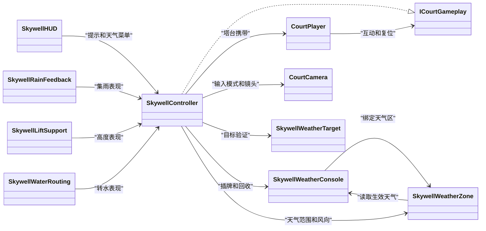

| 类型 | 自己拥有的状态与边界 |
| --- | --- |
| `SkywellController` | 由控制器本体、`SkywellWeatherInput.cs` 和 `SkywellLiftMechanism.cs` 组成。拥有 E 输入仲裁、手持天气选择、远程操作锚点、令牌唯一归属、已到访岸口、集水量、配重水量、升降、偏航、锁止、绞盘和排水。私有 `InteractionKind`、`InteractionTarget` 管短按候选；`WaterFlow` 区分待机、集雨、排水、转水。 [主体][controller] · [输入][weather-input] · [机械][lift] |
| `SkywellWeatherConsole`、`SkywellToken` | 每站有一个物理令牌槽和独立的请求天气，负责过渡时间、回收和归零。`SkywellToken` 是 `None/Rain/Wind/Sun`。 [天气控制台][console] |
| `SkywellWeatherZone` | 读取控制台的生效天气，提供范围检测、水平风向和受影响组件登记，驱动局部雨、风、云等视觉。 [天气区][zone] |
| `SkywellWeatherTarget` | 保存站点索引、实际点击表面、距离与可见性、轮廓及材质缓存；私有 `HighlightSlot` 和 `MeshSurface` 支撑高亮与表面选择。 [天气目标][target] |
| `SkywellHUD` | 从控制器、旅程、光路、叙事、运输读取提示并绘制 IMGUI，天气选择交回控制器。 [界面][hud] |
| `SkywellRainFeedback`、`SkywellLiftSupport`、`SkywellWaterRouting` | 分别投影集雨水面、入流与绳索，升降活塞和刻度，转水路径和水轮。集水、锁止和配重仍由控制器推进。 [集雨反馈][rain] · [活塞][support] · [转水显示][routing] |

### 叙事、光路和运输

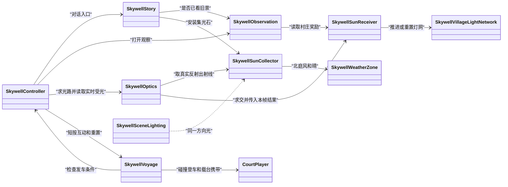

| 类型 | 自己拥有的状态与边界 |
| --- | --- |
| `SkywellObservation`、`SkywellStory` | 观察组件保存开关与 `HasViewed`；叙事组件保存对话页、检查镜心、集光石获得和消耗，私有 `Completion` 区分赠石与维修。确认最后一页时才提交赠石或安装。 [观察][observation] · [叙事][story] |
| `SkywellSceneLighting`、`SkywellSunCollector` | 前者设定作者方向光、环境光和背景；后者读取同一个太阳与本地天气，拥有维修、焦点索引、实际镜姿、锁定及太阳遮挡状态，并给出实算反射方向。 [场景照明][lighting] · [采日镜][collector] |
| `SkywellOptics` | 拥有本帧射线、最近遮挡、实际塔镜命中、反射计数和接光结果。线段显示与真实求交共用结果。 [光学求解][optics] |
| `SkywellSunReceiver`、`SettlementSunState`、`SkywellVillageLightNetwork` | 接光盘拥有有限口径、本帧是否受光、持续接光进度和货物奖励，状态为 `Unlit/Receiving/Spreading/Reward`；灯网拥有逐节点进度及各处照明表现。 [接光盘][receiver] · [灯网][village] |
| `SkywellVoyage`、`SkywellVoyagePhase` | 拥有登车路径、载台上站位、运输路段和到站/交付状态。状态为 `Waiting/Boarding/Boarded/Riding/Docking/Arrived/Delivered`。 [运输][voyage] |

### 水面、鹿与云台

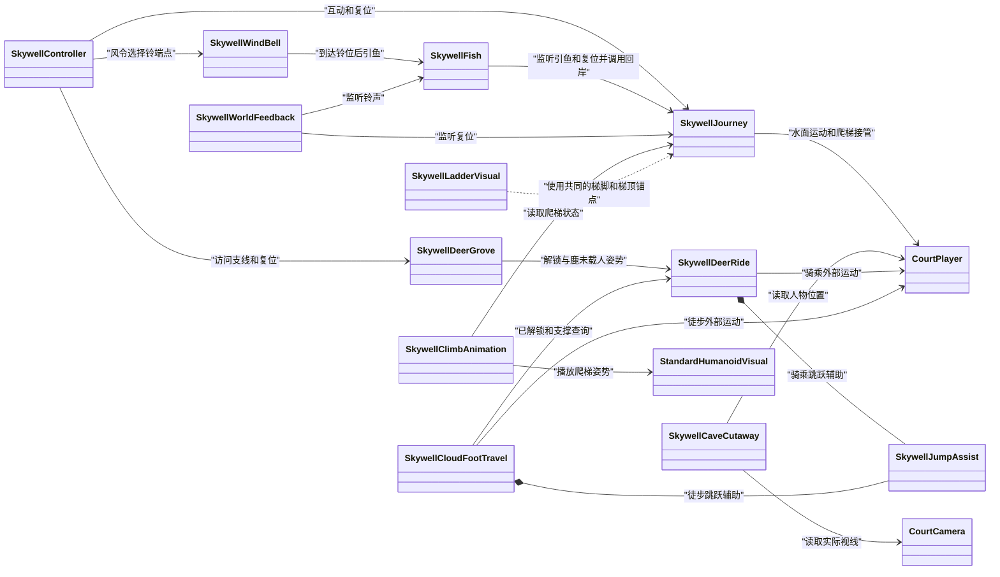

| 类型 | 自己拥有的状态与边界 |
| --- | --- |
| `SkywellJourney`、`SkywellTravel`、`SkywellClimbPhase` | 拥有船桨、晴牌、划船靠泊、回塔、辅助登船、攀梯与水面恢复。`SkywellTravel` 声明 `Walking/Descending/Swimming/Ascending/Returning/Docked/Climbing/Boarding`；保存场景采用水面路线。`SkywellClimbPhase` 将爬梯呈现分为 `None/Approach/Climbing/StepOff`。 [旅程][journey] |
| `SkywellFish`、`SkywellFishPhase`、`SkywellWindBell` | 鱼负责 `Patrol/Investigate/Warning/Chase`、视锥和物理遮挡、跟踪与捕获。风铃拥有端点请求和实际移动，达到目标后将引鱼事件交给鱼。 [鱼][fish] · [风铃][bell] |
| `SkywellWorldFeedback`、`SkywellClimbAnimation`、`SkywellLadderVisual`、`SkywellCaveCutaway` | 分别表现铃声/声波与借晴反馈、攀爬动画、梯子可见结构和洞壁遮挡。剖面切换 Renderer 的阴影模式，原碰撞器仍参与查询。 [反馈][feedback] · [攀爬动画][climb] · [梯子][ladder] · [剖面][cutaway] |
| `SkywellDeerGrove` | 拥有生长、脱落果实的重力和落地、鹿进食及云台显现；私有 `GrovePhase` 为 `Waiting/Approaching/Feeding/Revealing/Ready`，私有 `Fruit` 保存每个果实的位置、成熟及运动状态。 [果树支线][grove] |
| `SkywellDeerRide`、`SkywellCloudFootTravel`、`SkywellJumpAssist` | 骑乘拥有跨越顺序、最近安全面、卸载和鹿返程；徒步拥有解锁后当下支撑、移动、恢复与交还常规行走；两者各自持有可序列化的 `SkywellJumpAssist`，处理离地宽限、按键缓冲、起跳速度和空中转向。 [骑乘][ride] · [徒步][foot] · [跳跃辅助][jump] |
| `SkywellAirFeedback`、`SkywellSmokeProbe` | 前者保留空气紧张提示实现，保存场景无此组件；后者是 `-skywell-smoke` 明确开启的包内启动探针，正常关卡场景没有序列化实例。 [空气反馈][air] · [启动探针][smoke] |

### 可选辅助类

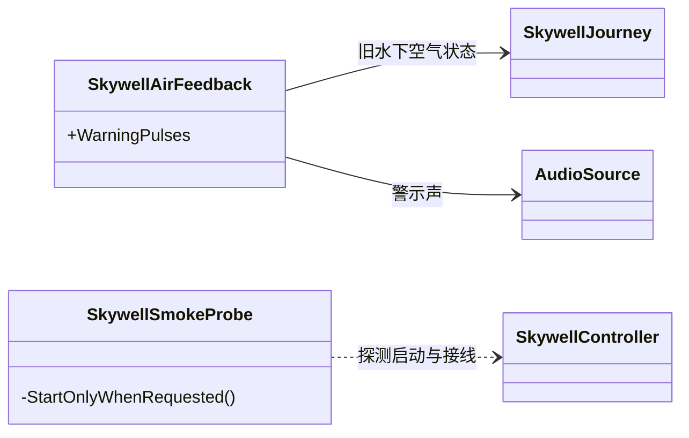

保存的 L5 场景中没有这两者的实例。`SkywellSmokeProbe` 由独立试玩启动参数按需创建。 [空气反馈][air] · [启动探针][smoke]

## 主线与分支

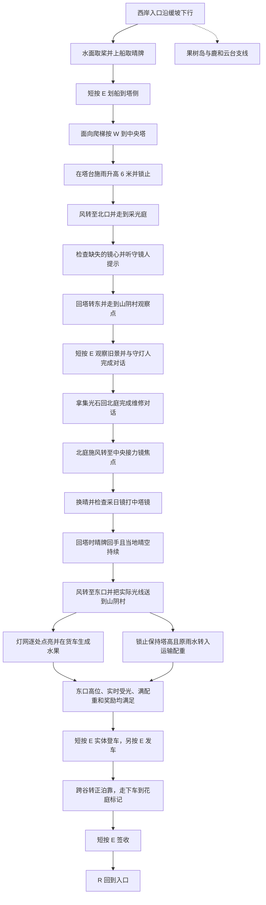

首次北庭查镜与守镜人提供路线线索。赠石的实际前置是打开东岸观察，随后完成守灯人对话；维修在带石完成北庭维修对话时提交。主线连续路线夹具从入口使用生产移动、对话和天气输入走到交付，并覆盖短按 `Q` 取消登车后重试。 [叙事条件][story] · [主线验证入口][route-checks] · [连续叙事段][story-checks]

### 短按 E 与当地天气

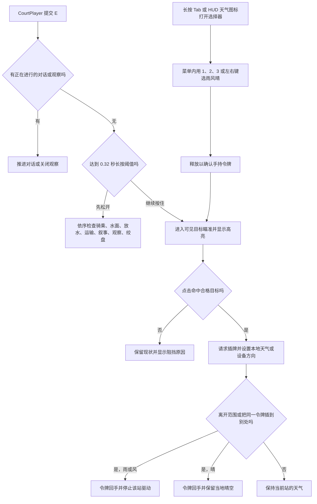

- 远程施令读取有效目标表面、实际可见性与 **45 m** 距离。玩家在区外施令时记录原位，超过 **3.5 m** 或失去目标距离即回牌；本地施令按天气区边界回牌。塔台门槛有人时拒绝施令，塔台正在运动时拒绝再次给风。 [目标与远程范围][weather-input] · [塔台安全][controller] · [保存输入参数][scene-controller]
- 左键提交雨、晴和顺向风，右键只提交反向风。对塔台，顺向依次 `西 -90° → 北 0° → 东 +90°`；对采日镜，左键选中央接力镜，右键选校光位；水边风令选择铃的端点。天气区只能改变本站天气。接光盘需要物理入射。 [施令映射][weather-input] · [控制器派发][controller] · [光路][optics]
- 晴牌只有登船取得后可用。回收晴牌与当地晴空分开，重新施加其他天气或全关复位会改变当地晴空。天气选择器、瞄准模式可用 `Q` 或 `Esc` 退出；航程组件另在登车与已登车阶段处理 `Q`。 [令牌和取消][controller] · [天气状态][console] · [运输][voyage]

### 升降、接岸与同一份雨水

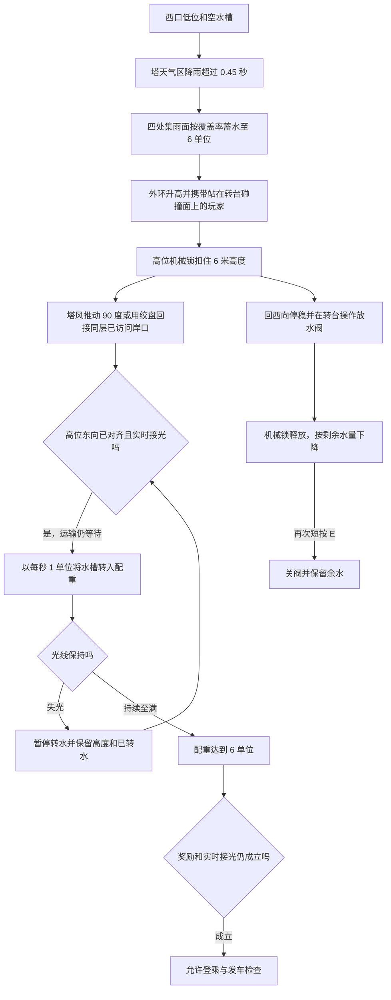

保存场景参数为集雨和排水基准各 **1.5 单位/秒**、升降 **1.5 m/s**、转动 **30°/s**。转水分支按相同水量扣减水槽并增加配重，塔高由机械锁保持。集雨分支单独将水槽限制为 6 单位。实体桥随 Rotor 移动，`DockedPort` 同时检查静止、高度和角度。西口对应低位，北、东口对应高位。控制器按脚下向下射线的最近支撑判断玩家是否站在 Rotor 上，并依据同一局部站位更新玩家位移和偏航。 [场景参数][scene-controller] · [机械推进与对接][lift] · [支撑判定][controller]

### 采日镜、塔镜和山阴村

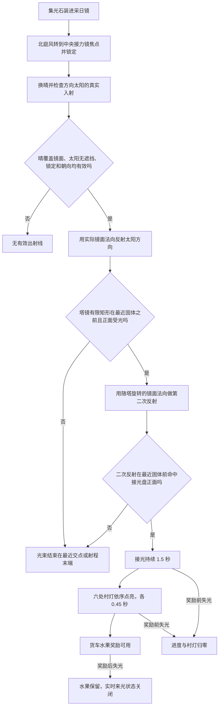

- 保存场景的链路是 `Sun → Fixed_reflector → Rotating_mirror → Settlement_sun_receiver`。`Fixed_reflector` 是采日镜自身的镜面；光学求解器另外保留的可选 `fixedMirror` 字段为空。镜台给出的第一束已由 `Vector3.Reflect` 求得，`SkywellOptics.Reflections` 从这束出射光开始计数。 [太阳反射][collector] · [求交与反射][optics] · [保存光学字段][scene-optics]
- 风只推动实际镜面向两个焦点停位移动。场景保存角速度 **60°/s**、锁定容差 **0.25°**。换晴后必须由当地晴空覆盖已修复的镜面、朝向正确、已锁止，且向真实太阳探测无阻挡。太阳及每段光线分别做物理遮挡查询。 [焦点参数][scene-collector] · [采日镜驱动][collector] · [段内遮挡查询][optics]
- 塔镜矩形半尺寸 **1.5 × 1.5 m**，接光盘半径 **1.4 m**，光学段最大距离 **180 m**。塔的东向停位让镜面的真实朝向具备几何条件，受光每帧仍由遮挡、有限口径与反射计算决定。转水和发车另外要求东口对齐及实时接光。 [塔镜设置][scene-optics] · [接光盘设置][scene-receiver] · [村灯设置][scene-village] · [发车条件][controller]

### 跨谷货运和实体交付

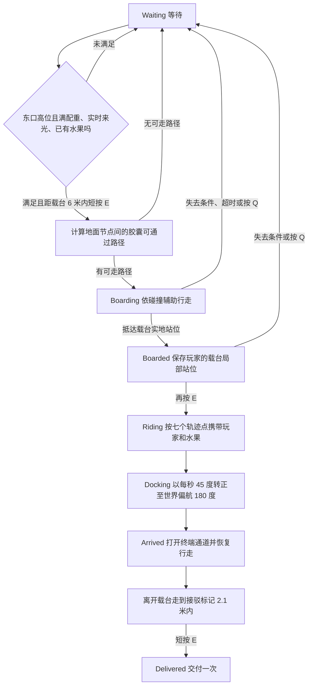

运输读取控制器的 `Complete`，其含义是当前可发车；运输组件自己的 `Delivered` 记录真正签收。登乘路径采样真实可站地面并验证连接上的胶囊通行。发车后沿路点按 **5.5 m/s** 或回望段 **3.2 m/s** 前进，持续按载台局部站位携带玩家；配重视觉随航程下降，原光路状态不参与推进已发车的航程。最终路点为 `(-26, 35, -4)`，交付点为世界向前偏移 7 m 后的 `(-26, 35, 3)`。 [运输与交付][voyage] · [控制器完成谓词][controller] · [七个轨迹点][scene-voyage]

### 水面、鱼与塔侧爬梯

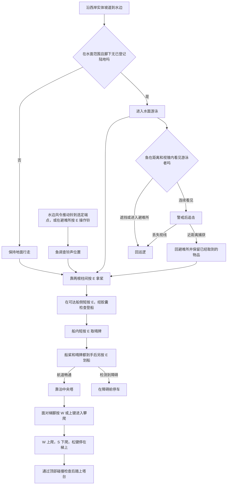

图示选用先取桨的顺序。桨与晴牌有独立状态，先上船拿晴牌也有效；二者均取得后才允许划船。靠泊用船体盒形投射，攀梯用实际角色碰撞位移。现行入口走水面网格和干地支撑面，水面游泳不使用共享角色深水升降输入。 [水面与登船][journey] · [鱼视线和回收][fish] · [风铃][bell] · [保存水面参数][scene-journey] · [共享游泳输入][player]

### 果树、白鹿与徒步云路

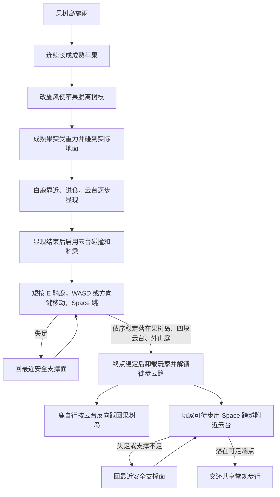

幼果可先被吹落，成熟果实实际着地才推进鹿的进食。保存场景的成长、进食、云台显现分别为 **2.5 s、2.2 s、1.6 s**。骑乘在稳定支撑上可短按 `E` 主动下鹿；自动徒步解锁要求实际按顺序落在六处支撑面并在终点稳定 **0.3 s**。骑乘和徒步各自通过共享角色的外部移动所有权处理本模式的碰撞和恢复。 [果树规则][grove] · [保存支线参数][scene-grove] · [骑乘与有序落点][ride] · [徒步与恢复][foot] · [共享外部运动][player]

### 整关 R 复位

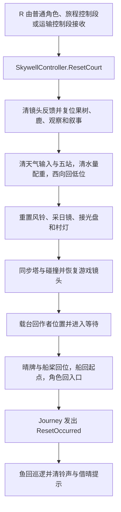

`ResetCourt` 是完整重玩的入口。`ResetMechanisms` 只清机制并复位角色，可供专项检查。`RecoverToRefuge` 只恢复水面移动并把玩家放回避难所，保留已拿到的桨和晴牌。角色在攀梯、受控船行等阶段停用时由 `SkywellJourney` 接住 `R`；运输在已登车、行驶、泊靠阶段接住 `R`。 [全关复位][controller-reset] · [旅程复位][journey-reset] · [运输接键][voyage] · [共享输入][player]

## 对照入口

- 当前保存几何和引用从 `05_Skywell.unity` 查看，游戏角色的朝向、场景组件序列化字段和物理表面以该文件为准。 [保存场景][scene]
- 连续路线、目标施令、故事、鱼与支线的运行验证可从 `Editor/Skywell` 查脚本。主线与专项夹具各自记录输入和摆位范围；历史 `playmode.txt` 当前存的是 2026-10-28 的天气截图专项。本文根据保存文件和源码核对。 [连续路线夹具][route-checks] · [专项夹具目录][editor-checks] · [现有天气专项报告][weather-report]

[scene]: ../../unity_prototype/BorrowingSun/Assets/BorrowingSun/Scenes/05_Skywell.unity
[scene-root]: ../../unity_prototype/BorrowingSun/Assets/BorrowingSun/Scenes/05_Skywell.unity#L128076
[scene-camera]: ../../unity_prototype/BorrowingSun/Assets/BorrowingSun/Scenes/05_Skywell.unity#L16272
[scene-player]: ../../unity_prototype/BorrowingSun/Assets/BorrowingSun/Scenes/05_Skywell.unity#L34065
[scene-humanoid]: ../../unity_prototype/BorrowingSun/Assets/BorrowingSun/Scenes/05_Skywell.unity#L23886
[scene-controller]: ../../unity_prototype/BorrowingSun/Assets/BorrowingSun/Scenes/05_Skywell.unity#L49891
[scene-journey]: ../../unity_prototype/BorrowingSun/Assets/BorrowingSun/Scenes/05_Skywell.unity#L49997
[scene-voyage]: ../../unity_prototype/BorrowingSun/Assets/BorrowingSun/Scenes/05_Skywell.unity#L50096
[scene-story]: ../../unity_prototype/BorrowingSun/Assets/BorrowingSun/Scenes/05_Skywell.unity#L50259
[scene-grove]: ../../unity_prototype/BorrowingSun/Assets/BorrowingSun/Scenes/05_Skywell.unity#L50315
[scene-optics]: ../../unity_prototype/BorrowingSun/Assets/BorrowingSun/Scenes/05_Skywell.unity#L19894
[scene-collector]: ../../unity_prototype/BorrowingSun/Assets/BorrowingSun/Scenes/05_Skywell.unity#L26673
[scene-receiver]: ../../unity_prototype/BorrowingSun/Assets/BorrowingSun/Scenes/05_Skywell.unity#L87039
[scene-village]: ../../unity_prototype/BorrowingSun/Assets/BorrowingSun/Scenes/05_Skywell.unity#L33625
[scene-observation]: ../../unity_prototype/BorrowingSun/Assets/BorrowingSun/Scenes/05_Skywell.unity#L73620
[scene-lighting]: ../../unity_prototype/BorrowingSun/Assets/BorrowingSun/Scenes/05_Skywell.unity#L114299
[scene-rain]: ../../unity_prototype/BorrowingSun/Assets/BorrowingSun/Scenes/05_Skywell.unity#L101238
[scene-water]: ../../unity_prototype/BorrowingSun/Assets/BorrowingSun/Scenes/05_Skywell.unity#L61848
[scene-lift]: ../../unity_prototype/BorrowingSun/Assets/BorrowingSun/Scenes/05_Skywell.unity#L109331
[scene-ladder]: ../../unity_prototype/BorrowingSun/Assets/BorrowingSun/Scenes/05_Skywell.unity#L111477
[scene-cutaway]: ../../unity_prototype/BorrowingSun/Assets/BorrowingSun/Scenes/05_Skywell.unity#L66123
[scene-target-tower]: ../../unity_prototype/BorrowingSun/Assets/BorrowingSun/Scenes/05_Skywell.unity#L7127
[scene-target-collector]: ../../unity_prototype/BorrowingSun/Assets/BorrowingSun/Scenes/05_Skywell.unity#L108698
[scene-target-refuge]: ../../unity_prototype/BorrowingSun/Assets/BorrowingSun/Scenes/05_Skywell.unity#L39833
[scene-target-village]: ../../unity_prototype/BorrowingSun/Assets/BorrowingSun/Scenes/05_Skywell.unity#L87068
[scene-target-grove]: ../../unity_prototype/BorrowingSun/Assets/BorrowingSun/Scenes/05_Skywell.unity#L98772
[scene-zone-tower]: ../../unity_prototype/BorrowingSun/Assets/BorrowingSun/Scenes/05_Skywell.unity#L126782
[scene-zone-collector]: ../../unity_prototype/BorrowingSun/Assets/BorrowingSun/Scenes/05_Skywell.unity#L100928
[scene-zone-refuge]: ../../unity_prototype/BorrowingSun/Assets/BorrowingSun/Scenes/05_Skywell.unity#L55962
[scene-zone-village]: ../../unity_prototype/BorrowingSun/Assets/BorrowingSun/Scenes/05_Skywell.unity#L2908
[scene-zone-grove]: ../../unity_prototype/BorrowingSun/Assets/BorrowingSun/Scenes/05_Skywell.unity#L89919
[controller]: ../../unity_prototype/BorrowingSun/Assets/BorrowingSun/Runtime/Skywell/SkywellController.cs#L84
[controller-reset]: ../../unity_prototype/BorrowingSun/Assets/BorrowingSun/Runtime/Skywell/SkywellController.cs#L244
[weather-input]: ../../unity_prototype/BorrowingSun/Assets/BorrowingSun/Runtime/Skywell/SkywellWeatherInput.cs#L34
[lift]: ../../unity_prototype/BorrowingSun/Assets/BorrowingSun/Runtime/Skywell/SkywellLiftMechanism.cs#L69
[console]: ../../unity_prototype/BorrowingSun/Assets/BorrowingSun/Runtime/Skywell/SkywellWeatherConsole.cs#L17
[zone]: ../../unity_prototype/BorrowingSun/Assets/BorrowingSun/Runtime/Skywell/SkywellWeatherZone.cs#L44
[target]: ../../unity_prototype/BorrowingSun/Assets/BorrowingSun/Runtime/Skywell/SkywellWeatherTarget.cs
[hud]: ../../unity_prototype/BorrowingSun/Assets/BorrowingSun/Runtime/Skywell/SkywellHUD.cs
[rain]: ../../unity_prototype/BorrowingSun/Assets/BorrowingSun/Runtime/Skywell/SkywellRainFeedback.cs
[support]: ../../unity_prototype/BorrowingSun/Assets/BorrowingSun/Runtime/Skywell/SkywellLiftSupport.cs
[routing]: ../../unity_prototype/BorrowingSun/Assets/BorrowingSun/Runtime/Skywell/SkywellWaterRouting.cs
[observation]: ../../unity_prototype/BorrowingSun/Assets/BorrowingSun/Runtime/Skywell/SkywellObservation.cs
[story]: ../../unity_prototype/BorrowingSun/Assets/BorrowingSun/Runtime/Skywell/SkywellStory.cs#L129
[lighting]: ../../unity_prototype/BorrowingSun/Assets/BorrowingSun/Runtime/Skywell/SkywellSceneLighting.cs
[collector]: ../../unity_prototype/BorrowingSun/Assets/BorrowingSun/Runtime/Skywell/SkywellSunCollector.cs#L45
[optics]: ../../unity_prototype/BorrowingSun/Assets/BorrowingSun/Runtime/Skywell/SkywellOptics.cs#L37
[receiver]: ../../unity_prototype/BorrowingSun/Assets/BorrowingSun/Runtime/Skywell/SkywellSunReceiver.cs#L32
[village]: ../../unity_prototype/BorrowingSun/Assets/BorrowingSun/Runtime/Skywell/SkywellVillageLightNetwork.cs
[voyage]: ../../unity_prototype/BorrowingSun/Assets/BorrowingSun/Runtime/Skywell/SkywellVoyage.cs#L23
[journey]: ../../unity_prototype/BorrowingSun/Assets/BorrowingSun/Runtime/Skywell/SkywellJourney.cs#L189
[journey-reset]: ../../unity_prototype/BorrowingSun/Assets/BorrowingSun/Runtime/Skywell/SkywellJourney.cs#L499
[fish]: ../../unity_prototype/BorrowingSun/Assets/BorrowingSun/Runtime/Skywell/SkywellFish.cs#L86
[bell]: ../../unity_prototype/BorrowingSun/Assets/BorrowingSun/Runtime/Skywell/SkywellWindBell.cs#L45
[feedback]: ../../unity_prototype/BorrowingSun/Assets/BorrowingSun/Runtime/Skywell/SkywellWorldFeedback.cs
[climb]: ../../unity_prototype/BorrowingSun/Assets/BorrowingSun/Runtime/Skywell/SkywellClimbAnimation.cs
[ladder]: ../../unity_prototype/BorrowingSun/Assets/BorrowingSun/Runtime/Skywell/SkywellLadderVisual.cs
[cutaway]: ../../unity_prototype/BorrowingSun/Assets/BorrowingSun/Runtime/Skywell/SkywellCaveCutaway.cs
[grove]: ../../unity_prototype/BorrowingSun/Assets/BorrowingSun/Runtime/Skywell/SkywellDeerGrove.cs#L102
[ride]: ../../unity_prototype/BorrowingSun/Assets/BorrowingSun/Runtime/Skywell/SkywellDeerRide.cs#L116
[foot]: ../../unity_prototype/BorrowingSun/Assets/BorrowingSun/Runtime/Skywell/SkywellCloudFootTravel.cs
[jump]: ../../unity_prototype/BorrowingSun/Assets/BorrowingSun/Runtime/Skywell/SkywellJumpAssist.cs
[air]: ../../unity_prototype/BorrowingSun/Assets/BorrowingSun/Runtime/Skywell/SkywellAirFeedback.cs
[smoke]: ../../unity_prototype/BorrowingSun/Assets/BorrowingSun/Runtime/Skywell/SkywellSmokeProbe.cs#L12
[player]: ../../unity_prototype/BorrowingSun/Assets/BorrowingSun/Runtime/Shared/CourtPlayer.cs#L185
[gameplay]: ../../unity_prototype/BorrowingSun/Assets/BorrowingSun/Runtime/Shared/ICourtGameplay.cs
[humanoid]: ../../unity_prototype/BorrowingSun/Assets/BorrowingSun/Runtime/Shared/StandardHumanoidVisual.cs
[camera]: ../../unity_prototype/BorrowingSun/Assets/BorrowingSun/Runtime/Shared/CourtCamera.cs
[route-checks]: ../../unity_prototype/BorrowingSun/Assets/BorrowingSun/Editor/Skywell/SkywellChecks.cs#L74
[story-checks]: ../../unity_prototype/BorrowingSun/Assets/BorrowingSun/Editor/Skywell/SkywellStoryChecks.cs#L31
[editor-checks]: ../../unity_prototype/BorrowingSun/Assets/BorrowingSun/Editor/Skywell
[weather-report]: ../evidence/2026-10-28-weather-capture.txt
