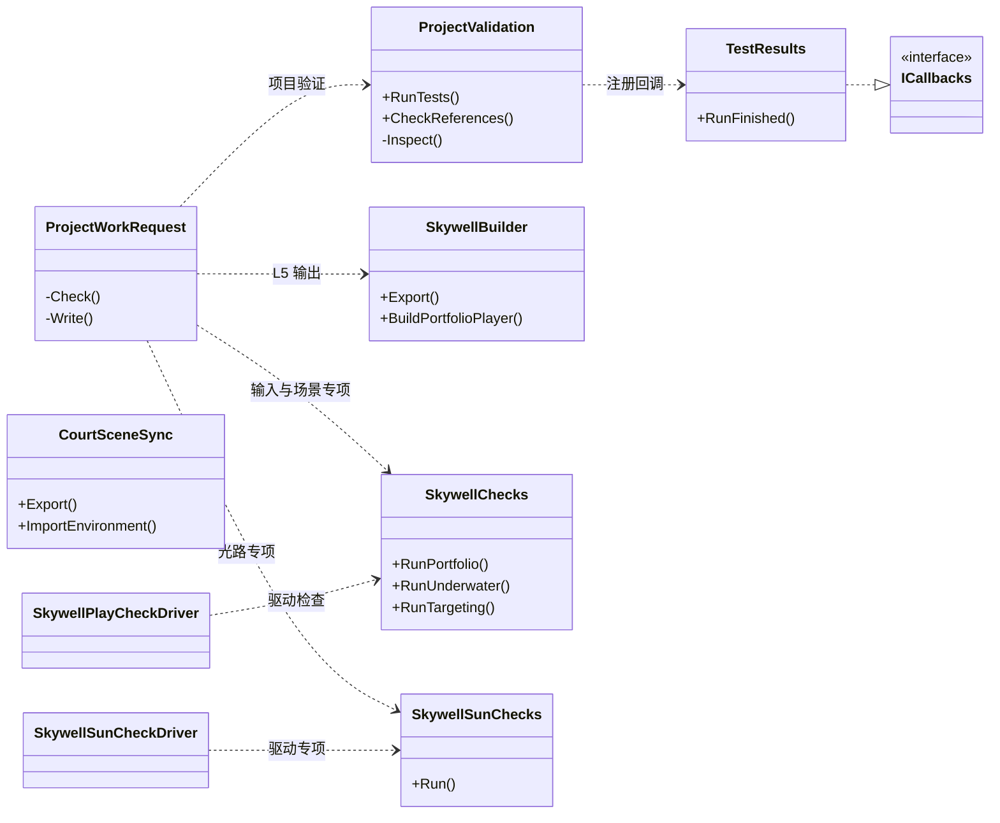
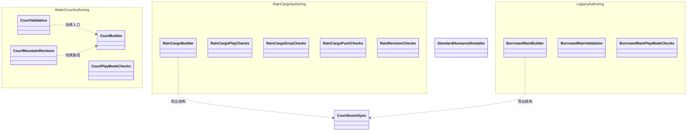
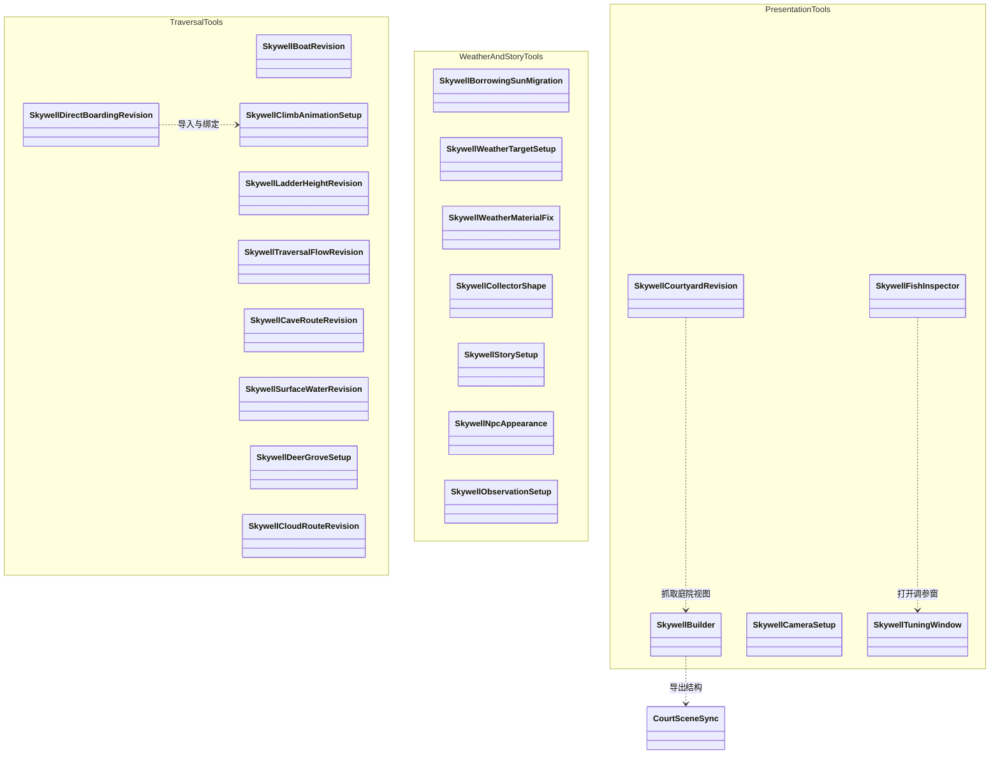
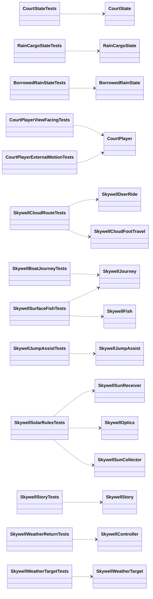
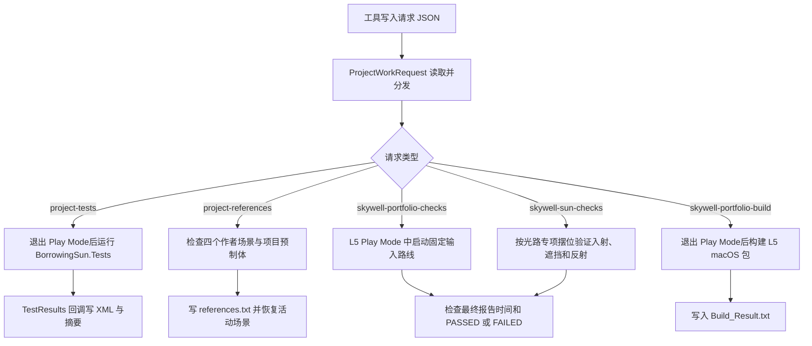

# Unity 编辑器工具与验证

## 工具类图

`SkywellBuilder` 与 `SkywellChecks` 均跨多个 partial 源文件。后者把 `SkywellPlayCheckDriver` 用作运行检查的协程驱动，`SkywellSunChecks` 使用自己的 `SkywellSunCheckDriver`。作者、导出、验证属于工具层。编辑器工具调用到同一套运行时规则。 [请求路由](../../unity_prototype/BorrowingSun/Assets/BorrowingSun/Editor/Shared/ProjectWorkRequest.cs) · [运行检查](../../unity_prototype/BorrowingSun/Assets/BorrowingSun/Editor/Skywell/SkywellChecks.cs) · [光路检查](../../unity_prototype/BorrowingSun/Assets/BorrowingSun/Editor/Skywell/SkywellSunChecks.cs)

| 职责 | 入口及其输出 |
| --- | --- |
| 关卡构建和布局修订 | `CourtBuilder`、`RainCargoBuilder`、`BorrowedRainBuilder`、`SkywellBuilder` 及各 Setup/Revision 负责原型构建或定向调整。当前引用与几何从保存场景查证 |
| 资产交接 | `CourtSceneSync` 的场景、相机、灯光和网格数据类型供几何交换。`StandardHumanoidInstaller` 安装角色外观。L5 导出和摆拍在 `SkywellBuilder` |
| 作者调试 | `SkywellTuningWindow` 提供调参窗口，`SkywellFishInspector` 绘制鱼 Inspector |
| 项目级验证 | `ProjectValidation` 用 Test Framework 执行 `BorrowingSun.Tests`。引用审计遍历作者场景及预制体的组件与对象引用，对临时打开的场景只读检查并关闭，最后恢复原活动场景 |
| 关卡级验证 | L1 的 `CourtValidation` / `CourtPlayModeChecks`，L3 的 `RainCargoPlayChecks` / `RainCargoDropChecks` / `RainCargoPushChecks` / `RainRevisionChecks`，旧 L3 的 `BorrowedRainValidation` / `BorrowedRainPlayModeChecks`，L5 的 `SkywellChecks` 和 `SkywellSunChecks` |
| L5 独立试玩 | `SkywellBuilder.BuildPortfolioPlayer` 以 `05_Skywell.unity` 构建 macOS Development Player，并输出构建结果 |

编辑器 51 个脚本及嵌套类在 [类型索引](01_TYPE_INDEX.md#editor--legacy_borrowedrain) 可逐项查找。当前项目规则要求从保存的场景核对现行行为。 [项目级验证实现](../../unity_prototype/BorrowingSun/Assets/BorrowingSun/Editor/Shared/ProjectValidation.cs) · [L5 构建实现](../../unity_prototype/BorrowingSun/Assets/BorrowingSun/Editor/Skywell/SkywellPortfolioTools.cs) · [项目规则](../../README.md)

## 早期场景作者工具类图

框内按工具所对应的关卡归组。无箭头的类型各自有作者或检查入口。 [L1 工具](../../unity_prototype/BorrowingSun/Assets/BorrowingSun/Editor/WaterCourt) · [L3 工具](../../unity_prototype/BorrowingSun/Assets/BorrowingSun/Editor/RainCargo) · [旧 L3 工具](../../unity_prototype/BorrowingSun/Assets/BorrowingSun/Editor/Legacy_BorrowedRain)

## L5 作者工具类图

L5 校验中的 `SkywellPlayCheckDriver` 与 `SkywellSunCheckDriver` 是测试驱动。`SkywellChecks` 的分文件覆盖天气、回牌、相机、登船、鹿、故事、观察等。布局修订工具保留工程历史，使用前检查其写入条件和目标场景。 [L5 作者与验证脚本](../../unity_prototype/BorrowingSun/Assets/BorrowingSun/Editor/Skywell)

## EditMode 类图

图上展示主要被测组件。测试会临时创建所需对象或调用规则。凡涉及存档场景、真实输入设备、几何和动画衔接的验收，使用对应 PlayMode 检查。 [13 个 EditMode 测试脚本](../../unity_prototype/BorrowingSun/Assets/BorrowingSun/Tests/Editor)

## 实际验证入口

历史 `editmode-summary.txt` 记录 2026-10-28 的 117 项通过。历史引用报告记录四个作者场景和一个预制体共 8,341 组件通过。当前路径的 `skywell/playmode.txt` 是 2026-10-28 的天气专项抓帧，有显式摆位。完整路线证据须单独读同版本的签收流程日志。 [EditMode 摘要](../evidence/2026-10-28-editmode.txt) · [引用报告](../evidence/2026-10-28-references.txt) · [天气专项](../evidence/2026-10-28-weather-capture.txt) · [运行入口说明](../VALIDATION.md)
