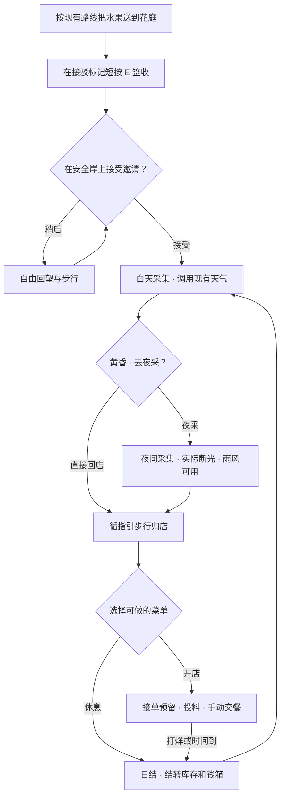
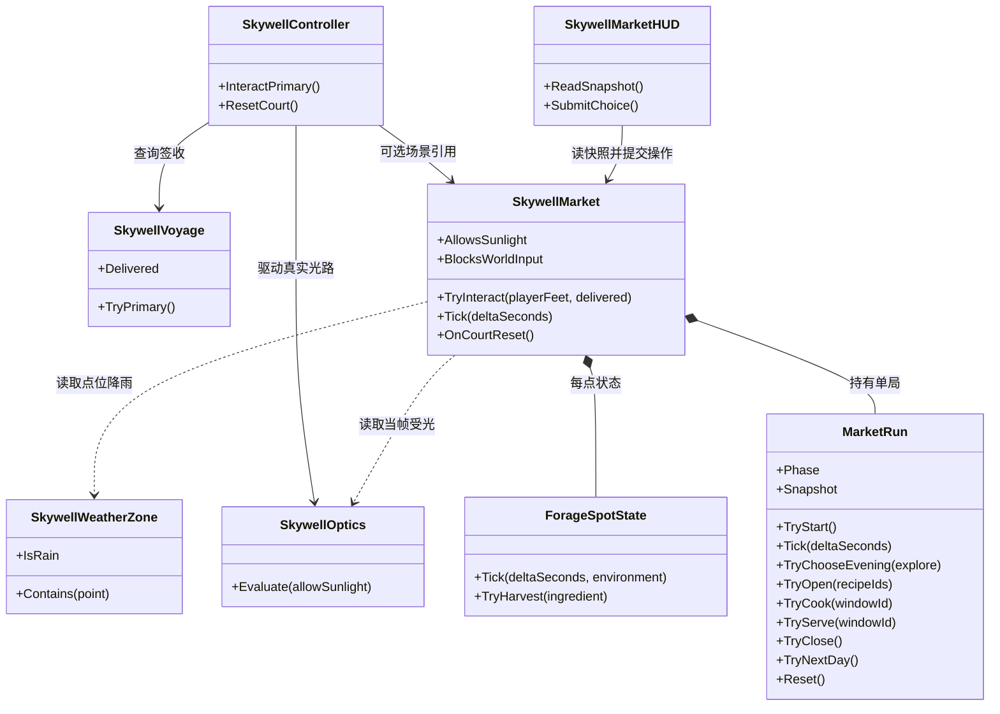

# Unity L5 经营接入提案

状态为待评审。文中新增类型、点位、时间和验收项均为实现提案。Unity 项目仍以 `05_Skywell.unity` 的保存内容为准。Godot 市场白盒提供已经实现的对照规则和测试材料。 [当前交接](../../README.md) · [Unity 场景](../../unity_prototype/BorrowingSun/Assets/BorrowingSun/Scenes/05_Skywell.unity) · [Godot 市场设计与证据](https://github.com/buriallsy/coding_team/tree/83de773b8d480a53d62b29690968ae03c8de8368/BorrowingSun2D/Docs/Market)

## 1. 接在花庭签收之后

保留雨升、风接岸、取得晴令、修镜、真实反射、原水入配重、登车、跨谷和花庭签收的现有顺序。货物签收后，花庭岸上的独立交互点提供一次「开始经营」邀请。玩家可以先回望、走开或用 `R` 从原入口重玩。接受后进入第一天白天采集，店铺、当日资源和归店指引才开始工作。签收和接受邀请使用两次独立交互。

第一轮优先在花庭试排一个短环路，验证从签收点看得见招牌、从摊位走得到采集点、天黑还能回店。摊位最终落点和是否需要转场由白盒决定。若花庭没有可用的天气或受光点，记录实际步行、光路和雨区覆盖，再比较在花庭布置局部天气点、接入既有站点，或经明确确认进入另一处可走的营业区域。用同一套经营规则测试各候选，现场确认前不给店铺指定东岸位置，也不把传送作为进度条件。

首轮范围是白天采集、一次黄昏选择、可实际游玩的夜采、配菜单、接单与第二天结转。建议从一个基础采集点和一个环境敏感点起步，配两道菜。起步食材能做一份基础菜，选择使用天气或夜采能带回可辨认的额外产物，并产生有实际收益的菜单选择。用一个窗口先走通交易和退料，再以两个窗口验证库存预留与独立烹饪。 [Godot 参考规则](https://github.com/buriallsy/coding_team/blob/83de773b8d480a53d62b29690968ae03c8de8368/BorrowingSun2D/Docs/Market/Design.md#策划案)

## 2. Unity 与 Godot 的差异

| 项目 | Godot 2D 市场白盒 | Unity L5 接法 |
| --- | --- | --- |
| 教学到经营 | `G` 签收后确认进入中央店铺，市场阶段由 `MarketRun` 管理 | `SkywellVoyage.Delivered` 是唯一解锁事实。有效短按 `E` 在花庭岸上接受邀请，选择后才开启经营时钟 |
| 天气 | `MarketPlay2D` 用经营态 `Raining` 和各果树的实际受光采样 | 每个果点显式关联 `SkywellWeatherZone` 和实际受天气作用的点。局部下雨由 `IsRain && Contains(samplePoint)` 判断，施令资格、遮挡、单槽和离位回牌仍由 L5 管 |
| 光学 | 北庭树采入射命中，东岸树采接收盘实时命中。夜间关太阳光路 | 复用 `SkywellOptics` 的真实孔径、正面、反射和遮挡。山阴供光型资源用 `SettlementReceiver.RayValid`。北庭候选点要先定义用途，`Collector.HasDirectSunlight` 表示入射可见，`Collector.Active` 表示修复、晴令、锁定和光照均满足时可送光。两者都只描述对应装置 |
| 载台与水 | 配重规则留下可用水，货台经营后可双向，单程耗水 1 单位，去程留回程水 | 原配重可把储水全转走，原跨谷有七个路标、乘员跟随、镜头和到岸对接。载台在签收后留在花庭，经营试作先用实际可步行的资源点 |
| 昼夜与经济 | 当前白天 180 秒，直接营业 120 秒，或夜探 90 秒加营业 60 秒。8 个采集点、双窗口和 36 金币快灶已有白盒 | 复用阶段、资源和订单概念。计时、配方、点位半径和价格以 Unity 实际步行与操作耗时重新测定，快灶和全地图采集留到后续 |
| 复用范围 | `MarketRun`、`ForageSpot`、`TakeawayShop` 是逻辑参照，`MarketPlay2D`/`MarketPanel` 接 Godot 节点和输入 | C#9 下移植必要规则，改写新语法，沿用 `BorrowingSun` 运行程序集与测试入口。场景、镜头、天气、载台和 HUD 由 Unity 接线 |

来源包括 [Godot Change Map](https://github.com/buriallsy/coding_team/blob/83de773b8d480a53d62b29690968ae03c8de8368/BorrowingSun2D/Docs/Market/ChangeMap.md)、[Godot MarketPlay2D](https://github.com/buriallsy/coding_team/blob/83de773b8d480a53d62b29690968ae03c8de8368/BorrowingSun2D/Scripts/MarketPlay2D.cs)、[Unity 光学](../../unity_prototype/BorrowingSun/Assets/BorrowingSun/Runtime/Skywell/SkywellOptics.cs#L35)、[接收器](../../unity_prototype/BorrowingSun/Assets/BorrowingSun/Runtime/Skywell/SkywellSunReceiver.cs#L25)、[水路](../../unity_prototype/BorrowingSun/Assets/BorrowingSun/Runtime/Skywell/SkywellLiftMechanism.cs#L79)和[运输](../../unity_prototype/BorrowingSun/Assets/BorrowingSun/Runtime/Skywell/SkywellVoyage.cs#L105)。

## 3. 玩家流程



- 阶段由经营域推进，地理到达由 Unity 检查。白天计时完进入黄昏选择，面板只在玩家稳定站在安全地面时弹出。若玩家正瞄准天气或在移动设施上，显示待处理提示，等当前动作正常收束。夜采选项确认后切换夜间实际光照条件，再开始夜采时钟。玩家沿可走路线回店，也可提前回店结束夜采。
- 探索时间用尽后，保留「回店」方向、移动和必要的安全天气操作，并给点位结算停止采集的反馈。到店才开放菜单，夜探超时后仍能走完返回路线。营业时间从确认菜单后开始，在黄昏、菜单、待归店和日结中暂停经营计时。先夜采再营业是否缩短时段，由对照测试定值。
- 归店后可按库存选菜，确认后窗口分配订单。预留按同一份库存计算。投料后各窗口独立计时，交餐只结算一次，打烊释放未投料预留并退回未交餐的已投料食材。日结保留背包、钱箱、累计营业额和故事世界，次日从店内操作开始。空背包可休息跳至下一天。

### 施令、场景安全与夜间

1. 现有 `CourtPlayer` 将 `E` 送到 `InteractPrimary`。`SkywellWeatherInput` 在按住期间打开长按瞄准，松开且满足短按条件才进入 `PerformPrimaryInteraction`。提议在已有骑乘、水下和排水优先检查之后、`voyage.TryPrimary()` 之前匹配 `MarketTarget`，因为 `Voyage` 在 `Delivered` 后会消费短按。交付前、交付当次和离开经营点时走原顺序。经营提示复用同一个目标解析结果，覆盖签收后的常驻提示只限可交互点。 [短按分派](../../unity_prototype/BorrowingSun/Assets/BorrowingSun/Runtime/Skywell/SkywellController.cs#L138) · [松开与长按分流](../../unity_prototype/BorrowingSun/Assets/BorrowingSun/Runtime/Skywell/SkywellWeatherInput.cs#L114)
2. 长按 `E` 仍由天气目标机制处理。选令、按住 `E`、指向高亮目标、点击、验证遮挡/距离和门槛、写入天气台、在现有覆盖范围内到达采集点。一次施令成功仅改变区域环境，采集仍须在资源点支持面落地、满足水平和高度距离并短按 `E`。施令点在区外时，离开当时的位置 3.5 米即按默认设置回牌，即使随后走进该天气区。首轮用一次完整实走检查点位能否在天气持续期间采到，天气生效时显示哪一个点受影响。`TryApplyWeather` 继续持有令牌修改入口。 [目标选择和回牌边界](../../unity_prototype/BorrowingSun/Assets/BorrowingSun/Runtime/Skywell/SkywellWeatherInput.cs#L34) · [令牌修改入口](../../unity_prototype/BorrowingSun/Assets/BorrowingSun/Runtime/Skywell/SkywellController.cs#L217)
3. 花庭已有固定到站组和载台开门/泊靠流程。新入口与资源点用 Inspector 绑定到实际步道，选择离闸口、移动载台和临崖有余量的固定支持面。检查角色胶囊净空、脚底支撑、楼层差和墙体遮挡，并测试从两种相机视角到达。若白盒最后采用转场，同时验证目标点支撑、镜头归位和坠落后回到经营侧安全点。现有 `CourtPlayer.Teleport()` 会重置移动状态，`Recover()` 用 `lastSafePosition`，因此单次搬移后的恢复点须实测。 [花庭场景组](../../unity_prototype/BorrowingSun/Assets/BorrowingSun/Scenes/05_Skywell.unity#L77641) · [泊靠与闸口](../../unity_prototype/BorrowingSun/Assets/BorrowingSun/Runtime/Skywell/SkywellVoyage.cs#L90) · [角色恢复](../../unity_prototype/BorrowingSun/Assets/BorrowingSun/Runtime/Shared/CourtPlayer.cs#L533)
4. `NightForage` 要同时切换场景可读照明、游戏太阳源和资源规则。`Evaluate(false)` 已清反射并送出 `RayValid=false`，但仍会调用采光器，采光器有独立的 `incomingSunRay`。让同一个 `allowSunlight` 信号也关停采光器的活动光和入射显示。夜间使用 `SkywellSceneLighting` 的运行时预设保住步道和招牌可见性，施晴前提示「夜间没有太阳」，保留已有风雨、装置校准、门槛与遮挡保护。白天恢复要重新做真实求交，保留已修的镜、已获晴令、已点亮的村庄状态和已签收的货。两条黄昏路径确定后用同一夜间状态，直返在归店前入夜，夜采在开始计时前入夜，营业到日结进入下一天。 [光路更新](../../unity_prototype/BorrowingSun/Assets/BorrowingSun/Runtime/Skywell/SkywellOptics.cs#L37) · [采光器入射显示](../../unity_prototype/BorrowingSun/Assets/BorrowingSun/Runtime/Skywell/SkywellSunCollector.cs#L61) · [场景光照](../../unity_prototype/BorrowingSun/Assets/BorrowingSun/Runtime/Skywell/SkywellSceneLighting.cs#L34) · [村庄奖励持续](../../unity_prototype/BorrowingSun/Assets/BorrowingSun/Runtime/Skywell/SkywellSunReceiver.cs#L41)

## 4. 类和状态归属



图中的成员名为职责示意。现有类仍持有各自的世界状态。`MarketRun` 持有单局、当前阶段、昼夜、剩余时间、食材、当日与累计收入和窗口订单。`ForageSpotState` 持有点位成熟进度和采集后的冷却。`SkywellMarket` 只在场景层持有授权的交互区域、场景绑定、开关面板的输入状态和短期反馈，将世界状态读成规则输入。天气区域、原水、机械、装置修复、接光和原货运各自沿用现有所有者。

### 规则与命令契约

| 入口 | 输入与结果 |
| --- | --- |
| `MarketRun.TryStart()` | 仅 `Locked` 可成功，初始化第一天。是否已签收和是否在入口由调用方核实 |
| `MarketRun.Tick(float deltaSeconds)` | 注入时间步长，按阶段更新探索、烹饪或营业。计时结束只触发一次状态迁移，显式 `TryNextDay()` 开新一天 |
| `MarketRun.TryChooseEvening(bool explore)` / `TryOpen(recipeIds)` | 只接受相应阶段内的可用选项和当前可做菜品。昼夜由经营状态导出，夜间环境由场景层落实 |
| `ForageSpotState.Tick(dt, environment)` / `TryHarvest(out ingredient)` | `environment` 为昼夜、该点是否落雨和该点对应的实际受光。尚未成熟或条件不合不给食材。场景先校验位置和阶段，成功后向 `MarketRun` 加库存一次 |
| `MarketRun.TryCook(windowId)` / `TryServe(windowId)` / `TryClose()` | 在同一所有者中执行预留、扣料、交餐、退料和收入结转。失败不部分写入，重复交餐不重复到账。返回可供 UI 映射的失败原因 |
| `SkywellMarket.TryInteract(Vector3 feet, bool delivered)` | 已签收且命中经营点时消费短按。成功操作还须符合当前阶段和安全条件。命中但暂不可操作时给出可恢复提示，其他情况保留现有交互链 |
| `SkywellMarket.OnCourtReset()` | 关闭经营面板，清理输入焦点、场景反馈、点位与单局状态，恢复默认白天。原世界由原 `ResetCourt` 各负责人重置 |

为这些入口使用具体类、小型只读数据和结果枚举。计时直接传 `deltaSeconds`，可随机的结果在需要时传种子或 `System.Random`。首轮 `Inventory`、窗口预留和食谱可以保持为 `MarketRun` 的内部数据。若扩至两窗后订单生命周期独立变化，再将其提取为纯 `TakeawayShop`。首轮没有共享接口需求。

### 接口与扩展点

现有 `ICourtGameplay` 继续把共享角色接到关卡。首轮 `SkywellController` 用可选的具体 `SkywellMarket` 接经营，`MarketRun` 用 `ForageEnvironment` 值和 `deltaSeconds` 测试规则。下面两个接口是候选契约，有具体调用需求时再落地。

```csharp
// 经营采集的世界事实。SceneForageEnvironment 采样实际天气和光路，
// 若 PlayMode 用例需要可替换场景，再注入 ScriptedForageEnvironment。
internal interface IForageEnvironmentSource
{
    bool TryRead(ForageSpotId spot, out ForageWorldSample sample);
}

// 只有往返运输白盒通过后，才由市场场景接线调用。
internal interface IMarketFerry
{
    FerrySnapshot Read();
    FerryDepartureResult TryDepart(FerryDock destination);
}
```

| 候选 | 所有者与调用方 | 数据和失败行为 |
| --- | --- | --- |
| `IForageEnvironmentSource` | Unity 场景层实现，`SkywellMarket` 调用。首轮也可用具体采样器或直接构造值 | `ForageWorldSample` 含该点 `IsRaining`、所选光学信号 `HasUsableLight` 与已评价帧号。昼夜归 `MarketRun`。绑定不存在或环境尚未刷新时返回失败，采集不写库存。取值不修改天气、光学或资源成熟状态 |
| `IMarketFerry` | 以后由唯一实体摆渡控制器实现。L5 适配层查当前乘员、发车与停靠。市场核心不调用 Unity 载具或水量字段 | `FerrySnapshot` 给出泊位、运行状态与返航用水。发车依次验证已落地登乘、目标泊位、航道及水；确认时由水拥有者一次扣水并切航行。拒绝时水量和位置不变，重复命令不重复扣水。落岸事件只更新摆渡 |
| `MarketSnapshot` 与命令返回值 | `MarketRun` 输出只读快照，`SkywellMarketHUD` 通过适配器提交命令 | 快照含阶段、当日剩余时间、库存与窗口进度、当日和累计账目。订单命令返回成功或明确原因，确保界面能区分材料被预留、未煮好和已交付 |

不需要虚方法基类来统一天气装置和食材。新食材通过配方和点位配置添加，新实体摆渡通过独立接口接入；两者各自有不同的变更原因。 [玩法、地形和代码冲突](06_MARKET_CONFLICTS.md)

### 现有类改动面

| 类或文件 | 最小接线 |
| --- | --- |
| `SkywellController` / `SkywellWeatherInput` | 加一个可选 `SkywellMarket` 引用。按照目前天气台更新 → 光学 → 机械的顺序保持已有行为，经营每帧采样一次已验证的光线结果。白昼门控在该帧光学求交前读取，若阶段切换恰在帧末，等下一次求交后再接受该阶段首个采集命令。接短按、提示、同帧输入锁、一次完整重置 |
| `SkywellVoyage` / `SkywellLiftMechanism` | 先只读 `Delivered`，使用原签收判定。市场不能搬运原果箱、改泊靠或扣已经进入原配重的水。阶段内继续使用原塔位、门槛和天气保护 |
| `SkywellOptics` / `SkywellSunCollector` | 扩展现有 `Evaluate` 的昼夜门控到采光器可用性与入射线显示。物理射线、受光器、碰撞层和村庄持久奖励照旧 |
| `SkywellSceneLighting` | 可选运行时昼夜预设，管理背景、环境光和方向光强度。用原作者日光参数恢复天亮，保持太阳方向由原场景确定 |
| `SkywellWeatherZone` / `SkywellWeatherConsole` | 优先用公开的实时天气和区域包含关系。需要花庭本地施令时，在场景新增明确绑定的目标、天气台和区，核对既有站点索引与作用保护 |
| `SkywellMarketHUD` / `SkywellHUD` | 市场展示阶段/时间、当前有效点、库存、窗口状态和一条操作提示。只在黄昏决策、配菜与日结等面板使用模态锁。沿用 L5 的相机指针机制，阻止面板点击穿透到施令/肩视角，关闭的同一帧吞掉确认输入。经营夜间把原「山阴尚未收到阳光」换成实时光束状态，签收状态另行显示 |
| `CourtPlayer` / `CourtCamera` / 场景 | 市场通过 L5 的 `IsObserving` 和 `SyncCameraInteraction` 协调输入。保留正常探索移动和原 `R`。场景手工挂接入口、店铺、两类资源点及安全站位。先在相关范围验证 L5，再决定共享类是否确实需要修改 |

## 5. 交付阶段与验收

| 阶段 | 可玩交付 | 验收依据 |
| --- | --- | --- |
| A · 花庭接点 | 现有完整跨谷后可选择开始经营，店与资源有真实可走路径 | 从入口用现行输入完整玩到签收。靠错侧、未到岸、半途按键和签收同一按均不能开店。分别用固定/肩视角走完入场、回店、临边恢复和 `R`。原场景中无市场引用时流程仍可用 |
| B · 白天和真实夜采 | 一个常规资源点、一个环境敏感资源点、直返与夜采两个选择、可回到店 | 同一点在无有效光、实时受光、雨区内外、真实夜间有可解释差异。遮挡有效光时资源判定更新，即使村庄奖励保持。入夜入射线和反射线都熄灭，雨风可用且门槛仍保护。天亮重新验光，超时后可安全走回 |
| C · 营业与第二天 | 两道菜，从一个窗口扩展至两个，手动交餐、退料、日结、重开 | 同份库存不能占两单，两窗计时独立，一单只到账一次。到时与手动打烊都返还未交餐食材，空库可休息。次日保留背包、余额、已修装置和签收。菜单、夜采与烹饪分别测 `R`，同帧无按键穿透、回原入口、清市场、白天恢复 |
| D · 调整和回归 | 两条采购策略都能完成真实营业，记录数值与原因 | EditMode 覆盖纯规则与资源边界。现有 L5 项目引用、规则和入口至交付报告单独保存，再用实际键鼠留下两天的新流程和失败后恢复证据。分别写明手动输入、自动用例与摆位校验的覆盖范围 |

全关重置统一走 `R → ResetCourt → OnCourtReset`。日结只推进经营，不调用 `ResetCourt` 或 `ResetMechanisms`。`ResetCourt` 原本还会重置鹿、故事、天气、塔和光学，顺序由现有调用方管理。 [重置入口](../../unity_prototype/BorrowingSun/Assets/BorrowingSun/Runtime/Skywell/SkywellController.cs#L244) · [项目验证命令](../../README.md)

## 6. 风险、待决策和数值交接

| 待决定 | 本轮如何验证 |
| --- | --- |
| 花庭本地环路、其他候选营业区、是否需要转场 | 先量从接驳标记到摊位、摊位到每个点再返回的实走时间。记录固定支持面、回程视线、天气覆盖与安全返回。入口在花庭，最终经营区域留给白盒结果 |
| 晴果依赖哪个光学信号 | 先确定点位和它从哪个装置受益，再在真实可达路线做一次有光、一次遮挡、一次夜间测试。若花庭看不到并用不到山阴光路，首轮花庭资源先用本地雨和夜间条件，山阴点列作候选 |
| 经营是否值得探索 | Godot 基础菜两份菇收 12 金币，三份菜即可攒到 36 金币。Unity 同时跑基础采集直返和主动改变天气/夜采各一局，记录回店可做菜、实际交付、每分钟收入与无操作等待。若两策略的选择几乎等效，先调整菜品收益或移动成本 |
| 原载台是否改双向、是否收水 | 作为独立设计验证。先证明两端有安全登乘和落地、低水量能回岸，并定义经营用水从哪里来。移动与相机的可复用部分从真实路线提取，保留 `SkywellVoyage` 的原单程和交付成功条件。不同控制器不能同时驱动同一载台 |

交给数值负责人的首轮输入是一份候选参数表，记录区域和点位、水平/高度交互范围、实际往返耗时、天气生效和回牌耗时、资源成熟/冷却、白天/夜采/营业时间、菜谱成本/售价/烹饪时间，以及每种策略的交付数、收入和无事可做时长。用 Unity 秒和米；Godot 像素和秒保留在「参考值」栏。附测试路线、输入顺序、版本和可复现的种子（如用随机）。首轮验收之后再评估八点扩展、付费摆渡、快灶、耐心队列、长期存档和跨版本共用代码。
