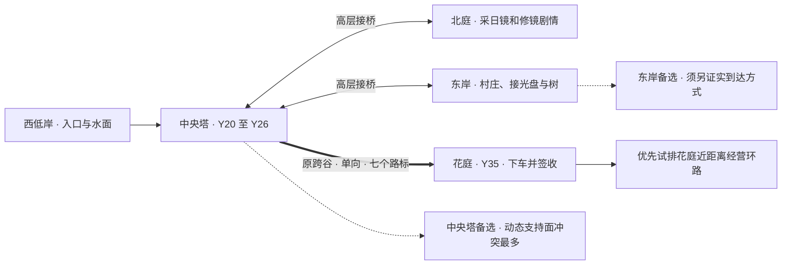
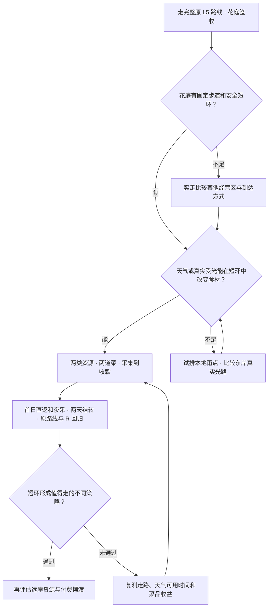

# 经营原型接入 Unity 的冲突清单

2026-11-11 静态核对。对照 Unity 作者工程保存的 L5 场景与同学的 `feature/djwcb2333/market-loop`（`83de773`）。经营玩法、接口和点位都处于提案阶段。表中“首轮”指经营试作的第一个完整短环路，路径、镜头和数值待实际白盒复测。 [同学的规则与数值](https://github.com/buriallsy/coding_team/blob/83de773b8d480a53d62b29690968ae03c8de8368/BorrowingSun2D/Docs/Market/Design.md) · [Unity 接入提案](05_MARKET_INTEGRATION.md) · [当前 L5 架构](03_SKYWELL.md)

## 1. 玩法冲突

| 对照点 | 原型搬过来会发生什么 | 首轮处理与验证 |
| --- | --- | --- |
| 一次性通关 → 无限经营 | Godot 签收后可开启中央店铺，Unity 交付后目前保留结束目标，玩家和车都留在远端花庭。当天强制开店会覆盖原结尾，也可能把玩家送离已到达的岸 | 花庭签收是解锁条件，签收和接受邀请各用一次交互。先显示正常完成，玩家可离开邀请点、回望或按 `R` 重玩。重复点邀请只进入一次 |
| 采集奖励与现有水果的语义重叠 | Unity 有交付货车果箱、村庄接光奖励中的旧货车、鹿岛可喂的鲜果/坏果。若共用“水果数量”，可能消耗剧情货物、误点亮运输或让鹿果刷新 | 经营食材有独立类型和库存。场景把同一地区的菜用食材与故事道具区分。测采集、投料、打烊、`R` 对原果箱、鹿和村庄奖励的影响 |
| 2D 连续雨 → 3D 局部令牌 | Godot 市场可让中央雨持续，再转桥到另一岸采雨果。Unity 雨区和风区由具体插槽决定，同一塔台仅一个天气槽，离开施令区域会回牌并结束雨/风。远施点以原位置 3.5 m 为回收半径。树在雨区、玩家离施令处太远，仍可能在走到前断雨 | 首轮给果树绑定实际雨区和操作站，用短路径保持天气有效。测试靠近、跨区、切风、远程施令后跨 3.5 m。现有集水、风转和门槛照旧。若需要持续农田雨，先定义独立雨区及令牌所有权 |
| 点亮村庄 → 实时果树受光 | 山阴奖励可以锁存，村庄灯仍亮时实际光束可能已断。北庭的入射照到镜盘也不代表镜已修好或能输出。拿亮度、令牌或任务完成当晴果条件，会让遮挡和夜晚失效 | 东岸用接收器当帧 `RayValid`，北庭按设计用途明确入射或镜输出。点位若本身需直射，再测点位到太阳的真实视线。四个反例分别为锁存后断光、入射但未对准、第二段挡住、夜间 |
| 计时采集 → 多层立体路线 | Godot 单次摆渡 3.4 s，采集区通过二维距离门槛。Unity 还要走到桥口、等锁高和转台、找落地点，再看天气和镜头。照搬 180 s 白天、90 s 夜探、60/120 s 营业会改变可采资源和回程成本 | 首轮经营环路不依赖跨谷。实走记录去程、等桥、施令、停留和回店秒数。计时结束提示返店并允许安全走完，菜单从实际到店开始。同学用这些数据调时段、成熟、菜价和收益 |
| 黄昏选择 → 正在走机关 | 倒计时结束可能发生在桥口、船上、鹿身上、浮桥或长按瞄准中。马上冻结输入、关雨或按目标复位，可能把玩家留在悬空位置、吞天气点击或抢相机。Godot 现有摆渡只在探索阶段更新，计时到点切出探索时载台可能停在空中，待次日才清理 | 时间到后先挂待处理状态，到固定地面再开黄昏面板。现有输入和移动所有者收束后接管。分别测落地前一帧、过门槛、关面板和 `R` |
| 次日复位 → 已修镜、已送货、已开路 | Godot 次日会从中央低位重置塔台和载具，保留经济。Unity 的 `ResetCourt` 同时清晴令、对话、修镜、鹿、收光、水账和交付。调用它会要求玩家每天重做序章 | 日结只推进库存、订单、时段和资源点。保留故事与世界进度；`R` 走完整重开。每日若把塔压回西低且清已到访岸，东岸高台无法用同层绞盘解围。测试日结后仍可走经营路线，`R` 后从原入口到签收仍可走通 |
| 菜单后才来客 → 空库存软锁 | Unity 路线长时可能错过点位或夜采无收获，若营业要求先交一单才能日结就没有退出路径。准备窗口重复扣料或收款会破坏数值评估 | 空库可休息。预留、投料、烹饪、交餐、退料是一条状态链。使用单库存做双窗、同帧双击交餐、到时打烊和菜单返回的复测，再交给同学调整配方与售价 |

[局部施令和回牌](../../unity_prototype/BorrowingSun/Assets/BorrowingSun/Runtime/Skywell/SkywellWeatherInput.cs#L43) · [村庄收光与锁存](../../unity_prototype/BorrowingSun/Assets/BorrowingSun/Runtime/Skywell/SkywellSunReceiver.cs#L25) · [原跨谷状态](../../unity_prototype/BorrowingSun/Assets/BorrowingSun/Runtime/Skywell/SkywellVoyage.cs#L25) · [Godot 探索更新](https://github.com/buriallsy/coding_team/blob/83de773b8d480a53d62b29690968ae03c8de8368/BorrowingSun2D/Scripts/TowerSlice.cs#L114) · [Godot 摆渡和次日](https://github.com/buriallsy/coding_team/blob/83de773b8d480a53d62b29690968ae03c8de8368/BorrowingSun2D/Scripts/MarketPlay2D.cs)

## 2. 地形、店址和交通

坐标为保存场景的世界位置估算，Unity 单位为米，`X` 东、`Y` 高、`Z` 北。尺寸与变换只能用来挑选测试区，营业碰撞、肩视角、实际可达、夜间能见度和太阳光影响需进场验证。

| 位置或物件 | 保存场景给出的条件 | 拟检查及影响 |
| --- | --- | --- |
| **花庭固定台面** | `Flower_garden_arrival_station` 约 `(-26,35,-4)`。出车后通过 `Arrival_gangway`（中心 `(-26,34.8,-0.8)`）走到 `Arrival_court`（中心 `(-26,34.8,3)`，固定台面约 12×8 m）。签收计算点约 `(-26,35,3)`，作用半径 2.1 m | 店招应在签收后容易看见且不会抢签收。店、等待点、基础采集和环境采集都要留角色净空、临崖余量与回头动线。把店放到签收点旁边前，检查房屋/屋檐、相机夹墙、原返回走道和 `Terminal_gate`。现有序列化站点中无花庭天气台，先测该区可获得的自然直射或设计独立的本地雨点 |
| **东岸山阴村** | 人行区约 `Y26`，`Village_observation` 约 `(48,26,110)`，守灯人约 `(50.5,26,112.5)`，东岸树约 `(55,26,104)` 和 `(58,26,104)`。东岸天气区中心约 `(54,27,108)`，半径 8 m、垂直半高 7 m。接光晶体约 `(49,35,105)`。`East_sun_occluding_mountain_ridge` 为既有山阴遮挡，洞体的剖切视觉变化保留碰撞 | `Outer_mountain_court` 顶面约 12×14 m。通塔的 `Long_freight_bridge` 长约 37 m、宽约 3.6 m，应留空给步行和既有轨道。这里具备既有接光和树的语义，仍须实测花庭交付后如何回到东岸。店顶、顾客、食材和道具碰撞要避开镜束、施令视线、NPC/观察交互和真实货路。亮起环境美术后还要复测有光、挡光和真实夜间 |
| **中央塔旁** | Godot 小店绑定 `Lift/MarketStore`。Unity 中央塔运行升高 6 m、风转、回接和放水，门槛保护需要空出，且船和镜各有移动绑定 | 摊位/订单面板若绑旋转台，顾客、交互点和恢复位置都会变化。若保留中央概念，固定岸面作为候选。检查落地与相机停留、玩家身体占门槛、队列妨碍排水和风转。物理支持与日结位置都要明确 |
| **北庭与开场/鹿岛** | 北庭既有采日、转镜、修镜和灯路。开场多层含浅水、鱼和小船，鹿岛需独立路径状态，难度与风险明显高于普通平地 | 采集标记在实际脚底层生效，同时校验水平距离和高度差、落地、遮挡和当前移动所有者。首轮不把基础进货放在水下、空中云台、鹿或狭窄回接段 |
| **原跨谷路径** | `SkywellVoyage.route` 从 `(12,26,108)` 到 `(-26,35,-4)`，七个世界路标。仅这段折线约 206 m。用代码巡航速度估算约 47 s 单程，往返约 94 s，未含登乘、起点补段、停靠和步行。场景载具出发端在移动塔台侧，线路掠过东村不代表已有固定东岸站 | Godot 3.4 s 车程和 90 s 夜探的关系在 Unity 不能照搬。花庭一侧只有到站闸口绑定，船体掉头 180°。船板与固定过板同高、约重叠 1.4 m，返航时须辨认玩家确实落在随船支持面上。若做可往返，独立白盒两端固定泊位、再登乘、掉落恢复、夜间等候和返航。按真实全程决定直达快线、时段或可探索范围 |

[花庭站](../../unity_prototype/BorrowingSun/Assets/BorrowingSun/Scenes/05_Skywell.unity#L77641) · [过板](../../unity_prototype/BorrowingSun/Assets/BorrowingSun/Scenes/05_Skywell.unity#L65866) · [固定庭面](../../unity_prototype/BorrowingSun/Assets/BorrowingSun/Scenes/05_Skywell.unity#L49358) · [东岸雨区](../../unity_prototype/BorrowingSun/Assets/BorrowingSun/Scenes/05_Skywell.unity#L2910) · [东岸固定庭面](../../unity_prototype/BorrowingSun/Assets/BorrowingSun/Scenes/05_Skywell.unity#L37328) · [东岸货桥](../../unity_prototype/BorrowingSun/Assets/BorrowingSun/Scenes/05_Skywell.unity#L127687) · [山阴遮挡](../../unity_prototype/BorrowingSun/Assets/BorrowingSun/Scenes/05_Skywell.unity#L66088) · [原线路序列化](../../unity_prototype/BorrowingSun/Assets/BorrowingSun/Scenes/05_Skywell.unity#L50096) · [运动速度、到岸确认](../../unity_prototype/BorrowingSun/Assets/BorrowingSun/Runtime/Skywell/SkywellVoyage.cs#L67)

## 3. 代码与数据冲突

| 接缝 | 具体冲突 | 改法和需要保留的条件 |
| --- | --- | --- |
| `CourtPlayer → ICourtGameplay → SkywellController` | `E` 有短按分派和长按施令，现有骑乘、水下、排水等优先。`SkywellVoyage.TryPrimary` 在 `Delivered` 仍消费 `E`。若加通用交互接口或者用 `E` 先抢全局，其他关卡、剧情或天气都可能失效 | 用 L5 可选 `SkywellMarket` 引用，在短按分派的既有骑乘/水下/排水之后、Voyage 之前匹配合法的已签收经营点。交付同一按不触发经营。操作提示与实际匹配使用同一次目标解析。保持共享接口契约 |
| `SkywellWeatherInput` / `SkywellHUD` / `CourtCamera` | 天气轮盘、长按瞄准、剧情、观测、肩视角已各自有输入锁。HUD 增加菜单若只显示遮罩，按键与点击仍可能落到天气；用暂停全局时间则会改变塔、鱼、载具、故事与收光 | 通过 L5 明确的模态状态接入既有指针/观察路径。关闭同一帧消费确认/取消输入，释放镜头和移动锁，`R` 仍通过全关重置。市场面板仅暂停自己的经营时钟；做固定与肩视角、Esc、鼠标点穿透及手柄/键鼠支持范围的验证 |
| `SkywellController` 内的局部天气索引 | 当前保存场景五个 `consoles` 与 `weatherTargets` 槽位，控制代码有站点专属规则及数组联动。直接加第六个花庭元素可能数组长度或索引含义不一致；全局雨布尔会让五站同时变化 | 优先让点位显式绑定现有区并读 `IsRain && Contains(point)`。新增站点时逐项核对站点策略、允许令牌、覆盖形状、目标高亮、落位回收、效果及重置。单独测试原五站。避免用位置或场景层级顺序暗推索引 |
| `SkywellController.Update → SkywellOptics → SkywellSunCollector` | 现行调用 `Evaluate(true)`。单改背景颜色不会关真实光，调用 `Evaluate(false)` 也可能保留采日镜单独画的入射段。日夜边界复用上一帧 `RayValid` 可在夜里采晴果 | 用一个昼夜门控覆盖真实太阳、采光器入口/可见入射、主反射及资源读取。保留故事和持久奖励。先做当帧光学求交，再接受资源采集，跨阶段的第一个有效采集等新帧事实。天亮复算并复测雨和风 |
| `SkywellSceneLighting` / `SkywellHUD` | 原方向光同属场景布光和采光输入。停用组件或覆盖作者预设可能使天亮恢复不完整。旧 HUD 的“山阴尚未收到阳光”会把正常入夜显示成之前的任务失败 | 通过运行时昼夜预设和实际光学门控控制表现，次日和 `R` 有清晰恢复值。经营 HUD 分开显示已签收、村庄已有成果和当前活光。夜间测试同时确认村庄成果与剧情状态保持 |
| `SkywellLiftMechanism` 水账 | Unity 储水上限与原配重目标均是 6，首航能把水箱转空，配重保在车端。Godot 市场的 `TrySpendWater`、去程留 2 单位及“夜也能开船”直接照搬会耗掉首航配重或让夜间无可补的回程卡死 | 首轮经营无付费摆渡。若做，定义水源、去程与预留、返航和无水救援。扣水原子化，由水拥有者接受命令；航行已提交后仅扣一次，航行中不能再发。原锁高、排水、入配重和断光/装箱门槛独立 |
| `SkywellVoyage` / 承载物理 | 当前 `Waiting → Boarding → Boarded → Riding → Docking → Arrived → Delivered` 是单向任务，负责支撑、镜头和到站闸门。回退 phase、翻转 Transform 或再挂一个移动脚本会有双重位移、开门方向错误和重复签收 | 签收只读。真要共享载台，用明确的单一移动所有者，等双向需求成立才提取运动/登乘边界。已签收的任务状态不会随摆渡变化。两端验证走上走下、侧缘、到站脱离、在动载具重置、同方向重复指令 |
| `CourtPlayer.Teleport/Recover` | Godot 菜单或日结可以把玩家送回店。Unity 的移动辅助、骑乘和 `lastSafePosition` 都有自己的生命周期；传送后还可能回落到上一处安全点或受旧平台运动影响。目前永久地面排除塔转盘，扩充可往返载台时要防止其成为固定岸恢复点。 | 首轮用实走归店。若经实测要跨区转场，等控制权解除，使用真实的安全支持面、镜头与恢复点接线。按到岸即跌落、接收面不在视野、脱离外部移动和 `R` 测试 |
| `MarketRun`、`ForageSpot`、`TakeawayShop` | 可迁移的是规则与测试场景。Godot 适配层依赖像素、节点、输入、物理时钟和该版塔台。同一方法接两套引擎的真实对象会跨边界。原分支还用 Unity 当前语言版本不支持的语法 | 同步语义、测试与调参表，Unity 写适配。只在有两个真实实现时提取窄接口，比如点位环境读接口或可选载具发航端口。菜价、食谱、刷新和阶段时长用可调配置；保持 Unity 引擎、程序集和包 |
| `ResetCourt` 与关卡作者资源 | 经营如直接复用旧重建工具或把 PlayMode 运行态写回场景，会覆盖保存几何、对象引用和作者参数。日期、余额和库存应与场景序列化数据分离 | 试作中用可选引用隔离原关卡。点位由作者手工绑，运行态留在市场单局。先拍原 L5 从入口到签收及 `R`，再分别测试经营的两天与 `R`。暂无磁盘存档时，明确退出即结束本局 |

[现有输入分派和提示](../../unity_prototype/BorrowingSun/Assets/BorrowingSun/Runtime/Skywell/SkywellController.cs#L138) · [天气数组与范围](../../unity_prototype/BorrowingSun/Assets/BorrowingSun/Scenes/05_Skywell.unity#L49903) · [光学每帧](../../unity_prototype/BorrowingSun/Assets/BorrowingSun/Runtime/Skywell/SkywellOptics.cs#L37) · [独立入射显示](../../unity_prototype/BorrowingSun/Assets/BorrowingSun/Runtime/Skywell/SkywellSunCollector.cs#L61) · [水账](../../unity_prototype/BorrowingSun/Assets/BorrowingSun/Runtime/Skywell/SkywellLiftMechanism.cs#L79) · [重置](../../unity_prototype/BorrowingSun/Assets/BorrowingSun/Runtime/Skywell/SkywellController.cs#L244) · [角色恢复](../../unity_prototype/BorrowingSun/Assets/BorrowingSun/Runtime/Shared/CourtPlayer.cs#L533)

## 4. 白盒决策顺序

白盒记录给数值负责人需要能复算。每条路线至少有点位、落地高度、实走与等待秒数、降雨与受光可用时段、实际采到的数量、订单/退料/收款结果和复现步骤。店址、远岸摆渡和天气持续方式会改变这个采样，应在锁定时段与售价前确定。
