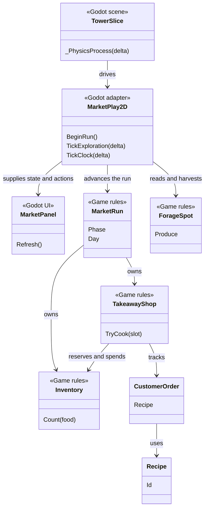
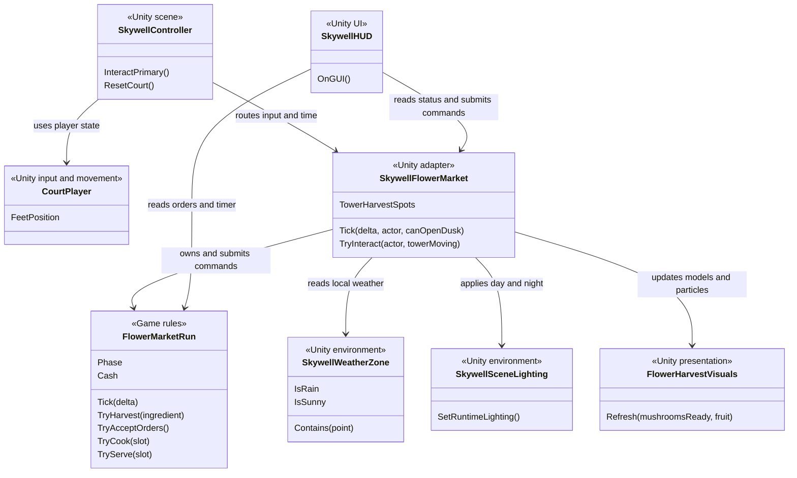

# AP6412 · Borrowing Sun Market Class Maps

| Delivered version | Frozen source | Entry point |
| --- | --- | --- |
| 2D market baseline | [83de773](https://github.com/buriallsy/coding_team/commit/83de773b8d480a53d62b29690968ae03c8de8368) | Godot 4.7.2 .NET, `BorrowingSun2D/project.godot` |
| 3D final market | [89036a2](https://github.com/buriallsy/coding_team/commit/89036a2940480b5043f3163611d15c26e2ded4ae) | Unity 6000.5.4f1, `06_Skywell_CentralMarket.unity` |

These maps cover the classes that drive the market loop and its engine integration. The 2D tag name is `2d-market-baseline`, which leaves the previously frozen delivery baseline `2d-baseline` intact. The 3D tag name is `3d-final`.

## 2D · Godot market baseline

`TowerSlice` owns the Godot scene loop. `MarketPlay2D` bridges scene conditions and market rules, including travel between shores. `MarketRun` controls the day and operating phases. The shop owns stove orders, the inventory owns food counts, and `ForageSpot` owns resource availability. [2D design and detailed class map](https://github.com/buriallsy/coding_team/blob/83de773b8d480a53d62b29690968ae03c8de8368/BorrowingSun2D/Docs/Market/Design.md)

## 3D · Unity central market

`FlowerMarketRun` is plain C# and owns phase, inventory, reservations, two stove slots, wallet and settlement. `SkywellFlowerMarket` handles reachability, the six independent harvest points, scene weather and sunlight. `FlowerHarvestVisuals` renders the ready state; the HUD projects screen-edge markers and displays rule state. Scene input, camera, lighting and particle rendering stay outside the rule class. [3D source and scene notes](https://github.com/buriallsy/coding_team/blob/89036a2940480b5043f3163611d15c26e2ded4ae/docs/04_Iterations/Skywell_Central_Market.md)

## Class and responsibility changes

| Change | 2D to 3D | Reason |
| --- | --- | --- |
| Adapted | `MarketRun`, `TakeawayShop`, `Inventory`, `CustomerOrder` and `Recipe` responsibilities are represented in `FlowerMarketRun` and its order and recipe data | Preserve inventory-backed orders, parallel cooking, payment and day rollover in the independent Unity implementation. |
| Adapted | `ForageSpot` responsibilities move to the Unity market adapter, point cooldown state and the run’s ingredient rules | Read 3D positions, local weather and sunlight while validating stock changes in the rules. |
| Replaced | `TowerSlice`, `MarketPlay2D` and `MarketPanel` give way to `SkywellController`, `SkywellFlowerMarket` and `SkywellHUD` | Godot scene/input/HUD wiring is replaced by Unity components and scene bindings. |
| Added | `FlowerHarvestVisuals`, world-space fruit models and off-screen markers | Give the player feedback for resource readiness in a 3D camera view. |
| Omitted from the market route | 2D shuttle fuel and trip gating | The Unity market uses the tower’s docking connections instead. |
| Preserved at the rule level | Gather ingredients, fulfill orders with two stoves, earn money and carry stock and upgrades into another day | These are shared gameplay responsibilities. The market implementation is independently authored in Unity; the maps make no claim of identical core source files. |

The 2D build retains menu selection and its shuttle economy. The Unity scene starts at the shop, transitions into night automatically, uses fixed recipes and gives a timed settlement. These differences must be reflected in the group report and evaluated against Route B’s consistency criterion. The earlier Godot-delivery CCR does not measure this pair. A final CCR for this pair needs its own agreed core scope and calculation. [GitHub version comparison](https://github.com/buriallsy/coding_team/compare/83de773b8d480a53d62b29690968ae03c8de8368...89036a2940480b5043f3163611d15c26e2ded4ae)
