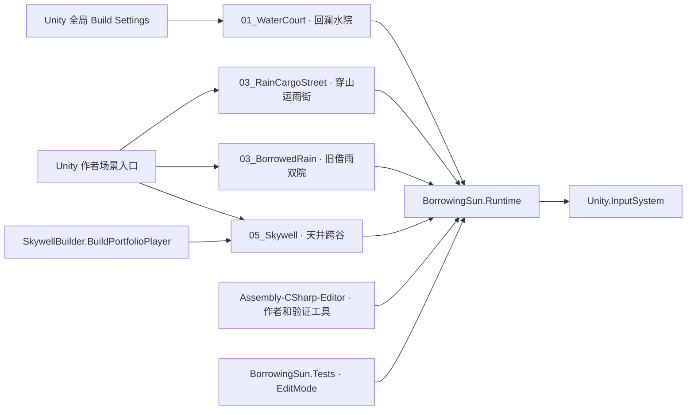

# 借晴 · Unity 类图与流程图

**2026-11-11 · Unity 6000.5.4f1 · 作者工程快照**

| 阅读入口 | 包含内容 |
| --- | --- |
| [图册](DIAGRAMS.html) | 浏览器打开即可看图，可跳到对应的可编辑 Markdown |
| [脚本类型索引](01_TYPE_INDEX.md) | `Assets/` 的 112 个 C# 文件和 145 个唯一类型，附源码链接和直接序列化挂载 |
| [Shared、L1、L3、旧借雨双院](02_SHARED_AND_EARLY_LEVELS.md) | 共用角色、相机、交互接口和三套独立玩法的类图与路线 |
| [L5 天井跨谷](03_SKYWELL.md) | 水下取牌、天气、塔台与水账、叙事和光路、跨谷、鹿岛云路及场景接线 |
| [编辑器与测试](04_EDITOR_AND_TESTS.md) | 作者工具、场景审计、EditMode、PlayMode 和试玩构建 |
| [经营接入提案](05_MARKET_INTEGRATION.md) | Godot 经营玩法如何接入 Unity，类职责、接口草案、状态流和迭代验收 |
| [经营冲突清单](06_MARKET_CONFLICTS.md) | 玩法冲突、地形和店址、交通与代码接缝，附场景依据及复测条件 |

当前系统各图按代码的职责边界拆分。类图连线表示引用、持有、实现或调用。流程图说明玩家操作如何进入规则和场景。只在个别流程使用的嵌套枚举、校验探针和工具数据在类型索引中定位。

## 工程入口与编译边界

四个作者场景在各自的 Inspector 中绑定自己的玩法控制器。共享的 `CourtPlayer` 从关卡取得运动限制、交互、支撑面等结果。当前全局构建默认启动 L1。L5 独立试玩入口显式传入 `05_Skywell.unity`。 [作者场景目录](../../unity_prototype/BorrowingSun/Assets/BorrowingSun/Scenes) · [全局场景清单](../../unity_prototype/BorrowingSun/ProjectSettings/EditorBuildSettings.asset) · [试玩构建入口](../../unity_prototype/BorrowingSun/Assets/BorrowingSun/Editor/Skywell/SkywellPortfolioTools.cs)

| 工程范围 | 本次核对 |
| --- | --- |
| 引擎与包 | Unity 6000.5.4f1，URP 17.5.0，Input System 1.19.0，Test Framework 1.7.0 |
| 游戏代码 | `BorrowingSun.Runtime` 引用 Input System。四套关卡和 Shared 位于同一 Runtime 程序集 |
| 工具和测试 | 第一方 Editor 脚本使用 Unity 的默认 Editor 程序集。独立 `BorrowingSun.Tests` 只针对 Editor 且受 `UNITY_INCLUDE_TESTS` 约束 |
| 范围 | `Assets/BorrowingSun` 的作者代码、四个关卡和天气亭预制体。模板 Readme 脚本也入索引。`SampleScene`、`_Recovery`、包代码、引擎组件和构建缓存不作为作者关卡分析 |

[Unity 版本](../../unity_prototype/BorrowingSun/ProjectSettings/ProjectVersion.txt) · [包清单](../../unity_prototype/BorrowingSun/Packages/manifest.json) · [运行时程序集](../../unity_prototype/BorrowingSun/Assets/BorrowingSun/Runtime/BorrowingSun.Runtime.asmdef) · [测试程序集](../../unity_prototype/BorrowingSun/Assets/BorrowingSun/Tests/Editor/BorrowingSun.Tests.asmdef)

## 与同学对齐时的起点

Unity L5 负责把真实场景事实交给经营规则，例如某个点当前下雨、接光盘当前接收到真实光束、玩家已在花庭签收。经营模块负责时间、库存、订单与钱。先在签收后做一轮采集到收款，借此检验天气改变食材是否值得玩家调整路线。原型里的数值在相同规则上由同学调，实际店址、夜探和返程接在后续验收。 [经营接入提案](05_MARKET_INTEGRATION.md) · [Godot 原型玩法](https://github.com/buriallsy/coding_team/blob/83de773b8d480a53d62b29690968ae03c8de8368/BorrowingSun2D/Docs/Market/Design.md)

现行图从保存场景、脚本及序列化数据读取。历史验证证据单独标注日期和覆盖范围。本次交付为架构文档和图册，未启动 Unity 或做新的玩法验收。
