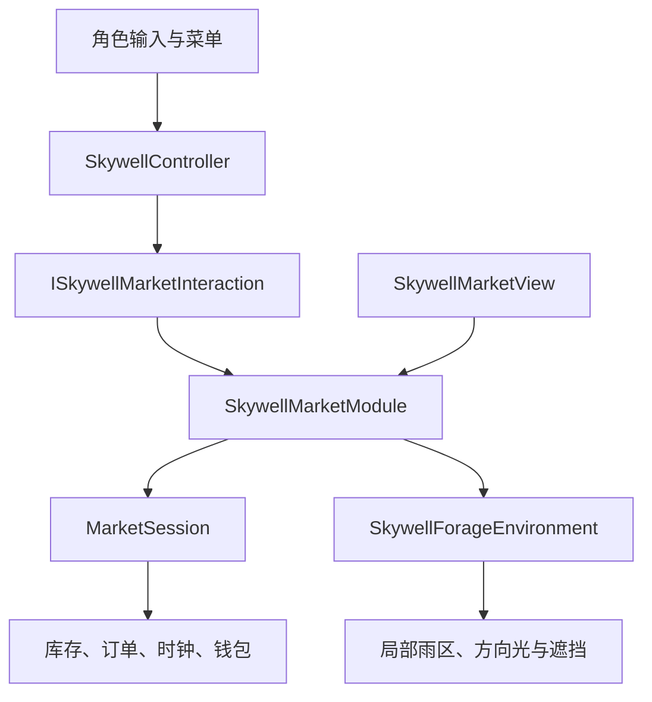
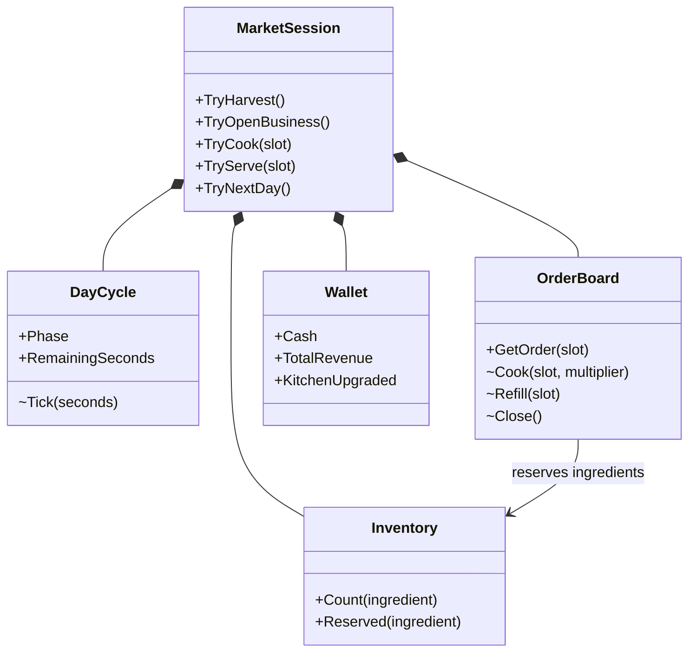
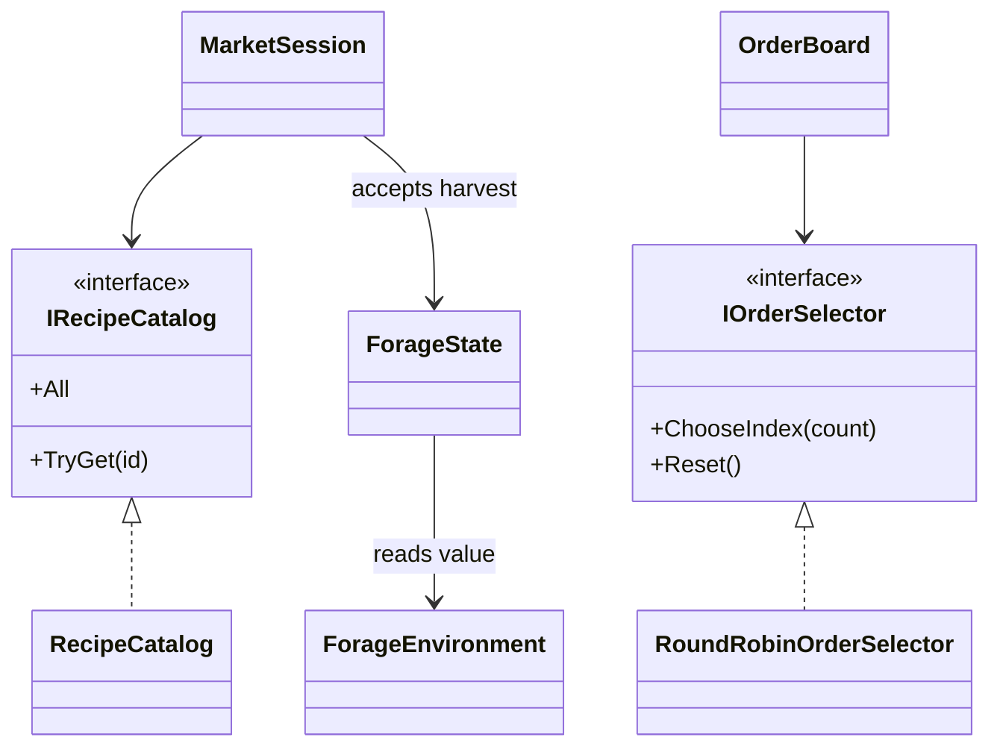
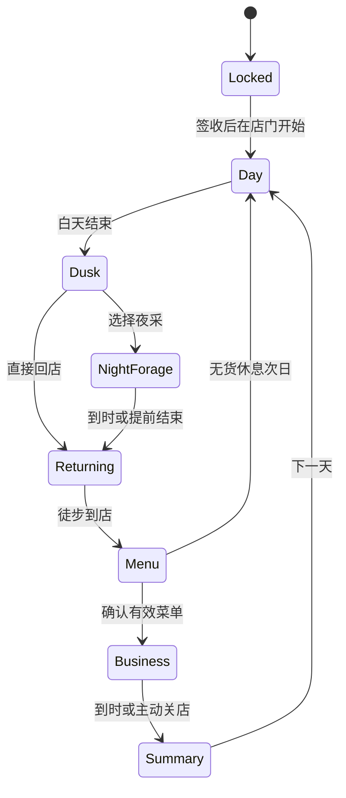

# Unity 经营模块：边界、结构与数值

## 本轮边界

经营领域在 Unity 项目中独立编写。Godot 原型提供玩法决策，既不参与运行，也不是这次 C# 类的代码来源。原 Unity 场景提供角色、地形、天气机关、光学、运货和签收；经营模块读取这些系统的事实，并负责采集、昼夜阶段、库存、菜单、订单和收入。

本轮入口是 `05_Skywell_MarketModules.unity`。它复制已保存的花庭白盒，复用原有店址、两个采集点和局部雨区。原 `05_Skywell.unity`、`05_Skywell_FlowerMarket.unity` 和 `SkywellVoyage` 保留。新场景禁用旧 `SkywellFlowerMarket`，在原 Controller 物体添加一个 `SkywellMarketModule`。界面由独立普通类 `SkywellMarketView` 绘制，无额外挂载组件。

## 架构与依赖方向

`Runtime/Market/Domain` 不引用 Unity、场景对象或 Godot。`MarketSession` 接收命令与时间增量；输入键、碰撞、光照读取和显示文字属于 `Runtime/Market/Unity`。Controller 只通过经营交互接点派发；没有新模块的原场景仍选用旧经营实现。

环境适配器用采集点是否处于启用的降雨区判断雨天。晴光读取方向光并进行遮挡检测；夜间明确没有阳光。历史“点亮村庄”的进度不能替代当前采集点的实时受光。镜面修复、签收和其他世界进度不因经营换日重置。

## Class Map

图中的类名与代码一致。为方便阅读，订单快照、食材数量和阶段枚举等值对象列在后面的表中。

| 类型 | 负责什么 | 不负责什么 |
| --- | --- | --- |
| `MarketSession` | 协调有效命令、阶段、支付与退料顺序 | 场景坐标、输入键、显示 |
| `DayCycle` | 阶段、天数、各阶段计时与转移 | 订单和碰撞 |
| `Inventory` | 总库存、预留量、原子增减 | 顾客选择和价格 |
| `OrderBoard` | 两个订单槽的预留、烹饪、交餐、补单与关店退料 | 现金和场景 |
| `Wallet` | 可用现金、收入统计、一次厨房升级 | 订单生成 |
| `ForageState` | 成熟、冷却和环境对应品种 | 射线、天气施令 |
| `RecipeCatalog` | 可替换的配方数据 | 开店阶段、库存扣除 |
| `RoundRobinOrderSelector` | 在可制作候选中轮选订单 | 修改库存、提高售价 |
| `SkywellMarketModule` | Unity 组装入口、交互安全、命令派发与时间接入 | 重复实现纯领域规则 |
| `SkywellForageEnvironment` | 读取真实环境，临时切换夜间光源并恢复 | 修改机关进度或签收事实 |
| `SkywellMarketView` | 独立展示类；查询模块状态，绘制菜单、双订单、收入与反馈 | 持有独立经营状态或直接修改领域；变更走模块命令 |
| `MarketSettings`、`RecipeDefinition`、`IngredientAmount` | 校验后的配置与配方数据 | 世界交互 |
| `ForageEnvironment`、`OrderSnapshot` | 环境值与只读订单快照 | Unity 引用或外部写入领域状态 |

## SOLID 在这里如何体现

| 原则 | 本轮做法 | 实际扩展例子 |
| --- | --- | --- |
| SRP | 时钟、库存、订单和收入分开；场景读取留在 Unity 层 | 调整收款统计不需要改采集点 |
| OCP | 配方目录与顾客选择是可替换依赖 | 新增菜谱数据；以后用另一种 `IOrderSelector` 替换轮选 |
| LSP | 目录必须返回唯一有效配方；选择器返回有效候选下标 | 自定义实现遵循相同合同，不绕过库存检查 |
| ISP | 核心只依赖所需配方查询与订单选择；场景交互接点单独存在 | 纯领域测试不用实现射线、角色和 HUD |
| DIP | `MarketSession` 接收配方与选择策略；世界事实转换成值对象 | 单独运行领域规则，无 Unity 场景依赖 |

没有为每个具体类创建接口。`DayCycle`、`Wallet` 等目前没有真实的替换需求，保持具体类更容易解释和测试。`SkywellMarketModule` 是 Unity 组合入口，仍负责多项引擎接线；界面与领域状态分离，后续再按真实变化拆分。

## 一天的状态与关键规则

返程阶段禁止继续采集，但不冻结角色移动；走到店后才选菜单。营业时间从确认菜单开始，返程和选菜不占营业时间。选过夜采后，提前回店仍使用短营业时长。

开店前没有订单。所选菜谱须合法，至少一道当前有足够食材即可开店；缺料菜可以保留在菜单中，但不会生成订单。确认菜单后，只从菜单内且当前有可用食材的配方生成订单。一个顾客占一个槽位，接单时预留食材，避免两个顾客承诺同一份库存。两个槽可分别投料，同时烹饪；完成后分别交餐并收款，然后只补该槽的下一位顾客。没有用餐等待。重复点击不能重复扣料、付款或升级。

关店时退回未交付订单的食材，包括已下锅但未交付的部分；这使白盒不会因为时间到而吞掉库存。已交付收入、库存和升级跨天保留。R 是完整重开，换日不是 R。当前没有跨应用重启的磁盘存档。

## 数值与本轮决定

| 项目 | 当前值 | 说明 |
| --- | --- | --- |
| 白天探索 | 180 秒 | 第一次在店开始后计时 |
| 可选夜采 | 90 秒 | 白天的一半；可提前结束 |
| 直接回店营业 | 120 秒 | 菜单确认后计时 |
| 夜采后营业 | 60 秒 | 不因提前回店增加 |
| 返程、菜单 | 不计时 | 返程不可采集；菜单未生成订单 |
| 同时订单 | 2 个 | 两个独立烹饪与交餐状态 |
| 采集点 | 2 个预设位置 | 菌丛、环境果树；本轮未实现随机刷新分布 |
| 单次采集 | 1 份 | 在点位短按 E |
| 再成熟时间 | 8 秒 | 只在可探索时递减；首次无需等冷却 |
| 交互半径 | 1.35 米 | 保留白盒店址与点位尺度 |
| 厨房升级 | 36 金币，限一次 | 菜单阶段购买；保留到以后各天 |
| 升级后烹饪耗时 | 原值 × 0.7 | 通过实际缩短等待使收入可用于体验改善 |
| 天数上限 / 失败期限 | 无 | 可以空菜单休息；没有强制限日收入目标 |
| 收入反馈 | 现金、总收入、当晚与昨夜收入 | 现金消费与累计收入分别记录 |

| 菜谱 ID | 食材 | 烹饪 | 售价 | 升级后烹饪 |
| --- | --- | --- | --- | --- |
| `mushroom` | 2 蘑菇 | 3 秒 | 12 | 2.1 秒 |
| `sun` | 1 蘑菇 + 1 晴果 | 4 秒 | 20 | 2.8 秒 |
| `rain` | 1 蘑菇 + 1 雨果 | 4 秒 | 22 | 2.8 秒 |
| `moon` | 1 蘑菇 + 1 月果 | 4 秒 | 24 | 2.8 秒 |
| `storm` | 1 蘑菇 + 1 雨夜果 | 5 秒 | 28 | 3.5 秒 |

雨果菜沿用 Unity 原花庭白盒的 **4 秒**，没有把 Godot 原型的 5 秒直接复制过来。以上是实现默认值，不是平衡性实测结论。

| 采集时的环境 | 果树当前产物 |
| --- | --- |
| 白天，无雨，有实际阳光 | `SunFruit` 晴果 |
| 白天，局部降雨 | `RainFruit` 雨果 |
| 白天，无雨，无实际阳光 | 暂无可采果实 |
| 夜晚，无雨 | `MoonFruit` 月果 |
| 夜晚，局部降雨 | `StormFruit` 雨夜果 |

成熟后尚未采走的果实随当前环境变化，不保留旧品种挡住新的产出。已进背包的食材保留原品种。夜间输入即使带有光照值，领域对象也强制没有阳光。

## 变化图与课程证据

| 对照对象 | 本轮处理 | 提交时应展示的证据 |
| --- | --- | --- |
| Godot 2D | 作为玩法验证，不复用运行代码 | 冻结版本、玩法对照、重新实现的理由 |
| 原 Unity L5 和原花庭场景 | 保留场景资产与原 fileID | 原文件哈希、Git diff、原场景回归 |
| 原 `FlowerMarketRun` / `SkywellFlowerMarket` | 作为原白盒保留；新场景禁用旧组件 | 两个场景分别运行，不把旧测试当新测试 |
| 新经营领域 | 新增纯 C# 类 | 上面的 Class Map、领域测试与最终源码 |
| Controller、天气与光学接线 | 增加可选新模块接点与夜间支持 | 逐文件 diff、原输入回归、新夜间实测 |
| 新场景、Editor 工具 | 新增独立入口、禁止覆盖原场景的创建命令 | 新旧场景结构对照、绑定检查 |

CCR 需在最终报告中先定义比较范围和类映射，再计数。若按课程“冻结 2D 领域类 → 最终 3D 领域类”的范围比较，本轮属于独立实现，不能把功能相似写成源码未变，也不能用未改动的美术、地形数量稀释比例。应分别报告保留、修改、替换、新增和删除，并说明 `CCR = 修改或替换的既有核心类数 / 比较基线中的核心类数`；新增类单列。当前文档没有伪造跨引擎复用比例。

下一轮先做 Unity 实机闭环与输入回归，再调整白天/夜间采集效率、菜价和升级价值。全地图资源分布、随机生成策略、磁盘存档和往返摆渡不在本轮范围内。
